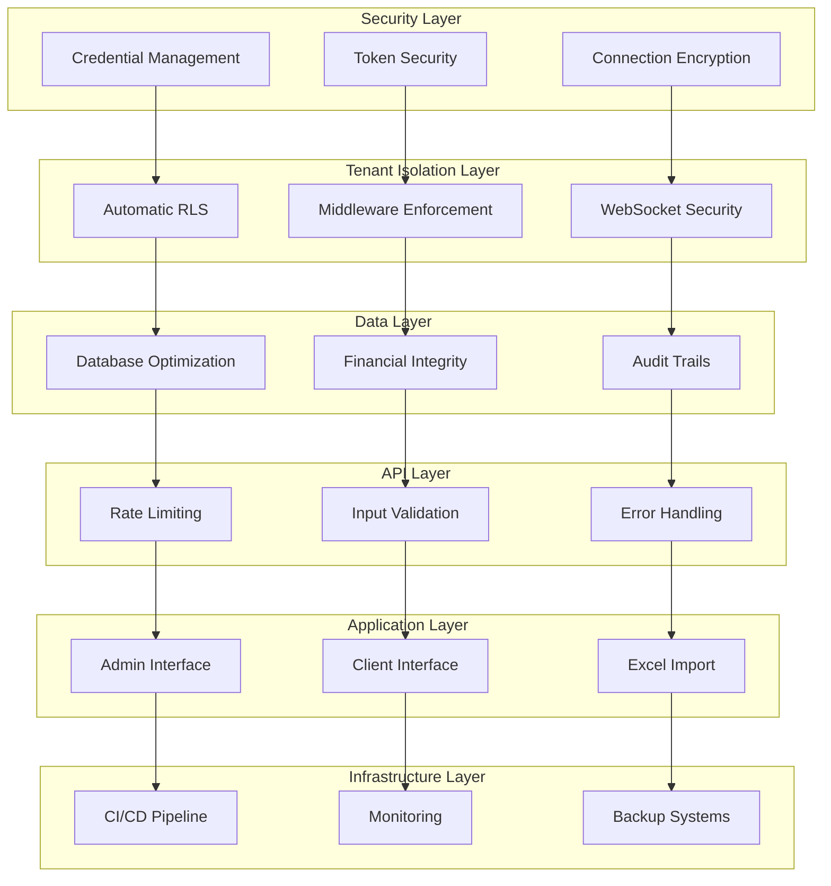

# Design Document: Comprehensive Project Audit Remediation

## Overview

This design document outlines a systematic approach to address the 134 issues discovered during the comprehensive project audit. The audit revealed critical security vulnerabilities, incomplete tenant isolation, financial accounting gaps, and significant deficiencies in both admin and client interfaces. This design provides a structured remediation plan organized by priority and impact.

The remediation strategy focuses on:
1. **Immediate Security Fixes** - Address critical vulnerabilities that pose immediate risks
2. **Tenant Isolation Hardening** - Ensure complete multi-tenant security
3. **Financial System Integrity** - Prevent double-charging and ensure audit compliance
4. **Interface Completion** - Transform incomplete admin/client interfaces into production-ready systems
5. **Performance & Scalability** - Address bottlenecks and implement proper pagination/caching
6. **Code Quality & Testing** - Establish proper testing coverage and eliminate technical debt

## Architecture

### Remediation Architecture Overview

The remediation follows a layered approach addressing issues from the infrastructure level up to the user interface:



### Priority-Based Remediation Phases

**Phase 1: Critical Security (Days 1-7)**
- Remove exposed credentials
- Implement secure token storage
- Enable automatic RLS
- Apply tenant isolation middleware

**Phase 2: Financial & Data Integrity (Days 8-14)**
- Add idempotency to financial operations
- Complete audit trail implementation
- Add database indexes and constraints

**Phase 3: Interface Completion (Days 15-35)**
- Complete admin interface features
- Implement missing client interface functionality
- Secure Excel import process

**Phase 4: Performance & Quality (Days 36-50)**
- Add comprehensive testing
- Implement caching and pagination
- Establish CI/CD pipeline

## Components and Interfaces

### 1. Security Remediation Component

**Purpose**: Address all critical security vulnerabilities

**Key Interfaces**:
- `CredentialManager`: Secure credential storage and rotation
- `TokenService`: httpOnly cookie-based authentication
- `EncryptionService`: TLS/SSL enforcement

**Implementation Strategy**:
```typescript
interface SecurityRemediationService {
  removeExposedCredentials(): Promise<void>
  implementSecureTokenStorage(): Promise<void>
  enforceEncryption(): Promise<void>
  rotateAllCredentials(): Promise<void>
}
```

### 2. Tenant Isolation Hardening Component

**Purpose**: Ensure complete multi-tenant security

**Key Interfaces**:
- `AutomaticRLSService`: Database-level tenant isolation
- `TenantMiddleware`: API-level tenant enforcement
- `WebSocketTenantGuard`: Real-time communication security

**Implementation Strategy**:
```typescript
interface TenantIsolationService {
  enableAutomaticRLS(): Promise<void>
  applyGlobalMiddleware(): Promise<void>
  secureWebSocketConnections(): Promise<void>
  validateTenantAccess(userId: string, tenantId: string): Promise<boolean>
}
```

### 3. Financial Integrity Component

**Purpose**: Prevent double-charging and ensure audit compliance

**Key Interfaces**:
- `IdempotencyService`: Prevent duplicate financial operations
- `AuditTrailService`: Complete financial audit logging
- `ReconciliationService`: Daily financial consistency checks

**Implementation Strategy**:
```typescript
interface FinancialIntegrityService {
  ensureIdempotency(operationId: string): Promise<boolean>
  logAuditTrail(operation: FinancialOperation): Promise<void>
  performReconciliation(): Promise<ReconciliationResult>
  validateBalanceConsistency(): Promise<ValidationResult>
}
```

### 4. Admin Interface Completion Component

**Purpose**: Transform incomplete admin interface into production-ready system

**Key Features to Implement**:
- Pagination for all data lists (tenants, transactions, logs)
- Complete subscription/finance tabs with real API integration
- Bulk operations (suspend/activate tenants, approve payments)
- Advanced filtering and search capabilities
- Real-time updates via WebSocket
- Role-based access control (RBAC) functionality
- Complete support center with ticket management
- System configuration interface
- Backup/restore management interface

### 5. Client Interface Enhancement Component

**Purpose**: Complete missing client interface functionality

**Key Features to Implement**:
- Message history pagination
- Debounced cost calculation (500ms delay)
- Real-time message status updates
- Message scheduling functionality
- Contact management system
- Message templates with variable substitution
- Advanced filtering in message history
- Export functionality for message logs
- Device health monitoring (battery, signal, last active)
- QR code generation for device pairing

### 6. Excel Import Security Component

**Purpose**: Secure and optimize Excel import functionality

**Key Security Measures**:
- File size validation (max 10MB)
- Row count enforcement (max 50,000 rows)
- Phone number format validation
- Duplicate detection
- Batch processing (1000 rows per batch)
- Cost estimation before upload
- Progress indicators with cancellation
- Secure error handling (no console logging)

## Data Models

### Enhanced Security Models

```typescript
interface SecureCredential {
  id: string
  service: string
  encryptedValue: string
  rotationSchedule: Date
  lastRotated: Date
  createdAt: Date
}

interface SecureToken {
  userId: string
  tenantId: string
  tokenHash: string
  expiresAt: Date
  isRevoked: boolean
  createdAt: Date
}
```

### Tenant Isolation Models

```typescript
interface TenantContext {
  tenantId: string
  userId: string
  permissions: string[]
  sessionId: string
  establishedAt: Date
}

interface RLSPolicy {
  tableName: string
  policyName: string
  isEnabled: boolean
  policyDefinition: string
  createdAt: Date
}
```

### Financial Integrity Models

```typescript
interface IdempotencyKey {
  key: string
  tenantId: string
  operationType: string
  status: 'pending' | 'completed' | 'failed'
  result?: any
  createdAt: Date
  completedAt?: Date
}

interface AuditTrail {
  id: string
  tenantId: string
  userId: string
  operation: string
  entityType: string
  entityId: string
  oldValues?: Record<string, any>
  newValues?: Record<string, any>
  timestamp: Date
  ipAddress: string
  userAgent: string
}

interface ReconciliationRecord {
  id: string
  tenantId: string
  reconciliationDate: Date
  balanceFromTenants: number
  balanceFromTransactions: number
  balanceFromHistory: number
  discrepancies: DiscrepancyRecord[]
  status: 'passed' | 'failed' | 'investigating'
}
```

### Enhanced Interface Models

```typescript
interface PaginationRequest {
  page: number
  limit: number
  sortBy?: string
  sortOrder?: 'asc' | 'desc'
  filters?: Record<string, any>
}

interface PaginationResponse<T> {
  data: T[]
  pagination: {
    page: number
    limit: number
    total: number
    totalPages: number
    hasNext: boolean
    hasPrev: boolean
  }
}

interface BulkOperation {
  operationType: string
  targetIds: string[]
  parameters?: Record<string, any>
  requestedBy: string
  requestedAt: Date
}

interface MessageTemplate {
  id: string
  tenantId: string
  name: string
  content: string
  variables: string[]
  category: string
  isActive: boolean
  createdAt: Date
  updatedAt: Date
}
```

## Error Handling

### Centralized Error Management

**Error Classification System**:
- **Security Errors**: Credential exposure, unauthorized access
- **Tenant Isolation Errors**: Cross-tenant data access attempts
- **Financial Errors**: Double-charging, balance inconsistencies
- **Validation Errors**: Invalid input data, format violations
- **System Errors**: Database failures, service unavailability

**Error Handling Strategy**:

```typescript
interface ErrorHandler {
  handleSecurityError(error: SecurityError): Promise<ErrorResponse>
  handleTenantIsolationError(error: TenantError): Promise<ErrorResponse>
  handleFinancialError(error: FinancialError): Promise<ErrorResponse>
  handleValidationError(error: ValidationError): Promise<ErrorResponse>
  handleSystemError(error: SystemError): Promise<ErrorResponse>
}

interface ErrorResponse {
  code: string
  message: string
  userMessage: string
  severity: 'low' | 'medium' | 'high' | 'critical'
  shouldLog: boolean
  shouldAlert: boolean
  recoveryActions?: string[]
}
```

**Security Error Handling**:
- Never log sensitive information
- Immediate security team notification for critical issues
- Automatic credential rotation triggers
- Session invalidation for compromised accounts

**Financial Error Handling**:
- Automatic transaction rollback on failures
- Immediate audit trail logging
- Balance reconciliation triggers
- Customer notification for billing issues

**User-Facing Error Messages**:
- Clear, actionable error descriptions
- No technical details exposed
- Suggested recovery steps
- Support contact information

## Testing Strategy

### Comprehensive Testing Approach

Given the current state (only 1 test file in entire project), we need a complete testing strategy:

**1. Unit Testing (Target: 80% coverage)**
- All business logic functions
- Data validation functions
- Error handling paths
- Financial calculation functions

**2. Integration Testing**
- API endpoint testing
- Database operation testing
- Third-party service integration
- Cross-component communication

**3. Security Testing**
- Tenant isolation validation
- Authentication/authorization testing
- Input sanitization testing
- SQL injection prevention

**4. Performance Testing**
- Load testing for bulk operations
- Database query performance
- Memory usage optimization
- Concurrent user handling

**5. End-to-End Testing**
- Complete user workflows
- Admin interface functionality
- Client interface operations
- Excel import processes

### Testing Implementation Plan

**Phase 1: Critical Path Testing (Week 1)**
- Security vulnerability tests
- Tenant isolation tests
- Financial operation tests

**Phase 2: Interface Testing (Week 2-3)**
- Admin interface component tests
- Client interface component tests
- API integration tests

**Phase 3: Performance & Load Testing (Week 4)**
- Bulk operation performance tests
- Concurrent user load tests
- Database performance tests

**Phase 4: End-to-End Testing (Week 5)**
- Complete workflow tests
- Cross-browser compatibility
- Mobile responsiveness tests

### Test Configuration

**Unit Test Configuration**:
- Jest for JavaScript/TypeScript testing
- React Testing Library for component testing
- Supertest for API testing
- Coverage threshold: 80% minimum

**Integration Test Configuration**:
- Test database with realistic data volumes
- Mock external services appropriately
- Test tenant isolation scenarios
- Validate financial operation integrity

### Why Property-Based Testing Is Not Applicable

This comprehensive audit remediation project is **not suitable for property-based testing** because:

1. **Audit Nature**: The primary focus is identifying and documenting existing issues, not implementing new functional behavior
2. **Remediation Activities**: The work involves fixing known problems rather than testing universal properties
3. **Infrastructure Changes**: Most fixes are configuration, security, and infrastructure improvements
4. **No Universal Properties**: The remediation tasks don't involve data transformations or algorithms that would benefit from property-based testing

Instead, the testing strategy focuses on:
- **Regression testing** to ensure fixes don't break existing functionality
- **Security testing** to validate vulnerability remediation
- **Integration testing** to ensure system components work together after changes
- **Performance testing** to validate optimization improvements

## Implementation Roadmap

### Phase 1: Critical Security Fixes (Days 1-7)

**Day 1-2: Credential Security**
- Remove all .env files from repository
- Update .gitignore to block all .env* files
- Rotate all exposed credentials (database passwords, JWT secrets, API keys)
- Remove hardcoded admin credentials from Login.jsx

**Day 3-4: Token Security**
- Replace localStorage token storage with httpOnly cookies
- Implement secure token refresh mechanism
- Add token revocation functionality
- Update all 50+ localStorage.setItem('token') usages

**Day 5-6: Connection Security**
- Replace all HTTP connections with HTTPS
- Update 40+ hardcoded http://localhost:8083 references
- Implement TLS/SSL for WebSocket connections
- Add certificate management

**Day 7: Tenant Isolation Critical Fixes**
- Enable automatic RLS enforcement
- Apply PreventCrossTenantAccess middleware globally
- Add JWT verification to WebSocket connections
- Implement tenant context validation

### Phase 2: Financial & Data Integrity (Days 8-14)

**Day 8-9: Idempotency Implementation**
- Add idempotency keys to subscription operations
- Implement duplicate transaction detection
- Add request deduplication middleware
- Create idempotency key management system

**Day 10-11: Audit Trail Completion**
- Implement consistent audit logging across all financial operations
- Add audit trail to subscription/manager.go
- Create audit trail viewing interface
- Implement audit trail export functionality

**Day 12-13: Database Optimization**
- Add missing indexes (created_at, phone_number, batch_id)
- Implement RLS on 13 missing tables
- Add database constraints (balance >= 0)
- Optimize SELECT * queries

**Day 14: Financial Reconciliation**
- Create daily reconciliation job
- Implement balance consistency checks
- Add discrepancy detection and alerting
- Create reconciliation reporting interface

### Phase 3: Interface Completion (Days 15-35)

**Day 15-20: Admin Interface Critical Features**
- Implement pagination for all data lists
- Complete subscription/finance tabs with real API integration
- Add bulk operations (suspend/activate tenants, approve payments)
- Implement advanced filtering and search

**Day 21-25: Admin Interface Advanced Features**
- Add real-time updates via WebSocket
- Implement functional RBAC system
- Complete support center with ticket management
- Add system configuration interface

**Day 26-30: Client Interface Core Features**
- Add message history pagination
- Implement debounced cost calculation
- Add real-time message status updates
- Create message scheduling functionality

**Day 31-35: Client Interface Advanced Features**
- Implement contact management system
- Add message templates with variables
- Create export functionality for message logs
- Add device health monitoring

### Phase 4: Excel Import Security (Days 36-40)

**Day 36-37: Input Validation**
- Add file size validation (max 10MB)
- Implement row count enforcement (max 50,000)
- Add comprehensive phone number validation
- Implement duplicate detection

**Day 38-39: Processing Security**
- Add batch processing (1000 rows per batch)
- Implement cost estimation before upload
- Add progress indicators with cancellation
- Remove console.error, implement secure logging

**Day 40: Import Enhancement**
- Add data preview before upload
- Implement column mapping validation
- Add character encoding handling
- Create downloadable Excel template

### Phase 5: Performance & Quality (Days 41-50)

**Day 41-43: Testing Implementation**
- Set up Jest and testing infrastructure
- Write unit tests for critical functions
- Implement integration tests for APIs
- Add property-based tests for financial operations

**Day 44-46: Performance Optimization**
- Implement caching layer
- Add debouncing to API calls
- Replace polling with WebSocket updates
- Optimize database queries

**Day 47-48: Code Quality**
- Replace all console.log with proper logging
- Fix empty catch blocks
- Migrate JavaScript to TypeScript
- Implement consistent error handling

**Day 49-50: Infrastructure**
- Set up CI/CD pipeline
- Create Docker configurations
- Implement monitoring and alerting
- Add backup/restore interfaces

## Risk Mitigation

### High-Risk Areas

**1. Credential Rotation Risk**
- **Risk**: Service disruption during credential rotation
- **Mitigation**: Staged rotation with fallback mechanisms
- **Rollback Plan**: Keep old credentials active during transition period

**2. RLS Implementation Risk**
- **Risk**: Data access disruption when enabling automatic RLS
- **Mitigation**: Gradual rollout with extensive testing
- **Rollback Plan**: Immediate RLS disable capability with manual fallback

**3. Financial System Changes Risk**
- **Risk**: Double-charging or balance corruption during idempotency implementation
- **Mitigation**: Extensive testing with transaction rollback capabilities
- **Rollback Plan**: Database backup before changes, immediate restore capability

**4. Interface Migration Risk**
- **Risk**: User workflow disruption during interface updates
- **Mitigation**: Feature flags for gradual rollout
- **Rollback Plan**: Previous interface version maintained in parallel

### Monitoring and Alerting

**Security Monitoring**:
- Failed authentication attempts
- Cross-tenant access attempts
- Credential usage anomalies
- Unusual API access patterns

**Financial Monitoring**:
- Balance reconciliation failures
- Duplicate transaction attempts
- Audit trail gaps
- Unusual financial operations

**Performance Monitoring**:
- API response times
- Database query performance
- Memory usage patterns
- Error rates by component

**User Experience Monitoring**:
- Interface load times
- Failed user operations
- Support ticket volume
- User satisfaction metrics

## Success Metrics

### Security Metrics
- Zero exposed credentials in repository
- 100% HTTPS/TLS usage
- Zero cross-tenant data access incidents
- 100% JWT verification on WebSocket connections

### Financial Integrity Metrics
- Zero double-charging incidents
- 100% audit trail coverage for financial operations
- Daily reconciliation success rate: 100%
- Balance consistency validation: 100% pass rate

### Interface Completion Metrics
- Admin interface feature completion: 100%
- Client interface feature completion: 100%
- User satisfaction score: >4.5/5
- Support ticket reduction: >50%

### Performance Metrics
- API response time: <200ms for 95% of requests
- Database query optimization: >50% improvement
- Page load time: <2 seconds for all interfaces
- Concurrent user capacity: >1000 users

### Quality Metrics
- Test coverage: >80%
- Code quality score: A grade
- Zero critical security vulnerabilities
- Zero high-priority bugs in production

## Conclusion

This comprehensive remediation design addresses all 134 discovered issues through a systematic, phased approach. The design prioritizes critical security vulnerabilities and financial integrity issues while ensuring complete interface functionality and robust performance.

The success of this remediation depends on:
1. **Immediate action** on critical security issues
2. **Careful implementation** of tenant isolation hardening
3. **Thorough testing** of financial system changes
4. **User-centered approach** to interface completion
5. **Continuous monitoring** throughout implementation

Upon completion, the system will transform from a development prototype with significant security and functionality gaps into a production-ready, secure, and fully-featured multi-tenant SMS gateway platform.