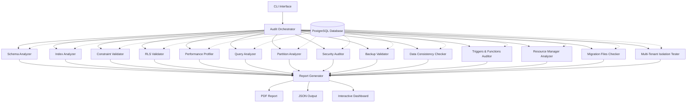

# وثيقة التصميم التقني: فحص شامل وعميق لقاعدة البيانات

## نظرة عامة (Overview)

### الهدف

تصميم نظام شامل لفحص وتدقيق قاعدة بيانات PostgreSQL الخاصة بنظام إدارة الرسائل متعدد المستأجرين. النظام يهدف إلى:

- تحديد جميع العيوب في البنية والأداء والأمان
- تحليل الأداء تحت ظروف الضغط
- التحقق من سلامة البيانات واتساقها
- توليد تقارير شاملة مع توصيات قابلة للتنفيذ

### النطاق

النظام يغطي:
- تحليل بنية الجداول والأعمدة (Schema Analysis)
- تحليل الفهارس والأداء (Index Analysis)
- التحقق من القيود والعلاقات (Constraints Validation)
- تحليل Row Level Security (RLS Analysis)
- تحليل الأداء تحت الضغط (Performance Under Load)
- تحليل الاستعلامات البطيئة (Slow Query Analysis)
- فحص استراتيجيات التقسيم (Partitioning Strategy)
- فحص الأمان والصلاحيات (Security Audit)
- التحقق من النسخ الاحتياطي (Backup Validation)
- تحليل الاتساق والنزاهة (Data Consistency)
- فحص Triggers و Functions
- تحليل Connection Pool و Resource Management
- فحص Migration Files
- تحليل Multi-Tenant Isolation
- توليد تقرير شامل

### السياق التقني

- **قاعدة البيانات**: PostgreSQL 14+
- **Backend**: Go (Golang)
- **النمط المعماري**: Multi-tenant مع Row Level Security
- **الجداول الرئيسية**: messages, tenants, subscriptions, packages, accounting_transactions, balance_history, payment_transactions, dedicated_gateways, gateway_statistics, resource_usage, dispatch_channels, paired_devices

## المعمارية (Architecture)

### المعمارية العامة

النظام يتبع معمارية Modular Analysis Pipeline حيث كل محلل (Analyzer) مستقل ويمكن تشغيله بشكل منفصل أو كجزء من pipeline شامل.



### مكونات النظام الرئيسية

1. **Audit Orchestrator**: المنسق الرئيسي الذي يدير تشغيل جميع المحللات
2. **Analyzers**: مجموعة من المحللات المتخصصة لكل جانب من جوانب الفحص
3. **Report Generator**: مولد التقارير الذي يجمع النتائج ويولد تقارير شاملة
4. **Database Connector**: طبقة الاتصال بقاعدة البيانات

### نمط التنفيذ

النظام يدعم ثلاثة أنماط تنفيذ:

1. **Full Audit**: تشغيل جميع المحللات
2. **Selective Audit**: تشغيل محللات محددة
3. **Continuous Monitoring**: مراقبة مستمرة مع تنبيهات

## تصميم المكونات (Components and Interfaces)

### 1. Audit Orchestrator

المنسق الرئيسي الذي يدير تشغيل جميع المحللات.

```go
type AuditOrchestrator struct {
    db          *sql.DB
    config      *AuditConfig
    analyzers   []Analyzer
    reporter    *ReportGenerator
    logger      *Logger
}

type AuditConfig struct {
    DatabaseURL         string
    EnabledAnalyzers    []string
    OutputFormat        string // "pdf", "json", "html"
    OutputPath          string
    Severity            []string // "critical", "high", "medium", "low"
    PerformanceMode     string // "quick", "standard", "deep"
    LoadTestDuration    time.Duration
    LoadTestConcurrency int
}

type Analyzer interface {
    Name() string
    Run(ctx context.Context) (*AnalysisResult, error)
    Priority() int
}

type AnalysisResult struct {
    AnalyzerName string
    Status       string // "success", "failed", "warning"
    Issues       []Issue
    Metrics      map[string]interface{}
    Duration     time.Duration
    Timestamp    time.Time
}

type Issue struct {
    ID          string
    Severity    string // "critical", "high", "medium", "low"
    Category    string
    Title       string
    Description string
    Impact      string
    Recommendation string
    SQLFix      string
    References  []string
}
```

**الوظائف الرئيسية:**

```go
func NewAuditOrchestrator(config *AuditConfig) (*AuditOrchestrator, error)
func (o *AuditOrchestrator) RegisterAnalyzer(analyzer Analyzer)
func (o *AuditOrchestrator) RunAudit(ctx context.Context) (*AuditReport, error)
func (o *AuditOrchestrator) RunAnalyzer(ctx context.Context, name string) (*AnalysisResult, error)
```

### 2. Schema Analyzer

محلل بنية قاعدة البيانات.

```go
type SchemaAnalyzer struct {
    db     *sql.DB
    logger *Logger
}

type TableSchema struct {
    SchemaName    string
    TableName     string
    Columns       []ColumnInfo
    PrimaryKey    *PrimaryKeyInfo
    ForeignKeys   []ForeignKeyInfo
    Indexes       []IndexInfo
    Constraints   []ConstraintInfo
    RowCount      int64
    TableSize     int64
    Issues        []Issue
}

type ColumnInfo struct {
    ColumnName      string
    DataType        string
    IsNullable      bool
    DefaultValue    *string
    CharMaxLength   *int
    NumericPrecision *int
    NumericScale    *int
    IsIdentity      bool
    Issues          []Issue
}

type PrimaryKeyInfo struct {
    ConstraintName string
    Columns        []string
}
```

**الوظائف الرئيسية:**

```go
func (sa *SchemaAnalyzer) AnalyzeAllTables(ctx context.Context) ([]TableSchema, error)
func (sa *SchemaAnalyzer) CheckMissingNotNull(table TableSchema) []Issue
func (sa *SchemaAnalyzer) CheckDecimalPrecision(table TableSchema) []Issue
func (sa *SchemaAnalyzer) CheckPrimaryKeys(table TableSchema) []Issue
func (sa *SchemaAnalyzer) CheckDataTypeConsistency(tables []TableSchema) []Issue
func (sa *SchemaAnalyzer) CheckUUIDGeneration(table TableSchema) []Issue
func (sa *SchemaAnalyzer) CheckTimestampColumns(table TableSchema) []Issue
func (sa *SchemaAnalyzer) CheckAuditColumns(table TableSchema) []Issue
```

### 3. Index Analyzer

محلل الفهارس والأداء.

```go
type IndexAnalyzer struct {
    db     *sql.DB
    logger *Logger
}

type IndexInfo struct {
    SchemaName      string
    TableName       string
    IndexName       string
    IndexDef        string
    IndexType       string
    Columns         []string
    IsUnique        bool
    IsPrimary       bool
    IndexSize       int64
    IndexScans      int64
    TuplesRead      int64
    TuplesFetched   int64
    UsagePercent    float64
    Bloat           float64
    Issues          []Issue
}

type MissingIndexSuggestion struct {
    TableName   string
    Columns     []string
    Reason      string
    EstimatedImpact string
    CreateSQL   string
}
```

**الوظائف الرئيسية:**

```go
func (ia *IndexAnalyzer) AnalyzeAllIndexes(ctx context.Context) ([]IndexInfo, error)
func (ia *IndexAnalyzer) FindUnusedIndexes(indexes []IndexInfo) []Issue
func (ia *IndexAnalyzer) FindDuplicateIndexes(indexes []IndexInfo) []Issue
func (ia *IndexAnalyzer) FindMissingIndexes(ctx context.Context) ([]MissingIndexSuggestion, error)
func (ia *IndexAnalyzer) CheckMultiTenantIndexes(indexes []IndexInfo) []Issue
func (ia *IndexAnalyzer) CalculateIndexBloat(index IndexInfo) (float64, error)
func (ia *IndexAnalyzer) CheckConcurrentCreation(ctx context.Context) []Issue
```

### 4. Constraint Validator

محلل القيود والعلاقات.

```go
type ConstraintValidator struct {
    db     *sql.DB
    logger *Logger
}

type ConstraintInfo struct {
    SchemaName      string
    TableName       string
    ConstraintName  string
    ConstraintType  string // "PRIMARY KEY", "FOREIGN KEY", "CHECK", "UNIQUE"
    Definition      string
    Columns         []string
    ReferencedTable *string
    ReferencedColumns []string
    OnDelete        *string
    OnUpdate        *string
    Issues          []Issue
}
```

**الوظائف الرئيسية:**

```go
func (cv *ConstraintValidator) AnalyzeAllConstraints(ctx context.Context) ([]ConstraintInfo, error)
func (cv *ConstraintValidator) CheckForeignKeyPolicies(constraints []ConstraintInfo) []Issue
func (cv *ConstraintValidator) FindMissingRelationships(ctx context.Context) []Issue
func (cv *ConstraintValidator) CheckCheckConstraints(constraints []ConstraintInfo) []Issue
func (cv *ConstraintValidator) CheckUniqueConstraints(ctx context.Context) []Issue
func (cv *ConstraintValidator) CheckFinancialColumnProtection(ctx context.Context) []Issue
func (cv *ConstraintValidator) CheckReferentialIntegrity(ctx context.Context) []Issue
func (cv *ConstraintValidator) CheckCascadeBehaviors(constraints []ConstraintInfo) []Issue
```

### 5. RLS Validator

محلل Row Level Security.

```go
type RLSValidator struct {
    db     *sql.DB
    logger *Logger
}

type RLSPolicy struct {
    SchemaName   string
    TableName    string
    PolicyName   string
    Command      string // "SELECT", "INSERT", "UPDATE", "DELETE", "ALL"
    Roles        []string
    UsingExpr    string
    CheckExpr    *string
    IsEnabled    bool
    Issues       []Issue
}

type RLSStatus struct {
    SchemaName      string
    TableName       string
    HasTenantID     bool
    RLSEnabled      bool
    Policies        []RLSPolicy
    MissingPolicies []string
    Issues          []Issue
}
```

**الوظائف الرئيسية:**

```go
func (rv *RLSValidator) AnalyzeRLSCoverage(ctx context.Context) ([]RLSStatus, error)
func (rv *RLSValidator) CheckRLSEnabled(ctx context.Context) []Issue
func (rv *RLSValidator) CheckPolicyCompleteness(status RLSStatus) []Issue
func (rv *RLSValidator) CheckTenantIDUsage(policies []RLSPolicy) []Issue
func (rv *RLSValidator) CheckCrossTenantLeaks(ctx context.Context) []Issue
func (rv *RLSValidator) CheckSuperAdminBypass(policies []RLSPolicy) []Issue
func (rv *RLSValidator) TestPolicies(ctx context.Context, status RLSStatus) []Issue
```

### 6. Performance Profiler

محلل الأداء تحت الضغط.

```go
type PerformanceProfiler struct {
    db              *sql.DB
    logger          *Logger
    loadDuration    time.Duration
    concurrency     int
}

type PerformanceMetrics struct {
    Timestamp           time.Time
    QueryResponseTime   map[string]time.Duration
    CacheHitRatio       float64
    Deadlocks           int
    LockContentions     int
    ConnectionPoolUsage float64
    TableBloat          map[string]float64
    DiskIO              DiskIOMetrics
    SequentialScans     []SequentialScanInfo
    Issues              []Issue
}

type DiskIOMetrics struct {
    ReadsPerSecond  float64
    WritesPerSecond float64
    ReadLatency     time.Duration
    WriteLatency    time.Duration
}

type SequentialScanInfo struct {
    TableName   string
    SeqScans    int64
    SeqTupRead  int64
    IndexScans  int64
    TableSize   int64
}
```

**الوظائف الرئيسية:**

```go
func (pp *PerformanceProfiler) RunLoadTest(ctx context.Context) (*PerformanceMetrics, error)
func (pp *PerformanceProfiler) MeasureQueryResponseTime(ctx context.Context, queries []string) map[string]time.Duration
func (pp *PerformanceProfiler) CalculateCacheHitRatio(ctx context.Context) (float64, error)
func (pp *PerformanceProfiler) DetectDeadlocks(ctx context.Context) (int, []Issue)
func (pp *PerformanceProfiler) MeasureConnectionPoolUsage(ctx context.Context) (float64, error)
func (pp *PerformanceProfiler) CalculateTableBloat(ctx context.Context) (map[string]float64, error)
func (pp *PerformanceProfiler) MeasureDiskIO(ctx context.Context) (DiskIOMetrics, error)
func (pp *PerformanceProfiler) FindSequentialScans(ctx context.Context) ([]SequentialScanInfo, error)
```

### 7. Query Analyzer

محلل الاستعلامات البطيئة.

```go
type QueryAnalyzer struct {
    db     *sql.DB
    logger *Logger
}

type SlowQuery struct {
    Query           string
    Calls           int64
    TotalTime       time.Duration
    MeanTime        time.Duration
    MaxTime         time.Duration
    StdDevTime      time.Duration
    Rows            int64
    QueryPlan       *QueryPlan
    Issues          []Issue
    Recommendations []string
}

type QueryPlan struct {
    PlanText        string
    PlanJSON        map[string]interface{}
    ExecutionTime   time.Duration
    PlanningTime    time.Duration
    HasSeqScan      bool
    HasIndexScan    bool
    BuffersHit      int64
    BuffersRead     int64
}
```

**الوظائف الرئيسية:**

```go
func (qa *QueryAnalyzer) AnalyzeSlowQueries(ctx context.Context, limit int) ([]SlowQuery, error)
func (qa *QueryAnalyzer) ExplainQuery(ctx context.Context, query string) (*QueryPlan, error)
func (qa *QueryAnalyzer) FindSequentialScans(queries []SlowQuery) []Issue
func (qa *QueryAnalyzer) CheckTenantIDUsage(queries []SlowQuery) []Issue
func (qa *QueryAnalyzer) AnalyzeQueryPlans(queries []SlowQuery) []Issue
func (qa *QueryAnalyzer) FindSelectStar(queries []SlowQuery) []Issue
func (qa *QueryAnalyzer) DetectNPlusOne(ctx context.Context) []Issue
func (qa *QueryAnalyzer) GenerateOptimizations(query SlowQuery) []string
```

### 8. Partition Analyzer

محلل استراتيجيات التقسيم.

```go
type PartitionAnalyzer struct {
    db     *sql.DB
    logger *Logger
}

type PartitionSuggestion struct {
    TableName       string
    CurrentRowCount int64
    TableSize       int64
    Strategy        string // "RANGE", "LIST", "HASH"
    PartitionColumn string
    PartitionInterval string // "MONTHLY", "QUARTERLY", "YEARLY"
    Benefits        []string
    Complexity      string
    Implementation  string
    Timeline        string
}

type PartitionStatus struct {
    TableName       string
    IsPartitioned   bool
    PartitionStrategy string
    PartitionCount  int
    Issues          []Issue
}
```

**الوظائف الرئيسية:**

```go
func (pa *PartitionAnalyzer) AnalyzePartitioningNeeds(ctx context.Context) ([]PartitionSuggestion, error)
func (pa *PartitionAnalyzer) SuggestStrategy(table string, rowCount int64) string
func (pa *PartitionAnalyzer) AnalyzeBenefits(suggestion PartitionSuggestion) []string
func (pa *PartitionAnalyzer) CheckExistingPartitions(ctx context.Context) ([]PartitionStatus, error)
func (pa *PartitionAnalyzer) GenerateImplementationPlan(suggestion PartitionSuggestion) string
```

### 9. Security Auditor

محلل الأمان والصلاحيات.

```go
type SecurityAuditor struct {
    db     *sql.DB
    logger *Logger
}

type DatabaseUser struct {
    Username        string
    IsSuperuser     bool
    CanCreateDB     bool
    CanCreateRole   bool
    Privileges      []Privilege
    Issues          []Issue
}

type Privilege struct {
    Database    string
    Schema      string
    Table       string
    PrivilegeType string
}

type EncryptionStatus struct {
    TableName       string
    ColumnName      string
    IsEncrypted     bool
    EncryptionType  string
    Issues          []Issue
}
```

**الوظائف الرئيسية:**

```go
func (sa *SecurityAuditor) AuditDatabaseUsers(ctx context.Context) ([]DatabaseUser, error)
func (sa *SecurityAuditor) CheckSuperuserPrivileges(users []DatabaseUser) []Issue
func (sa *SecurityAuditor) CheckMinimalPrivileges(ctx context.Context) []Issue
func (sa *SecurityAuditor) CheckEncryption(ctx context.Context) ([]EncryptionStatus, error)
func (sa *SecurityAuditor) FindUnencryptedSensitiveData(ctx context.Context) []Issue
func (sa *SecurityAuditor) CheckSSLConnection(ctx context.Context) []Issue
func (sa *SecurityAuditor) CheckAuditLogging(ctx context.Context) []Issue
func (sa *SecurityAuditor) DetectSQLInjectionRisks(ctx context.Context) []Issue
```

### 10. Report Generator

مولد التقارير الشامل.

```go
type ReportGenerator struct {
    results []AnalysisResult
    config  *ReportConfig
    logger  *Logger
}

type ReportConfig struct {
    Format          string // "pdf", "json", "html"
    OutputPath      string
    IncludeSummary  bool
    IncludeDetails  bool
    IncludeSQL      bool
    GroupBySeverity bool
}

type AuditReport struct {
    Timestamp       time.Time
    DatabaseInfo    DatabaseInfo
    ExecutiveSummary ExecutiveSummary
    Results         []AnalysisResult
    IssuesSummary   IssuesSummary
    Recommendations []Recommendation
    Timeline        ImplementationTimeline
}

type ExecutiveSummary struct {
    TotalIssues     int
    CriticalIssues  int
    HighIssues      int
    MediumIssues    int
    LowIssues       int
    OverallScore    float64
    KeyFindings     []string
}

type IssuesSummary struct {
    ByCategory  map[string]int
    BySeverity  map[string]int
    ByAnalyzer  map[string]int
}

type Recommendation struct {
    Priority        int
    Category        string
    Title           string
    Description     string
    Impact          string
    Effort          string
    SQLScript       string
    EstimatedTime   string
}

type ImplementationTimeline struct {
    ImmediateActions []Recommendation // 0-1 week
    ShortTerm        []Recommendation // 1-4 weeks
    MediumTerm       []Recommendation // 1-3 months
    LongTerm         []Recommendation // 3+ months
}
```

**الوظائف الرئيسية:**

```go
func (rg *ReportGenerator) GenerateReport(ctx context.Context) (*AuditReport, error)
func (rg *ReportGenerator) GeneratePDF(report *AuditReport) error
func (rg *ReportGenerator) GenerateJSON(report *AuditReport) error
func (rg *ReportGenerator) GenerateHTML(report *AuditReport) error
func (rg *ReportGenerator) GenerateDashboard(report *AuditReport) error
func (rg *ReportGenerator) CalculateOverallScore(results []AnalysisResult) float64
func (rg *ReportGenerator) PrioritizeRecommendations(issues []Issue) []Recommendation
```

## نماذج البيانات (Data Models)

### قاعدة البيانات الحالية

الجداول الرئيسية في النظام:

```sql
-- Core Tables
messages (
    id UUID PRIMARY KEY,
    tenant_id UUID NOT NULL,
    channel_id UUID,
    phone_number VARCHAR NOT NULL,
    content TEXT NOT NULL,
    status VARCHAR DEFAULT 'PENDING',
    cost DECIMAL(12,2) DEFAULT 0,
    scheduled_at TIMESTAMP DEFAULT CURRENT_TIMESTAMP,
    created_at TIMESTAMP DEFAULT CURRENT_TIMESTAMP
)

tenants (
    id UUID PRIMARY KEY,
    user_id UUID UNIQUE NOT NULL,
    business_name VARCHAR NOT NULL,
    balance DECIMAL(12,2) DEFAULT 0,
    status VARCHAR DEFAULT 'ACTIVE',
    created_at TIMESTAMP DEFAULT CURRENT_TIMESTAMP,
    updated_at TIMESTAMP DEFAULT CURRENT_TIMESTAMP
)

subscriptions (
    id UUID PRIMARY KEY,
    tenant_id UUID NOT NULL,
    package_id UUID NOT NULL,
    status VARCHAR DEFAULT 'active',
    messages_remaining INT DEFAULT 0,
    next_renewal_date TIMESTAMP,
    created_at TIMESTAMP DEFAULT CURRENT_TIMESTAMP
)

packages (
    id UUID PRIMARY KEY,
    tenant_id UUID,
    name VARCHAR NOT NULL,
    message_count INT NOT NULL,
    price DECIMAL(12,2) NOT NULL,
    is_active BOOLEAN DEFAULT true,
    created_at TIMESTAMP DEFAULT CURRENT_TIMESTAMP
)

accounting_transactions (
    id UUID PRIMARY KEY,
    tenant_id UUID NOT NULL,
    message_id UUID,
    amount DECIMAL(12,2) NOT NULL,
    status VARCHAR DEFAULT 'PENDING',
    type VARCHAR DEFAULT 'DEDUCTION',
    created_at TIMESTAMP DEFAULT CURRENT_TIMESTAMP
)

balance_history (
    id UUID PRIMARY KEY,
    tenant_id UUID NOT NULL,
    change_type VARCHAR NOT NULL,
    amount DECIMAL(12,2) NOT NULL,
    balance_before DECIMAL(12,2) NOT NULL,
    balance_after DECIMAL(12,2) NOT NULL,
    created_at TIMESTAMP DEFAULT CURRENT_TIMESTAMP
)

dispatch_channels (
    id UUID PRIMARY KEY,
    tenant_id UUID NOT NULL,
    type VARCHAR NOT NULL,
    channel_key VARCHAR NOT NULL,
    status VARCHAR DEFAULT 'ONLINE',
    priority INT DEFAULT 0,
    created_at TIMESTAMP DEFAULT CURRENT_TIMESTAMP
)

dedicated_gateways (
    id UUID PRIMARY KEY,
    tenant_id UUID NOT NULL,
    gateway_name VARCHAR NOT NULL,
    status VARCHAR DEFAULT 'active',
    created_at TIMESTAMP DEFAULT CURRENT_TIMESTAMP
)

gateway_statistics (
    id UUID PRIMARY KEY,
    tenant_id UUID NOT NULL,
    gateway_id UUID NOT NULL,
    date DATE NOT NULL,
    messages_sent INT DEFAULT 0,
    messages_failed INT DEFAULT 0,
    created_at TIMESTAMP DEFAULT CURRENT_TIMESTAMP
)

resource_usage (
    id UUID PRIMARY KEY,
    tenant_id UUID NOT NULL,
    gateway_id UUID,
    timestamp TIMESTAMP NOT NULL,
    cpu_usage DECIMAL(5,2),
    memory_usage DECIMAL(5,2),
    created_at TIMESTAMP DEFAULT CURRENT_TIMESTAMP
)
```

### نماذج البيانات للفحص

```go
// Database metadata
type DatabaseInfo struct {
    Version         string
    Size            int64
    TableCount      int
    IndexCount      int
    ConnectionCount int
    Uptime          time.Duration
}

// Audit configuration
type AuditSession struct {
    ID              uuid.UUID
    StartTime       time.Time
    EndTime         *time.Time
    Status          string
    Config          AuditConfig
    Results         []AnalysisResult
}

// Issue tracking
type IssueTracker struct {
    Issues          []Issue
    ResolvedIssues  []Issue
    PendingIssues   []Issue
}
```


## خصائص الصحة (Correctness Properties)

*الخاصية (Property) هي سمة أو سلوك يجب أن يكون صحيحاً عبر جميع عمليات التنفيذ الصالحة للنظام - بشكل أساسي، بيان رسمي حول ما يجب أن يفعله النظام. تعمل الخصائص كجسر بين المواصفات القابلة للقراءة البشرية وضمانات الصحة القابلة للتحقق الآلي.*

### Property 1: تحليل بنية الجداول الشامل

*لأي* قاعدة بيانات PostgreSQL، عند تشغيل Schema_Analyzer، يجب أن يعيد معلومات كاملة عن كل جدول تتضمن جميع الأعمدة والقيود والفهارس

**Validates: Requirements 1.1**

### Property 2: تحديد الأعمدة المفقودة NOT NULL

*لأي* جدول يحتوي على أعمدة يجب أن تكون NOT NULL (مثل foreign keys، أعمدة الحالة، الأعمدة المالية)، يجب أن يحدد Schema_Analyzer الأعمدة التي تفتقد قيد NOT NULL

**Validates: Requirements 1.2**

### Property 3: التحقق من دقة الأعمدة المالية

*لأي* عمود مالي (DECIMAL)، يجب أن يتحقق Schema_Analyzer من أن الدقة كافية (على الأقل DECIMAL(12,2)) ويحدد أي أعمدة بدقة غير كافية

**Validates: Requirements 1.3**

### Property 4: التحقق من وجود Primary Keys

*لأي* جدول في قاعدة البيانات، يجب أن يتحقق Schema_Analyzer من وجود Primary Key مناسب ويحدد الجداول بدون PK أو بـ PK غير مناسب

**Validates: Requirements 1.4**

### Property 5: اتساق أنواع البيانات

*لأي* مجموعة من الأعمدة المتشابهة عبر جداول مختلفة (مثل tenant_id، user_id، created_at)، يجب أن يحدد Schema_Analyzer أي عدم اتساق في أنواع البيانات

**Validates: Requirements 1.5**

### Property 6: توليد UUID الصحيح

*لأي* عمود من نوع UUID، يجب أن يتحقق Schema_Analyzer من استخدام gen_random_uuid() أو uuid_generate_v4() كقيمة افتراضية

**Validates: Requirements 1.6**

### Property 7: استخدام TIMESTAMP الصحيح

*لأي* عمود توقيت يحتاج إلى تخزين الوقت والتاريخ، يجب أن يتحقق Schema_Analyzer من استخدام TIMESTAMP بدلاً من DATE

**Validates: Requirements 1.7**

### Property 8: وجود أعمدة Audit

*لأي* جدول رئيسي، يجب أن يتحقق Schema_Analyzer من وجود أعمدة created_at و updated_at

**Validates: Requirements 1.8**

### Property 9: تحليل استخدام الفهارس

*لأي* فهرس في قاعدة البيانات، يجب أن يحسب Index_Analyzer معدل استخدامه من pg_stat_user_indexes

**Validates: Requirements 2.1**

### Property 10: تحديد الفهارس غير المستخدمة

*لأي* فهرس بـ idx_scan = 0، يجب أن يحدده Index_Analyzer كفهرس غير مستخدم يمكن حذفه

**Validates: Requirements 2.2**

### Property 11: تحديد الفهارس المكررة

*لأي* مجموعة من الفهارس على نفس الجدول، يجب أن يحدد Index_Analyzer الفهارس المكررة أو المتداخلة

**Validates: Requirements 2.3**

### Property 12: اقتراح الفهارس المفقودة

*لأي* جدول مع أنماط استعلام متكررة، يجب أن يحدد Index_Analyzer الأعمدة التي تحتاج فهارس بناءً على تحليل pg_stat_statements

**Validates: Requirements 2.4**

### Property 13: فهارس Multi-Tenant

*لأي* جدول يحتوي على tenant_id، يجب أن يتحقق Index_Analyzer من أن جميع الفهارس تبدأ بـ tenant_id

**Validates: Requirements 2.5**

### Property 14: حساب Index Bloat

*لأي* فهرس، يجب أن يحسب Index_Analyzer حجمه ونسبة التضخم (bloat)

**Validates: Requirements 2.6**

### Property 15: التحقق من Foreign Key Policies

*لأي* Foreign Key، يجب أن يتحقق Constraint_Validator من وجود ON DELETE و ON UPDATE policies مناسبة

**Validates: Requirements 3.1**

### Property 16: تحديد العلاقات المفقودة

*لأي* جدولين مرتبطين منطقياً، يجب أن يحدد Constraint_Validator العلاقات المفقودة (Foreign Keys غير موجودة)

**Validates: Requirements 3.2**

### Property 17: حماية الأعمدة المالية

*لأي* عمود مالي، يجب أن يتحقق Constraint_Validator من وجود CHECK constraint لمنع القيم السالبة

**Validates: Requirements 3.3, 3.5**

### Property 18: التحقق من UNIQUE Constraints

*لأي* عمود يجب أن يكون فريداً (مثل email، api_key)، يجب أن يتحقق Constraint_Validator من وجود UNIQUE constraint

**Validates: Requirements 3.4**

### Property 19: فحص Cascade Behaviors

*لأي* Foreign Key مع CASCADE behavior، يجب أن يحدد Constraint_Validator السلوكيات التي قد تؤدي إلى حذف بيانات غير مقصود

**Validates: Requirements 3.7**

### Property 20: تفعيل RLS على جداول Multi-Tenant

*لأي* جدول يحتوي على tenant_id، يجب أن يتحقق RLS_Validator من تفعيل Row Level Security

**Validates: Requirements 4.1**

### Property 21: اكتمال RLS Policies

*لأي* جدول مع RLS مفعل، يجب أن يتحقق RLS_Validator من وجود policies لجميع العمليات (SELECT, INSERT, UPDATE, DELETE)

**Validates: Requirements 4.2**

### Property 22: استخدام current_setting في Policies

*لأي* RLS policy، يجب أن يتحقق RLS_Validator من استخدام current_setting('app.current_tenant') بشكل صحيح

**Validates: Requirements 4.4**

### Property 23: عدم وجود ثغرات Cross-Tenant

*لأي* RLS policy، يجب أن يتحقق RLS_Validator من عدم وجود ثغرات تسمح بالوصول عبر المستأجرين

**Validates: Requirements 4.5**

### Property 24: Super Admin Bypass

*لأي* RLS policy، يجب أن يتحقق RLS_Validator من وجود super_admin bypass حيث يلزم

**Validates: Requirements 4.6**

### Property 25: قياس زمن استجابة الاستعلامات

*لأي* استعلام حرج تحت حمل مرتفع، يجب أن يقيس Performance_Profiler زمن الاستجابة بدقة

**Validates: Requirements 5.1**

### Property 26: تحديد الاستعلامات البطيئة

*لأي* استعلام يتجاوز 100ms تحت الحمل الطبيعي، يجب أن يحدده Performance_Profiler

**Validates: Requirements 5.2**

### Property 27: Cache Hit Ratio

*لأي* قاعدة بيانات، يجب أن يحسب Performance_Profiler cache hit ratio ويحدد إذا كان أقل من 95%

**Validates: Requirements 5.3**

### Property 28: تحديد Deadlocks

*لأي* deadlock يحدث تحت الضغط، يجب أن يحدده Performance_Profiler ويسجله

**Validates: Requirements 5.4**

### Property 29: Connection Pool Utilization

*لأي* قاعدة بيانات، يجب أن يقيس Performance_Profiler استخدام connection pool ويحدد أي نقص

**Validates: Requirements 5.5**

### Property 30: Table Bloat Analysis

*لأي* جدول، يجب أن يحسب Performance_Profiler نسبة التضخم (bloat) ويحدد الجداول التي تحتاج VACUUM

**Validates: Requirements 5.6**


### Property 31: Disk I/O Measurement

*لأي* قاعدة بيانات، يجب أن يقيس Performance_Profiler عمليات القراءة/الكتابة ويحدد أي عمليات مفرطة

**Validates: Requirements 5.7**

### Property 32: Sequential Scans Detection

*لأي* جدول كبير، يجب أن يحدد Performance_Profiler أي sequential scans تحت الضغط

**Validates: Requirements 5.8**

### Property 33: تحليل أبطأ الاستعلامات

*لأي* قاعدة بيانات، يجب أن يحلل Query_Analyzer pg_stat_statements ويعيد أبطأ 50 استعلام

**Validates: Requirements 6.1**

### Property 34: استخدام EXPLAIN ANALYZE

*لأي* استعلام بطيء، يجب أن يستخدم Query_Analyzer EXPLAIN ANALYZE لتحديد المشاكل

**Validates: Requirements 6.2**

### Property 35: تحديد Sequential Scans في الاستعلامات

*لأي* استعلام يستخدم Sequential Scan بدلاً من Index Scan، يجب أن يحدده Query_Analyzer

**Validates: Requirements 6.3**

### Property 36: التحقق من استخدام tenant_id

*لأي* استعلام على جدول multi-tenant، يجب أن يتحقق Query_Analyzer من استخدام tenant_id في WHERE clause

**Validates: Requirements 6.4**

### Property 37: تحديد SELECT *

*لأي* استعلام يستخدم SELECT *، يجب أن يحدده Query_Analyzer كممارسة سيئة

**Validates: Requirements 6.6**

### Property 38: تحديد N+1 Problems

*لأي* نمط N+1 query في الكود، يجب أن يحدده Query_Analyzer

**Validates: Requirements 6.7**

### Property 39: اقتراح تحسينات الاستعلامات

*لأي* استعلام بطيء، يجب أن يقترح Query_Analyzer تحسينات محددة

**Validates: Requirements 6.8**

### Property 40: تحديد Orphaned Records

*لأي* سجل بدون parent record (orphaned)، يجب أن يحدده Database_Auditor

**Validates: Requirements 10.1**

### Property 41: اتساق الأرصدة

*لأي* tenant، يجب أن يتحقق Database_Auditor من أن الرصيد في جدول tenants يطابق آخر سجل في balance_history

**Validates: Requirements 10.2**

### Property 42: اتساق المعاملات المالية

*لأي* tenant، يجب أن يتحقق Database_Auditor من أن مجموع accounting_transactions يطابق التغييرات في الأرصدة

**Validates: Requirements 10.3**

### Property 43: تحديد السجلات المكررة

*لأي* جدول يجب أن يحتوي على سجلات فريدة، يجب أن يحدد Database_Auditor أي سجلات مكررة

**Validates: Requirements 10.4**

### Property 44: صحة tenant_id في الرسائل

*لأي* message، يجب أن يتحقق Database_Auditor من أن tenant_id يشير إلى tenant موجود

**Validates: Requirements 10.5**

### Property 45: صحة package_id في الاشتراكات

*لأي* subscription، يجب أن يتحقق Database_Auditor من أن package_id يشير إلى package موجود

**Validates: Requirements 10.6**

### Property 46: تحديد NULL Values غير المسموحة

*لأي* عمود يجب أن يحتوي على قيم، يجب أن يحدد Database_Auditor أي NULL values

**Validates: Requirements 10.7**

### Property 47: اتساق التواريخ

*لأي* سجل يحتوي على start_date و end_date، يجب أن يتحقق Database_Auditor من أن start_date <= end_date

**Validates: Requirements 10.8**

### Property 48: توليد تقرير PDF شامل

*لأي* نتائج فحص، يجب أن يولد Report_Generator تقرير PDF يحتوي على جميع النتائج

**Validates: Requirements 15.1**

### Property 49: تصنيف المشاكل حسب الخطورة

*لأي* مشكلة محددة، يجب أن يصنفها Report_Generator حسب الخطورة (Critical, High, Medium, Low)

**Validates: Requirements 15.2**

### Property 50: توصيات محددة لكل مشكلة

*لأي* مشكلة محددة، يجب أن يقدم Report_Generator توصية محددة مع أولوية التنفيذ

**Validates: Requirements 15.3**

### Property 51: أمثلة SQL للتحسينات

*لأي* توصية، يجب أن يتضمن Report_Generator مثال SQL لتطبيق التحسين

**Validates: Requirements 15.4**

### Property 52: Executive Summary

*لأي* تقرير فحص، يجب أن يتضمن Report_Generator executive summary للإدارة العليا

**Validates: Requirements 15.5**

### Property 53: مقاييس الأداء

*لأي* تقرير فحص، يجب أن يتضمن Report_Generator مقاييس الأداء الحالية والمستهدفة

**Validates: Requirements 15.6**

### Property 54: Dashboard تفاعلي

*لأي* تقرير فحص، يجب أن يولد Report_Generator dashboard تفاعلي لمراقبة التحسينات

**Validates: Requirements 15.7**

### Property 55: جدول زمني للتحسينات

*لأي* تقرير فحص، يجب أن يتضمن Report_Generator جدول زمني مقترح لتطبيق التحسينات

**Validates: Requirements 15.8**

## معالجة الأخطاء (Error Handling)

### استراتيجية معالجة الأخطاء

النظام يتبع استراتيجية معالجة أخطاء شاملة:

1. **Connection Errors**: إعادة المحاولة مع exponential backoff
2. **Query Timeouts**: تسجيل الخطأ والمتابعة مع المحللات الأخرى
3. **Permission Errors**: تسجيل الخطأ وتخطي الفحص المحدد
4. **Data Inconsistency**: تسجيل المشكلة في التقرير
5. **Resource Exhaustion**: إيقاف الفحص بشكل آمن

### أنواع الأخطاء

```go
type ErrorType string

const (
    ErrorConnection     ErrorType = "CONNECTION_ERROR"
    ErrorPermission     ErrorType = "PERMISSION_ERROR"
    ErrorTimeout        ErrorType = "TIMEOUT_ERROR"
    ErrorQuery          ErrorType = "QUERY_ERROR"
    ErrorDataInconsistency ErrorType = "DATA_INCONSISTENCY"
    ErrorResourceExhaustion ErrorType = "RESOURCE_EXHAUSTION"
)

type AuditError struct {
    Type        ErrorType
    Analyzer    string
    Message     string
    Query       string
    Timestamp   time.Time
    Recoverable bool
}
```

### معالجة الأخطاء في المحللات

```go
func (a *Analyzer) RunWithErrorHandling(ctx context.Context) (*AnalysisResult, error) {
    defer func() {
        if r := recover(); r != nil {
            a.logger.Error("Panic recovered", "analyzer", a.Name(), "error", r)
        }
    }()
    
    result, err := a.Run(ctx)
    if err != nil {
        return a.handleError(err)
    }
    
    return result, nil
}

func (a *Analyzer) handleError(err error) (*AnalysisResult, error) {
    switch {
    case isConnectionError(err):
        return a.retryWithBackoff()
    case isPermissionError(err):
        return a.skipWithWarning()
    case isTimeoutError(err):
        return a.continueWithPartialResults()
    default:
        return nil, err
    }
}
```

### Retry Logic

```go
func (a *Analyzer) retryWithBackoff() (*AnalysisResult, error) {
    maxRetries := 3
    backoff := time.Second
    
    for i := 0; i < maxRetries; i++ {
        time.Sleep(backoff)
        result, err := a.Run(context.Background())
        if err == nil {
            return result, nil
        }
        backoff *= 2
    }
    
    return nil, fmt.Errorf("max retries exceeded")
}
```

## استراتيجية الاختبار (Testing Strategy)

### نهج الاختبار المزدوج

النظام يستخدم نهج اختبار مزدوج:

1. **Unit Tests**: للتحقق من أمثلة محددة وحالات حدية
2. **Property-Based Tests**: للتحقق من الخصائص العامة عبر جميع المدخلات

### Unit Testing

**الأدوات**:
- Go testing framework
- testify/assert للتأكيدات
- testify/mock للـ mocking

**التغطية**:
- اختبار كل محلل بشكل منفصل
- اختبار حالات الحدود (empty database, single table, etc.)
- اختبار معالجة الأخطاء
- اختبار توليد التقارير

**مثال**:

```go
func TestSchemaAnalyzer_CheckMissingNotNull(t *testing.T) {
    // Arrange
    analyzer := NewSchemaAnalyzer(mockDB)
    table := TableSchema{
        TableName: "users",
        Columns: []ColumnInfo{
            {ColumnName: "email", IsNullable: true}, // Should be NOT NULL
            {ColumnName: "name", IsNullable: false},
        },
    }
    
    // Act
    issues := analyzer.CheckMissingNotNull(table)
    
    // Assert
    assert.Len(t, issues, 1)
    assert.Equal(t, "email", issues[0].Description)
    assert.Equal(t, "high", issues[0].Severity)
}
```

### Property-Based Testing

**الأدوات**:
- gopter (Go property testing library)

**التكوين**:
- 100 iterations كحد أدنى لكل property test
- Random seed للتكرار
- Shrinking للعثور على أصغر مثال فاشل

**مثال**:

```go
// Feature: database-comprehensive-audit, Property 2: تحديد الأعمدة المفقودة NOT NULL
func TestProperty_MissingNotNull(t *testing.T) {
    parameters := gopter.DefaultTestParameters()
    parameters.MinSuccessfulTests = 100
    
    properties := gopter.NewProperties(parameters)
    
    properties.Property("Schema analyzer identifies missing NOT NULL constraints", 
        prop.ForAll(
            func(table TableSchema) bool {
                analyzer := NewSchemaAnalyzer(mockDB)
                issues := analyzer.CheckMissingNotNull(table)
                
                // For any column that should be NOT NULL but isn't,
                // the analyzer should identify it
                for _, col := range table.Columns {
                    if shouldBeNotNull(col) && col.IsNullable {
                        found := false
                        for _, issue := range issues {
                            if strings.Contains(issue.Description, col.ColumnName) {
                                found = true
                                break
                            }
                        }
                        if !found {
                            return false
                        }
                    }
                }
                return true
            },
            genTableSchema(),
        ))
    
    properties.TestingRun(t)
}
```


### Integration Testing

**الهدف**: اختبار تكامل المحللات مع قاعدة البيانات الفعلية

**البيئة**:
- PostgreSQL test container
- بيانات اختبار واقعية
- سيناريوهات متعددة المستأجرين

**السيناريوهات**:
1. قاعدة بيانات فارغة
2. قاعدة بيانات بجدول واحد
3. قاعدة بيانات بجداول متعددة مع علاقات
4. قاعدة بيانات مع RLS مفعل
5. قاعدة بيانات تحت حمل

### Performance Testing

**الهدف**: التحقق من أن الفحص لا يؤثر على أداء قاعدة البيانات

**المقاييس**:
- زمن تنفيذ كل محلل
- استهلاك الذاكرة
- عدد الاستعلامات المنفذة
- تأثير على قاعدة البيانات الإنتاجية

**الحدود المقبولة**:
- Full audit: < 10 دقائق لقاعدة بيانات متوسطة
- Memory usage: < 500MB
- CPU usage: < 20% من موارد الخادم

### Test Coverage Goals

- Unit tests: > 80% code coverage
- Property tests: جميع الخصائص المحددة في التصميم
- Integration tests: جميع السيناريوهات الرئيسية
- End-to-end tests: سيناريو فحص كامل

## اعتبارات الأداء (Performance Considerations)

### تحسين الاستعلامات

1. **استخدام Prepared Statements**: لتقليل overhead التحليل
2. **Batch Queries**: تجميع الاستعلامات المتشابهة
3. **Parallel Execution**: تشغيل المحللات المستقلة بالتوازي
4. **Query Timeouts**: تحديد timeout لكل استعلام لتجنب التعليق

```go
type QueryOptimizer struct {
    preparedStmts map[string]*sql.Stmt
    batchSize     int
    timeout       time.Duration
}

func (qo *QueryOptimizer) ExecuteWithTimeout(ctx context.Context, query string) (*sql.Rows, error) {
    ctx, cancel := context.WithTimeout(ctx, qo.timeout)
    defer cancel()
    
    return qo.db.QueryContext(ctx, query)
}
```

### Caching Strategy

```go
type CacheManager struct {
    tableSchemas    map[string]TableSchema
    indexInfo       map[string][]IndexInfo
    constraintInfo  map[string][]ConstraintInfo
    ttl             time.Duration
}

func (cm *CacheManager) GetTableSchema(tableName string) (*TableSchema, bool) {
    schema, exists := cm.tableSchemas[tableName]
    return &schema, exists
}
```

### Parallel Execution

```go
func (o *AuditOrchestrator) RunParallel(ctx context.Context) (*AuditReport, error) {
    var wg sync.WaitGroup
    results := make(chan *AnalysisResult, len(o.analyzers))
    errors := make(chan error, len(o.analyzers))
    
    for _, analyzer := range o.analyzers {
        wg.Add(1)
        go func(a Analyzer) {
            defer wg.Done()
            result, err := a.Run(ctx)
            if err != nil {
                errors <- err
                return
            }
            results <- result
        }(analyzer)
    }
    
    wg.Wait()
    close(results)
    close(errors)
    
    return o.aggregateResults(results, errors)
}
```

### Resource Management

```go
type ResourceManager struct {
    maxConnections  int
    maxMemory       int64
    connectionPool  *sql.DB
}

func (rm *ResourceManager) AcquireConnection(ctx context.Context) (*sql.Conn, error) {
    return rm.connectionPool.Conn(ctx)
}

func (rm *ResourceManager) MonitorMemory() error {
    var m runtime.MemStats
    runtime.ReadMemStats(&m)
    
    if m.Alloc > uint64(rm.maxMemory) {
        return fmt.Errorf("memory limit exceeded: %d > %d", m.Alloc, rm.maxMemory)
    }
    
    return nil
}
```

## اعتبارات الأمان (Security Considerations)

### Database Credentials

```go
type SecureConfig struct {
    DatabaseURL string // من environment variable
    UseSSL      bool
    CertPath    string
}

func LoadSecureConfig() (*SecureConfig, error) {
    dbURL := os.Getenv("DATABASE_URL")
    if dbURL == "" {
        return nil, fmt.Errorf("DATABASE_URL not set")
    }
    
    return &SecureConfig{
        DatabaseURL: dbURL,
        UseSSL:      true,
        CertPath:    os.Getenv("DB_CERT_PATH"),
    }, nil
}
```

### Read-Only Access

```go
func (o *AuditOrchestrator) EnsureReadOnly() error {
    // التحقق من أن المستخدم لديه صلاحيات قراءة فقط
    var canWrite bool
    err := o.db.QueryRow(`
        SELECT has_table_privilege(current_user, 'messages', 'INSERT')
    `).Scan(&canWrite)
    
    if err != nil {
        return err
    }
    
    if canWrite {
        return fmt.Errorf("audit user should have read-only access")
    }
    
    return nil
}
```

### Sensitive Data Handling

```go
type DataMasker struct {
    sensitiveColumns []string
}

func (dm *DataMasker) MaskSensitiveData(data map[string]interface{}) map[string]interface{} {
    masked := make(map[string]interface{})
    
    for key, value := range data {
        if dm.isSensitive(key) {
            masked[key] = "***MASKED***"
        } else {
            masked[key] = value
        }
    }
    
    return masked
}

func (dm *DataMasker) isSensitive(column string) bool {
    sensitive := []string{"password", "api_key", "token", "secret"}
    for _, s := range sensitive {
        if strings.Contains(strings.ToLower(column), s) {
            return true
        }
    }
    return false
}
```

### Audit Logging

```go
type AuditLogger struct {
    logger *log.Logger
}

func (al *AuditLogger) LogAccess(user, action, resource string) {
    al.logger.Printf("[AUDIT] User: %s, Action: %s, Resource: %s, Time: %s",
        user, action, resource, time.Now().Format(time.RFC3339))
}
```

## التصميم منخفض المستوى (Low-Level Design)

### خوارزمية تحديد الفهارس المكررة

```
Algorithm: FindDuplicateIndexes
Input: indexes []IndexInfo
Output: duplicates []Issue

1. Create a map: indexSignature -> []IndexInfo
2. For each index in indexes:
   a. Generate signature: tableName + columns (sorted)
   b. Add index to map[signature]
3. For each signature in map:
   a. If len(indexes) > 1:
      - Create issue for duplicate indexes
      - Add to duplicates
4. Return duplicates
```

**التنفيذ**:

```go
func (ia *IndexAnalyzer) FindDuplicateIndexes(indexes []IndexInfo) []Issue {
    signatureMap := make(map[string][]IndexInfo)
    
    for _, idx := range indexes {
        signature := generateIndexSignature(idx)
        signatureMap[signature] = append(signatureMap[signature], idx)
    }
    
    var issues []Issue
    for signature, idxList := range signatureMap {
        if len(idxList) > 1 {
            issue := Issue{
                Severity:    "medium",
                Category:    "index_optimization",
                Title:       "Duplicate Indexes Detected",
                Description: fmt.Sprintf("Found %d duplicate indexes: %v", 
                    len(idxList), getIndexNames(idxList)),
                Recommendation: fmt.Sprintf("Keep one index and drop others: %s",
                    generateDropSQL(idxList[1:])),
            }
            issues = append(issues, issue)
        }
    }
    
    return issues
}

func generateIndexSignature(idx IndexInfo) string {
    cols := make([]string, len(idx.Columns))
    copy(cols, idx.Columns)
    sort.Strings(cols)
    return fmt.Sprintf("%s.%s:%s", idx.SchemaName, idx.TableName, 
        strings.Join(cols, ","))
}
```

### خوارزمية تحديد Orphaned Records

```
Algorithm: FindOrphanedRecords
Input: tableName string, foreignKey ForeignKeyInfo
Output: orphans []Issue

1. Query child table for records
2. For each record:
   a. Check if parent record exists
   b. If not exists:
      - Add to orphans list
3. If orphans found:
   a. Create issue with details
   b. Suggest cleanup SQL
4. Return orphans
```

**التنفيذ**:

```go
func (dc *DataConsistencyChecker) FindOrphanedRecords(
    ctx context.Context, 
    tableName string, 
    fk ForeignKeyInfo,
) []Issue {
    query := fmt.Sprintf(`
        SELECT c.id, c.%s
        FROM %s c
        LEFT JOIN %s p ON c.%s = p.%s
        WHERE p.%s IS NULL
        LIMIT 100
    `, fk.ColumnName, tableName, fk.ReferencedTable, 
       fk.ColumnName, fk.ReferencedColumn, fk.ReferencedColumn)
    
    rows, err := dc.db.QueryContext(ctx, query)
    if err != nil {
        return []Issue{{
            Severity: "high",
            Title:    "Query Error",
            Description: err.Error(),
        }}
    }
    defer rows.Close()
    
    var orphanedIDs []string
    for rows.Next() {
        var id, fkValue string
        if err := rows.Scan(&id, &fkValue); err != nil {
            continue
        }
        orphanedIDs = append(orphanedIDs, id)
    }
    
    if len(orphanedIDs) == 0 {
        return nil
    }
    
    return []Issue{{
        Severity:    "high",
        Category:    "data_consistency",
        Title:       "Orphaned Records Found",
        Description: fmt.Sprintf("Found %d orphaned records in %s", 
            len(orphanedIDs), tableName),
        Impact:      "Data integrity violation",
        Recommendation: fmt.Sprintf("Review and clean up orphaned records"),
        SQLFix:      generateCleanupSQL(tableName, orphanedIDs),
    }}
}
```

### خوارزمية حساب Cache Hit Ratio

```
Algorithm: CalculateCacheHitRatio
Input: database connection
Output: ratio float64, error

1. Query pg_statio_user_tables for heap_blks_hit and heap_blks_read
2. Calculate total hits = sum(heap_blks_hit)
3. Calculate total reads = sum(heap_blks_read)
4. Calculate ratio = hits / (hits + reads)
5. Return ratio
```

**التنفيذ**:

```go
func (pp *PerformanceProfiler) CalculateCacheHitRatio(ctx context.Context) (float64, error) {
    query := `
        SELECT 
            sum(heap_blks_hit) as heap_hit,
            sum(heap_blks_read) as heap_read
        FROM pg_statio_user_tables
    `
    
    var heapHit, heapRead int64
    err := pp.db.QueryRowContext(ctx, query).Scan(&heapHit, &heapRead)
    if err != nil {
        return 0, err
    }
    
    if heapHit+heapRead == 0 {
        return 0, nil
    }
    
    ratio := float64(heapHit) / float64(heapHit+heapRead)
    return ratio, nil
}
```

### خوارزمية تحديد RLS Leaks

```
Algorithm: CheckCrossTenantLeaks
Input: policies []RLSPolicy
Output: leaks []Issue

1. For each policy:
   a. Parse USING expression
   b. Check if it uses current_setting('app.current_tenant')
   c. Check for OR conditions that might bypass tenant check
   d. Check for missing tenant_id in WHERE clause
   e. If leak detected:
      - Create issue with details
      - Add to leaks
2. Return leaks
```

**التنفيذ**:

```go
func (rv *RLSValidator) CheckCrossTenantLeaks(policies []RLSPolicy) []Issue {
    var issues []Issue
    
    for _, policy := range policies {
        // Check if policy uses tenant isolation
        if !strings.Contains(policy.UsingExpr, "tenant_id") {
            issues = append(issues, Issue{
                Severity:    "critical",
                Category:    "security",
                Title:       "Missing Tenant Isolation in RLS Policy",
                Description: fmt.Sprintf("Policy %s on %s.%s does not filter by tenant_id",
                    policy.PolicyName, policy.SchemaName, policy.TableName),
                Impact:      "Potential cross-tenant data access",
                Recommendation: "Add tenant_id filter to policy USING clause",
            })
        }
        
        // Check for OR conditions that might bypass tenant check
        if strings.Contains(policy.UsingExpr, " OR ") {
            if !strings.Contains(policy.UsingExpr, "is_super_admin") {
                issues = append(issues, Issue{
                    Severity:    "high",
                    Category:    "security",
                    Title:       "Suspicious OR Condition in RLS Policy",
                    Description: fmt.Sprintf("Policy %s contains OR condition that might bypass tenant isolation",
                        policy.PolicyName),
                    Impact:      "Potential security vulnerability",
                    Recommendation: "Review OR conditions in policy",
                })
            }
        }
    }
    
    return issues
}
```


## استعلامات SQL للفحص (SQL Queries for Audit)

### Schema Analysis Queries

```sql
-- Get all tables with column information
SELECT 
    t.table_schema,
    t.table_name,
    c.column_name,
    c.data_type,
    c.is_nullable,
    c.column_default,
    c.character_maximum_length,
    c.numeric_precision,
    c.numeric_scale
FROM information_schema.tables t
JOIN information_schema.columns c 
    ON t.table_schema = c.table_schema 
    AND t.table_name = c.table_name
WHERE t.table_schema = 'public'
    AND t.table_type = 'BASE TABLE'
ORDER BY t.table_name, c.ordinal_position;

-- Get primary keys
SELECT
    tc.table_schema,
    tc.table_name,
    tc.constraint_name,
    string_agg(kcu.column_name, ', ' ORDER BY kcu.ordinal_position) as columns
FROM information_schema.table_constraints tc
JOIN information_schema.key_column_usage kcu
    ON tc.constraint_name = kcu.constraint_name
    AND tc.table_schema = kcu.table_schema
WHERE tc.constraint_type = 'PRIMARY KEY'
    AND tc.table_schema = 'public'
GROUP BY tc.table_schema, tc.table_name, tc.constraint_name;

-- Get table sizes
SELECT
    schemaname,
    tablename,
    pg_size_pretty(pg_total_relation_size(schemaname||'.'||tablename)) AS size,
    pg_total_relation_size(schemaname||'.'||tablename) AS size_bytes,
    n_live_tup as row_count
FROM pg_stat_user_tables
WHERE schemaname = 'public'
ORDER BY pg_total_relation_size(schemaname||'.'||tablename) DESC;
```

### Index Analysis Queries

```sql
-- Get all indexes with usage statistics
SELECT
    schemaname,
    tablename,
    indexname,
    idx_scan,
    idx_tup_read,
    idx_tup_fetch,
    pg_size_pretty(pg_relation_size(indexrelid)) as index_size,
    pg_relation_size(indexrelid) as index_size_bytes
FROM pg_stat_user_indexes
WHERE schemaname = 'public'
ORDER BY idx_scan ASC;

-- Get unused indexes
SELECT
    schemaname,
    tablename,
    indexname,
    pg_size_pretty(pg_relation_size(indexrelid)) as index_size
FROM pg_stat_user_indexes
WHERE schemaname = 'public'
    AND idx_scan = 0
    AND indexrelid NOT IN (
        SELECT indexrelid 
        FROM pg_index 
        WHERE indisprimary OR indisunique
    )
ORDER BY pg_relation_size(indexrelid) DESC;

-- Get index definitions
SELECT
    schemaname,
    tablename,
    indexname,
    indexdef
FROM pg_indexes
WHERE schemaname = 'public'
ORDER BY tablename, indexname;

-- Calculate index bloat
SELECT
    schemaname,
    tablename,
    indexname,
    pg_size_pretty(pg_relation_size(indexrelid)) as index_size,
    CASE 
        WHEN pg_relation_size(indexrelid) > 0 
        THEN round(100 * (pg_relation_size(indexrelid) - 
            (SELECT sum(pg_column_size(attname)) 
             FROM pg_attribute 
             WHERE attrelid = indexrelid)) / 
            pg_relation_size(indexrelid)::numeric, 2)
        ELSE 0
    END as bloat_percent
FROM pg_stat_user_indexes
WHERE schemaname = 'public';
```

### Constraint Analysis Queries

```sql
-- Get all foreign keys
SELECT
    tc.table_schema,
    tc.table_name,
    tc.constraint_name,
    kcu.column_name,
    ccu.table_name AS foreign_table_name,
    ccu.column_name AS foreign_column_name,
    rc.update_rule,
    rc.delete_rule
FROM information_schema.table_constraints AS tc
JOIN information_schema.key_column_usage AS kcu
    ON tc.constraint_name = kcu.constraint_name
    AND tc.table_schema = kcu.table_schema
JOIN information_schema.constraint_column_usage AS ccu
    ON ccu.constraint_name = tc.constraint_name
    AND ccu.table_schema = tc.table_schema
JOIN information_schema.referential_constraints AS rc
    ON rc.constraint_name = tc.constraint_name
WHERE tc.constraint_type = 'FOREIGN KEY'
    AND tc.table_schema = 'public';

-- Get all check constraints
SELECT
    tc.table_schema,
    tc.table_name,
    tc.constraint_name,
    cc.check_clause
FROM information_schema.table_constraints tc
JOIN information_schema.check_constraints cc
    ON tc.constraint_name = cc.constraint_name
WHERE tc.constraint_type = 'CHECK'
    AND tc.table_schema = 'public';

-- Get all unique constraints
SELECT
    tc.table_schema,
    tc.table_name,
    tc.constraint_name,
    string_agg(kcu.column_name, ', ' ORDER BY kcu.ordinal_position) as columns
FROM information_schema.table_constraints tc
JOIN information_schema.key_column_usage kcu
    ON tc.constraint_name = kcu.constraint_name
    AND tc.table_schema = kcu.table_schema
WHERE tc.constraint_type = 'UNIQUE'
    AND tc.table_schema = 'public'
GROUP BY tc.table_schema, tc.table_name, tc.constraint_name;
```

### RLS Analysis Queries

```sql
-- Get RLS status for all tables
SELECT
    schemaname,
    tablename,
    rowsecurity as rls_enabled
FROM pg_tables
WHERE schemaname = 'public'
ORDER BY tablename;

-- Get all RLS policies
SELECT
    schemaname,
    tablename,
    policyname,
    permissive,
    roles,
    cmd,
    qual as using_expression,
    with_check as check_expression
FROM pg_policies
WHERE schemaname = 'public'
ORDER BY tablename, policyname;

-- Check tables with tenant_id but no RLS
SELECT
    t.table_name
FROM information_schema.tables t
JOIN information_schema.columns c
    ON t.table_name = c.table_name
    AND t.table_schema = c.table_schema
LEFT JOIN pg_tables pt
    ON t.table_name = pt.tablename
    AND t.table_schema = pt.schemaname
WHERE t.table_schema = 'public'
    AND c.column_name = 'tenant_id'
    AND (pt.rowsecurity IS NULL OR pt.rowsecurity = false);
```

### Performance Analysis Queries

```sql
-- Get slow queries from pg_stat_statements
SELECT
    query,
    calls,
    total_exec_time,
    mean_exec_time,
    max_exec_time,
    stddev_exec_time,
    rows
FROM pg_stat_statements
WHERE mean_exec_time > 100
ORDER BY mean_exec_time DESC
LIMIT 50;

-- Get cache hit ratio
SELECT
    sum(heap_blks_read) as heap_read,
    sum(heap_blks_hit) as heap_hit,
    round(sum(heap_blks_hit) / nullif(sum(heap_blks_hit) + sum(heap_blks_read), 0) * 100, 2) as cache_hit_ratio
FROM pg_statio_user_tables;

-- Get table bloat
SELECT
    schemaname,
    tablename,
    pg_size_pretty(pg_total_relation_size(schemaname||'.'||tablename)) as total_size,
    round(100 * pg_total_relation_size(schemaname||'.'||tablename) / 
        nullif(pg_database_size(current_database()), 0), 2) as percent_of_db,
    n_dead_tup,
    n_live_tup,
    round(100 * n_dead_tup / nullif(n_live_tup, 0), 2) as dead_tuple_percent
FROM pg_stat_user_tables
WHERE schemaname = 'public'
ORDER BY pg_total_relation_size(schemaname||'.'||tablename) DESC;

-- Get sequential scans on large tables
SELECT
    schemaname,
    tablename,
    seq_scan,
    seq_tup_read,
    idx_scan,
    n_live_tup,
    pg_size_pretty(pg_total_relation_size(schemaname||'.'||tablename)) as table_size
FROM pg_stat_user_tables
WHERE schemaname = 'public'
    AND seq_scan > 0
    AND n_live_tup > 10000
ORDER BY seq_tup_read DESC;

-- Get connection statistics
SELECT
    datname,
    count(*) as connections,
    count(*) FILTER (WHERE state = 'active') as active,
    count(*) FILTER (WHERE state = 'idle') as idle,
    count(*) FILTER (WHERE state = 'idle in transaction') as idle_in_transaction
FROM pg_stat_activity
GROUP BY datname;

-- Get lock information
SELECT
    pg_stat_activity.pid,
    pg_stat_activity.usename,
    pg_stat_activity.query,
    pg_locks.mode,
    pg_locks.granted
FROM pg_stat_activity
JOIN pg_locks ON pg_stat_activity.pid = pg_locks.pid
WHERE NOT pg_locks.granted
ORDER BY pg_stat_activity.query_start;
```

### Data Consistency Queries

```sql
-- Find orphaned messages (tenant_id not in tenants)
SELECT COUNT(*) as orphaned_messages
FROM messages m
LEFT JOIN tenants t ON m.tenant_id = t.id
WHERE t.id IS NULL;

-- Check balance consistency
SELECT
    t.id as tenant_id,
    t.balance as current_balance,
    bh.balance_after as last_balance_history,
    t.balance - bh.balance_after as difference
FROM tenants t
LEFT JOIN LATERAL (
    SELECT balance_after
    FROM balance_history
    WHERE tenant_id = t.id
    ORDER BY created_at DESC
    LIMIT 1
) bh ON true
WHERE t.balance != bh.balance_after;

-- Check accounting transactions sum
SELECT
    tenant_id,
    SUM(CASE WHEN type = 'DEDUCTION' THEN -amount ELSE amount END) as total_change
FROM accounting_transactions
WHERE status = 'COMMITTED'
GROUP BY tenant_id;

-- Find duplicate records
SELECT
    tenant_id,
    phone_number,
    content,
    COUNT(*) as duplicate_count
FROM messages
GROUP BY tenant_id, phone_number, content, scheduled_at
HAVING COUNT(*) > 1;

-- Check date consistency
SELECT
    id,
    table_name,
    start_date,
    end_date
FROM (
    SELECT id, 'subscriptions' as table_name, created_at as start_date, next_renewal_date as end_date
    FROM subscriptions
    WHERE next_renewal_date < created_at
) inconsistent_dates;
```

### Security Audit Queries

```sql
-- Get database users and privileges
SELECT
    usename,
    usesuper,
    usecreatedb,
    usecreaterole,
    usebypassrls
FROM pg_user
ORDER BY usename;

-- Get table privileges
SELECT
    grantee,
    table_schema,
    table_name,
    privilege_type
FROM information_schema.table_privileges
WHERE table_schema = 'public'
ORDER BY grantee, table_name;

-- Check SSL connection
SELECT
    datname,
    usename,
    ssl,
    client_addr
FROM pg_stat_ssl
JOIN pg_stat_activity USING (pid);

-- Get functions with SECURITY DEFINER
SELECT
    n.nspname as schema_name,
    p.proname as function_name,
    pg_get_functiondef(p.oid) as function_definition
FROM pg_proc p
JOIN pg_namespace n ON p.pronamespace = n.oid
WHERE p.prosecdef = true
    AND n.nspname = 'public';
```

## خطة التنفيذ (Implementation Plan)

### المرحلة 1: البنية الأساسية (أسبوع 1-2)

**المهام**:
1. إعداد بنية المشروع
2. تنفيذ Audit Orchestrator
3. تنفيذ Database Connector
4. إعداد نظام Logging
5. إعداد Configuration Management

**المخرجات**:
- هيكل مشروع كامل
- Orchestrator يمكنه تشغيل محللات وهمية
- اتصال بقاعدة البيانات

### المرحلة 2: المحللات الأساسية (أسبوع 3-4)

**المهام**:
1. تنفيذ Schema Analyzer
2. تنفيذ Index Analyzer
3. تنفيذ Constraint Validator
4. كتابة unit tests للمحللات

**المخرجات**:
- ثلاثة محللات عاملة
- تغطية اختبار > 80%

### المرحلة 3: محللات الأمان والأداء (أسبوع 5-6)

**المهام**:
1. تنفيذ RLS Validator
2. تنفيذ Security Auditor
3. تنفيذ Performance Profiler
4. تنفيذ Query Analyzer

**المخرجات**:
- أربعة محللات إضافية
- اختبارات تكامل

### المرحلة 4: محللات متقدمة (أسبوع 7-8)

**المهام**:
1. تنفيذ Partition Analyzer
2. تنفيذ Data Consistency Checker
3. تنفيذ Triggers & Functions Auditor
4. تنفيذ Resource Manager Analyzer
5. تنفيذ Migration Files Checker
6. تنفيذ Multi-Tenant Isolation Tester

**المخرجات**:
- جميع المحللات المتقدمة
- property-based tests

### المرحلة 5: توليد التقارير (أسبوع 9-10)

**المهام**:
1. تنفيذ Report Generator
2. تنفيذ PDF generation
3. تنفيذ JSON output
4. تنفيذ HTML dashboard
5. تنفيذ Executive Summary

**المخرجات**:
- نظام توليد تقارير كامل
- تقارير بصيغ متعددة

### المرحلة 6: CLI و Documentation (أسبوع 11)

**المهام**:
1. تنفيذ CLI interface
2. كتابة documentation
3. إنشاء أمثلة استخدام
4. إعداد CI/CD

**المخرجات**:
- CLI سهل الاستخدام
- documentation شامل

### المرحلة 7: الاختبار والتحسين (أسبوع 12)

**المهام**:
1. اختبار على قاعدة بيانات إنتاجية
2. تحسين الأداء
3. إصلاح الأخطاء
4. تحسين التقارير

**المخرجات**:
- نظام جاهز للإنتاج
- تقارير محسنة

## الخلاصة (Conclusion)

هذا التصميم يوفر نظام فحص شامل لقاعدة بيانات PostgreSQL مع التركيز على:

1. **الشمولية**: تغطية جميع جوانب قاعدة البيانات
2. **الدقة**: استخدام property-based testing للتحقق من الصحة
3. **الأداء**: تحسين الاستعلامات والتنفيذ المتوازي
4. **الأمان**: حماية البيانات الحساسة وصلاحيات قراءة فقط
5. **القابلية للصيانة**: معمارية modular وكود نظيف
6. **التقارير**: تقارير شاملة مع توصيات قابلة للتنفيذ

النظام مصمم ليكون قابلاً للتوسع ويمكن إضافة محللات جديدة بسهولة في المستقبل.
