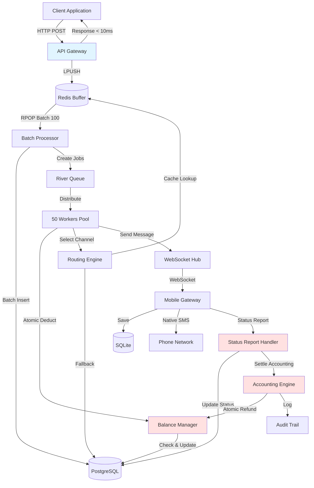
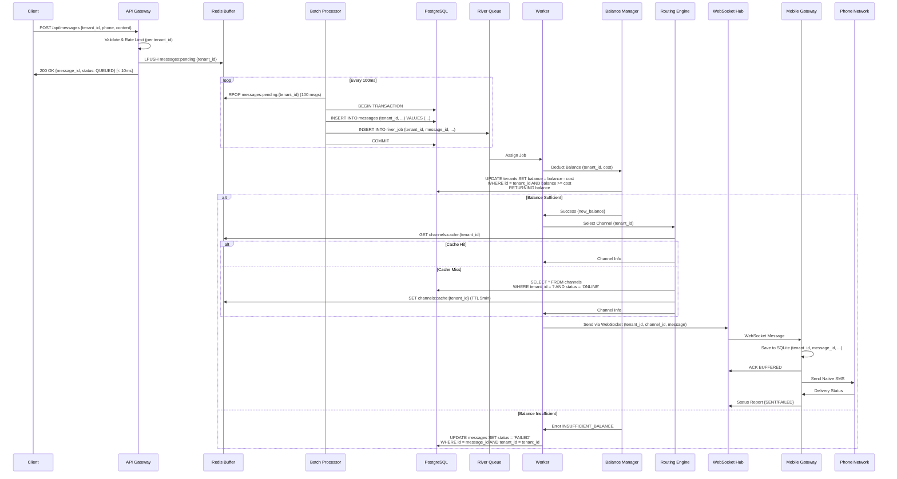
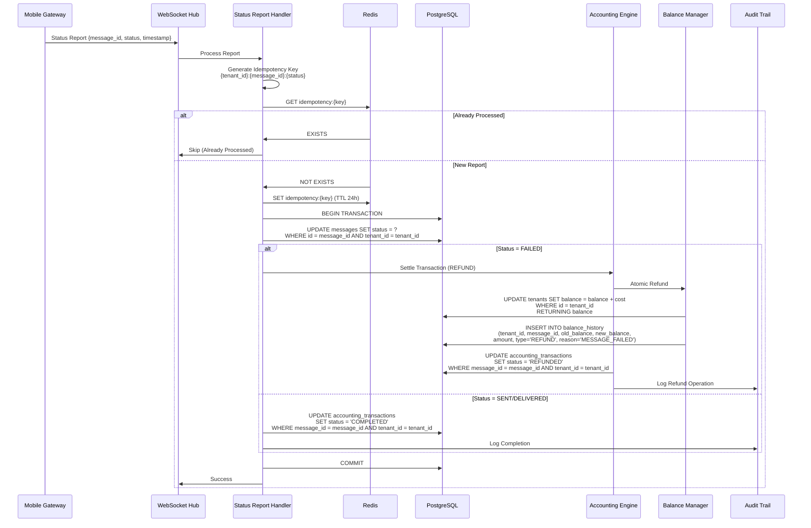
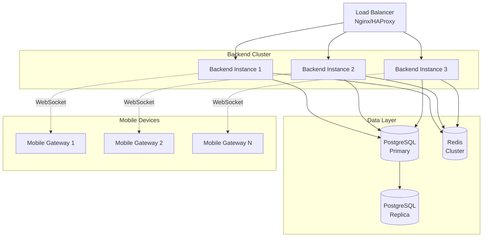

# وثيقة التصميم - إعادة بناء دورة حياة الرسالة الكاملة

## نظرة عامة (Overview)

### الهدف من التصميم

هذه الوثيقة تصف التصميم التفصيلي لإعادة بناء دورة حياة الرسالة الكاملة في نظام SMS Gateway. الهدف الرئيسي هو حل المشاكل الحرجة في الأداء والمحاسبة التي تسبب خسائر مالية يومية تقدر بـ $500-1000، وتحقيق أداء 5000+ رسالة/دقيقة مع 1000+ شركة مع ضمان الحماية المالية الكاملة والعزل التام بين الشركات.

### المشاكل الحالية

1. **Race Conditions في خصم الرصيد**: عمليات متزامنة تؤدي لخصم مضاعف
2. **عدم معالجة تقارير الحالة**: تقارير FAILED لا تسترد الرصيد
3. **أداء منخفض**: معالجة فردية للرسائل تسبب بطء شديد
4. **استنزاف موارد قاعدة البيانات**: اتصالات غير محدودة تسبب انهيار النظام
5. **عدم وجود عزل بين الشركات**: إمكانية تسرب البيانات بين Tenants

### الأهداف الرئيسية

1. **الحماية المالية المطلقة**: منع أي Race Conditions أو خسائر مالية
2. **الأداء العالي**: تحقيق 5000+ رسالة/دقيقة مع زمن استجابة < 10ms
3. **العزل التام**: ضمان عدم تسرب البيانات بين الشركات
4. **الموثوقية**: ضمان عدم فقدان أي رسالة
5. **التوافق الكامل**: عدم تغيير الواجهات الحالية (admin-web, client-web)

### نطاق التصميم

**داخل النطاق:**
- إعادة بناء API Gateway لاستقبال الرسائل
- تطبيق Redis Buffer للتخزين المؤقت
- تطبيق Batch Processor لمعالجة الدفعات
- إعادة بناء Balance Manager مع Atomic Operations
- تطبيق Status Report Handler لمعالجة التقارير
- تحسين WebSocket Hub للاتصالات
- تحسين Mobile Gateway للمعالجة الفورية
- تطبيق آليات العزل التام بين الشركات

**خارج النطاق:**
- تغيير واجهات admin-web أو client-web
- تغيير Database Schema للجداول المستخدمة من الواجهات
- تغيير API Endpoints أو Request/Response Format


## المعمارية (Architecture)

### المعمارية العامة (High-Level Architecture)

النظام الجديد يتبع معمارية Event-Driven مع Batch Processing لتحقيق أداء عالي وحماية مالية مطلقة:



### تدفق البيانات الكامل (Complete Data Flow)

#### 1. تدفق إرسال الرسالة (Message Send Flow)




#### 2. تدفق معالجة تقرير الحالة (Status Report Flow)



### الطبقات المعمارية (Architectural Layers)

النظام مقسم إلى 7 طبقات رئيسية مع عزل تام بين الشركات في كل طبقة:

#### 1. API Gateway Layer
- **المسؤولية**: استقبال الطلبات والتحقق من الصحة
- **التقنيات**: Go HTTP Server, Rate Limiter
- **العزل**: Rate Limiting منفصل لكل tenant_id
- **الأداء**: Response Time < 10ms

#### 2. Buffer Layer
- **المسؤولية**: التخزين المؤقت السريع للرسائل
- **التقنيات**: Redis Lists
- **العزل**: Keys منفصلة لكل tenant: `messages:pending:{tenant_id}`
- **الأداء**: LPUSH/RPOP في O(1)

#### 3. Batch Processing Layer
- **المسؤولية**: معالجة الرسائل على شكل دفعات
- **التقنيات**: Go Goroutines, PostgreSQL Batch Insert
- **العزل**: معالجة منفصلة لكل tenant
- **الأداء**: 100 رسالة/دفعة كل 100ms

#### 4. Queue Layer
- **المسؤولية**: توزيع المهام على Workers
- **التقنيات**: River Queue (PostgreSQL-based)
- **العزل**: Jobs تحتوي على tenant_id
- **الأداء**: 50 Workers متزامنة

#### 5. Business Logic Layer
- **المسؤولية**: خصم الرصيد، اختيار القناة، إرسال الرسائل
- **التقنيات**: Go Services, Atomic SQL Operations
- **العزل**: جميع Queries تحتوي على `WHERE tenant_id = ?`
- **الأداء**: Atomic Operations, Caching

#### 6. Communication Layer
- **المسؤولية**: الاتصال بالأجهزة عبر WebSocket
- **التقنيات**: WebSocket (gorilla/websocket)
- **العزل**: اتصال منفصل لكل tenant
- **الأداء**: Non-blocking Send, Buffered Channels

#### 7. Mobile Gateway Layer
- **المسؤولية**: إرسال الرسائل عبر Native SMS
- **التقنيات**: React Native, SQLite, Native Modules
- **العزل**: SQLite منفصل أو جدول مع tenant_id
- **الأداء**: Event-Driven Processing


## المكونات والواجهات (Components and Interfaces)

### 1. API Gateway Component

#### المسؤوليات
- استقبال طلبات إرسال الرسائل من العملاء
- التحقق من صحة البيانات (Validation)
- تطبيق Rate Limiting لكل Tenant
- حفظ الرسائل في Redis Buffer
- إرجاع استجابة سريعة (< 10ms)

#### الواجهات (Interfaces)

```go
// MessageRequest represents incoming message request
type MessageRequest struct {
    TenantID    int64    `json:"tenant_id" validate:"required"`
    PhoneNumber string   `json:"phone_number" validate:"required,e164"`
    Content     string   `json:"content" validate:"required,max=1600"`
    Priority    string   `json:"priority" validate:"omitempty,oneof=HIGH NORMAL LOW"`
    ScheduledAt *time.Time `json:"scheduled_at" validate:"omitempty"`
}

// MessageResponse represents API response
type MessageResponse struct {
    MessageID string `json:"message_id"`
    Status    string `json:"status"` // QUEUED
    QueuedAt  time.Time `json:"queued_at"`
}

// APIGateway interface
type APIGateway interface {
    // ReceiveMessage receives and queues a message
    // Returns response within 10ms
    ReceiveMessage(ctx context.Context, req MessageRequest) (*MessageResponse, error)
    
    // ReceiveBulk receives bulk messages (up to 10,000)
    ReceiveBulk(ctx context.Context, reqs []MessageRequest) (*BulkResponse, error)
    
    // CheckRateLimit checks if tenant exceeded rate limit
    CheckRateLimit(ctx context.Context, tenantID int64) error
}
```

#### آلية العزل
- Rate Limiting منفصل لكل Tenant: `rate_limit:{tenant_id}`
- Redis Keys منفصلة: `messages:pending:{tenant_id}`
- Validation تتحقق من صحة tenant_id

#### معالجة الأخطاء
- `400 Bad Request`: بيانات غير صحيحة
- `429 Too Many Requests`: تجاوز حد الطلبات (100/دقيقة)
- `500 Internal Server Error`: خطأ في النظام

### 2. Redis Buffer Component

#### المسؤوليات
- تخزين مؤقت سريع للرسائل الواردة
- توفير واجهة FIFO (First In First Out)
- دعم العزل التام بين Tenants
- TTL للرسائل القديمة (24 ساعة)

#### الواجهات

```go
// BufferedMessage represents message in buffer
type BufferedMessage struct {
    MessageID   string    `json:"message_id"`
    TenantID    int64     `json:"tenant_id"`
    PhoneNumber string    `json:"phone_number"`
    Content     string    `json:"content"`
    Priority    string    `json:"priority"`
    QueuedAt    time.Time `json:"queued_at"`
}

// MessageBuffer interface
type MessageBuffer interface {
    // Push adds message to buffer for specific tenant
    Push(ctx context.Context, tenantID int64, msg BufferedMessage) error
    
    // PopBatch retrieves up to batchSize messages for specific tenant
    PopBatch(ctx context.Context, tenantID int64, batchSize int) ([]BufferedMessage, error)
    
    // GetSize returns current buffer size for tenant
    GetSize(ctx context.Context, tenantID int64) (int64, error)
    
    // GetAllTenants returns list of tenants with pending messages
    GetAllTenants(ctx context.Context) ([]int64, error)
}
```

#### هيكل البيانات في Redis

```
# Message Queue per Tenant (List)
messages:pending:{tenant_id} → List of JSON-encoded BufferedMessage

# Buffer Size Counter per Tenant (String)
messages:count:{tenant_id} → Integer

# Rate Limiting per Tenant (String with TTL)
rate_limit:{tenant_id} → Counter (TTL: 1 minute)

# Tenants with Pending Messages (Set)
tenants:active → Set of tenant_ids
```

#### آلية العزل
- كل Tenant له Queue منفصلة تماماً
- لا يمكن لـ Tenant الوصول لـ Queue tenant آخر
- Keys تحتوي على tenant_id صريح

### 3. Batch Processor Component

#### المسؤوليات
- استخراج الرسائل من Redis Buffer
- إدخال دفعات في قاعدة البيانات
- إنشاء River Queue Jobs
- التكيف الذكي مع حجم الضغط

#### الواجهات

```go
// BatchProcessor interface
type BatchProcessor interface {
    // ProcessBatch processes a batch of messages for specific tenant
    ProcessBatch(ctx context.Context, tenantID int64) error
    
    // ProcessAllTenants processes batches for all active tenants
    ProcessAllTenants(ctx context.Context) error
    
    // AdaptBatchSize adjusts batch size based on pressure
    AdaptBatchSize(ctx context.Context, tenantID int64) int
    
    // Start starts the batch processor
    Start(ctx context.Context) error
    
    // Stop stops the batch processor gracefully
    Stop(ctx context.Context) error
}

// BatchConfig represents batch processing configuration
type BatchConfig struct {
    DefaultBatchSize int           // 100
    MinBatchSize     int           // 10
    MaxBatchSize     int           // 1000
    ProcessInterval  time.Duration // 100ms
    AdaptiveMode     bool          // true
}
```

#### خوارزمية التكيف الذكي

```go
func (bp *BatchProcessor) AdaptBatchSize(ctx context.Context, tenantID int64) int {
    bufferSize := bp.buffer.GetSize(ctx, tenantID)
    
    switch {
    case bufferSize < 10:
        // Low pressure: process immediately with small batch
        return min(bufferSize, 10)
    case bufferSize >= 10 && bufferSize < 100:
        // Medium pressure: process with medium batch
        return min(bufferSize, 50)
    case bufferSize >= 100:
        // High pressure: process with large batch
        return min(bufferSize, 100)
    default:
        return bp.config.DefaultBatchSize
    }
}
```

#### آلية العزل
- معالجة منفصلة لكل Tenant
- Batch Insert يحتوي على tenant_id في كل صف
- River Jobs تحتوي على tenant_id


### 4. Balance Manager Component

#### المسؤوليات
- خصم الرصيد بشكل ذري (Atomic)
- منع Race Conditions
- منع الرصيد السالب
- تسجيل جميع العمليات المالية
- استرداد الرصيد عند الفشل

#### الواجهات

```go
// BalanceOperation represents a balance operation
type BalanceOperation struct {
    TenantID    int64
    MessageID   string
    Amount      decimal.Decimal
    Type        string // DEDUCT, REFUND, CHARGE
    Reason      string
    CreatedBy   string
}

// BalanceResult represents result of balance operation
type BalanceResult struct {
    Success     bool
    OldBalance  decimal.Decimal
    NewBalance  decimal.Decimal
    Error       error
}

// BalanceManager interface
type BalanceManager interface {
    // DeductBalance deducts balance atomically
    // Returns error if balance insufficient
    DeductBalance(ctx context.Context, op BalanceOperation) (*BalanceResult, error)
    
    // RefundBalance refunds balance atomically
    RefundBalance(ctx context.Context, op BalanceOperation) (*BalanceResult, error)
    
    // GetBalance returns current balance for tenant
    GetBalance(ctx context.Context, tenantID int64) (decimal.Decimal, error)
    
    // CheckSufficient checks if balance is sufficient
    CheckSufficient(ctx context.Context, tenantID int64, amount decimal.Decimal) (bool, error)
}
```

#### Atomic Deduction Implementation

```sql
-- Atomic Balance Deduction with Race Condition Protection
UPDATE tenants 
SET 
    balance = balance - :amount,
    updated_at = NOW()
WHERE 
    id = :tenant_id 
    AND balance >= :amount  -- Critical: prevents negative balance
    AND deleted_at IS NULL
RETURNING 
    id,
    balance AS new_balance,
    (balance + :amount) AS old_balance;

-- If no rows returned, balance was insufficient
```

#### Atomic Refund Implementation

```sql
-- Atomic Balance Refund
UPDATE tenants 
SET 
    balance = balance + :amount,
    updated_at = NOW()
WHERE 
    id = :tenant_id 
    AND deleted_at IS NULL
RETURNING 
    id,
    balance AS new_balance,
    (balance - :amount) AS old_balance;
```

#### Balance History Logging

```sql
-- Log every balance operation
INSERT INTO balance_history (
    tenant_id,
    message_id,
    old_balance,
    new_balance,
    amount,
    type,
    reason,
    created_by,
    created_at
) VALUES (
    :tenant_id,
    :message_id,
    :old_balance,
    :new_balance,
    :amount,
    :type,
    :reason,
    :created_by,
    NOW()
);
```

#### آلية العزل
- كل عملية تحتوي على tenant_id صريح
- WHERE clause يضمن عدم الوصول لرصيد tenant آخر
- Balance History منفصلة لكل Tenant

#### معالجة الأخطاء
- `INSUFFICIENT_BALANCE`: الرصيد غير كافٍ
- `TENANT_NOT_FOUND`: الشركة غير موجودة
- `CONCURRENT_UPDATE`: تنافس في التحديث (يُعاد المحاولة)

### 5. Routing Engine Component

#### المسؤوليات
- اختيار أفضل قناة إرسال متاحة
- Load Balancing بين القنوات
- Caching لتقليل Database Queries
- دعم الأولويات

#### الواجهات

```go
// Channel represents a sending channel (device)
type Channel struct {
    ID          int64
    TenantID    int64
    DeviceID    string
    Status      string // ONLINE, OFFLINE, BUSY
    Priority    int
    Capacity    int
    CurrentLoad int
}

// RoutingEngine interface
type RoutingEngine interface {
    // SelectChannel selects best available channel for tenant
    SelectChannel(ctx context.Context, tenantID int64, priority string) (*Channel, error)
    
    // GetAvailableChannels returns all available channels for tenant
    GetAvailableChannels(ctx context.Context, tenantID int64) ([]*Channel, error)
    
    // UpdateChannelStatus updates channel status
    UpdateChannelStatus(ctx context.Context, channelID int64, status string) error
    
    // InvalidateCache invalidates channel cache for tenant
    InvalidateCache(ctx context.Context, tenantID int64) error
}
```

#### خوارزمية اختيار القناة

```go
func (re *RoutingEngine) SelectChannel(ctx context.Context, tenantID int64, priority string) (*Channel, error) {
    // 1. Try cache first
    cacheKey := fmt.Sprintf("channels:cache:%d", tenantID)
    channels, err := re.cache.Get(ctx, cacheKey)
    
    if err != nil || len(channels) == 0 {
        // 2. Cache miss: query database
        channels, err = re.db.Query(ctx, `
            SELECT id, tenant_id, device_id, status, priority, capacity, current_load
            FROM channels
            WHERE tenant_id = $1 
              AND status = 'ONLINE'
              AND deleted_at IS NULL
            ORDER BY priority DESC, current_load ASC
        `, tenantID)
        
        if err != nil {
            return nil, err
        }
        
        // 3. Store in cache (5 minutes)
        re.cache.Set(ctx, cacheKey, channels, 5*time.Minute)
    }
    
    // 4. Filter by priority if specified
    if priority == "HIGH" {
        channels = filterHighPriority(channels)
    }
    
    // 5. Select channel with lowest load
    if len(channels) == 0 {
        return nil, ErrNoChannelAvailable
    }
    
    return selectLeastLoaded(channels), nil
}
```

#### آلية العزل
- Query يحتوي على `WHERE tenant_id = ?`
- Cache Keys تحتوي على tenant_id: `channels:cache:{tenant_id}`
- لا يمكن لـ Tenant رؤية قنوات tenant آخر

### 6. WebSocket Hub Component

#### المسؤوليات
- إدارة اتصالات WebSocket مع الأجهزة
- إرسال الرسائل بشكل غير متزامن
- استقبال تقارير الحالة
- Heartbeat للتحقق من الاتصال

#### الواجهات

```go
// WebSocketMessage represents message sent via WebSocket
type WebSocketMessage struct {
    Type        string      `json:"type"` // MESSAGE, HEARTBEAT, ACK
    MessageID   string      `json:"message_id"`
    TenantID    int64       `json:"tenant_id"`
    ChannelID   int64       `json:"channel_id"`
    PhoneNumber string      `json:"phone_number"`
    Content     string      `json:"content"`
    Timestamp   time.Time   `json:"timestamp"`
}

// WebSocketHub interface
type WebSocketHub interface {
    // SendMessage sends message to device via WebSocket
    // Non-blocking operation
    SendMessage(ctx context.Context, msg WebSocketMessage) error
    
    // RegisterConnection registers new WebSocket connection
    RegisterConnection(ctx context.Context, tenantID int64, channelID int64, conn *websocket.Conn) error
    
    // UnregisterConnection unregisters WebSocket connection
    UnregisterConnection(ctx context.Context, tenantID int64, channelID int64) error
    
    // BroadcastToTenant broadcasts message to all tenant's devices
    BroadcastToTenant(ctx context.Context, tenantID int64, msg WebSocketMessage) error
    
    // GetConnectionStatus returns connection status
    GetConnectionStatus(ctx context.Context, tenantID int64, channelID int64) (string, error)
}
```

#### آلية العزل
- كل اتصال WebSocket مرتبط بـ tenant_id و channel_id
- Rooms منفصلة لكل Tenant
- لا يمكن لجهاز إرسال/استقبال رسائل من tenant آخر


### 7. Status Report Handler Component

#### المسؤوليات
- استقبال تقارير الحالة من الأجهزة
- تحديث حالة الرسائل
- تسوية المحاسبة (Refund عند FAILED)
- ضمان Idempotency

#### الواجهات

```go
// StatusReport represents status report from device
type StatusReport struct {
    MessageID   string    `json:"message_id"`
    TenantID    int64     `json:"tenant_id"`
    ChannelID   int64     `json:"channel_id"`
    Status      string    `json:"status"` // BUFFERED, SENT, DELIVERED, FAILED
    Timestamp   time.Time `json:"timestamp"`
    FailReason  string    `json:"fail_reason,omitempty"`
}

// StatusReportHandler interface
type StatusReportHandler interface {
    // ProcessReport processes status report with idempotency
    ProcessReport(ctx context.Context, report StatusReport) error
    
    // CheckIdempotency checks if report already processed
    CheckIdempotency(ctx context.Context, key string) (bool, error)
    
    // SettleAccounting settles accounting based on status
    SettleAccounting(ctx context.Context, report StatusReport) error
}
```

#### Idempotency Implementation

```go
func (sh *StatusReportHandler) ProcessReport(ctx context.Context, report StatusReport) error {
    // 1. Generate idempotency key
    key := fmt.Sprintf("%d:%s:%s", report.TenantID, report.MessageID, report.Status)
    idempotencyKey := fmt.Sprintf("idempotency:%s", key)
    
    // 2. Check if already processed
    exists, err := sh.redis.Exists(ctx, idempotencyKey)
    if err != nil {
        return fmt.Errorf("check idempotency: %w", err)
    }
    
    if exists {
        // Already processed, skip
        return nil
    }
    
    // 3. Set idempotency key (TTL 24 hours)
    err = sh.redis.Set(ctx, idempotencyKey, "1", 24*time.Hour)
    if err != nil {
        return fmt.Errorf("set idempotency: %w", err)
    }
    
    // 4. Process report in transaction
    tx, err := sh.db.Begin(ctx)
    if err != nil {
        return fmt.Errorf("begin transaction: %w", err)
    }
    defer tx.Rollback(ctx)
    
    // 5. Update message status
    err = sh.updateMessageStatus(ctx, tx, report)
    if err != nil {
        return fmt.Errorf("update message status: %w", err)
    }
    
    // 6. Settle accounting if needed
    if report.Status == "FAILED" {
        err = sh.settleFailedMessage(ctx, tx, report)
        if err != nil {
            return fmt.Errorf("settle failed message: %w", err)
        }
    } else if report.Status == "SENT" || report.Status == "DELIVERED" {
        err = sh.settleSuccessMessage(ctx, tx, report)
        if err != nil {
            return fmt.Errorf("settle success message: %w", err)
        }
    }
    
    // 7. Commit transaction
    err = tx.Commit(ctx)
    if err != nil {
        return fmt.Errorf("commit transaction: %w", err)
    }
    
    return nil
}
```

#### Accounting Settlement for Failed Messages

```sql
-- 1. Get message cost
SELECT cost, tenant_id 
FROM messages 
WHERE id = :message_id AND tenant_id = :tenant_id;

-- 2. Atomic refund
UPDATE tenants 
SET balance = balance + :cost
WHERE id = :tenant_id
RETURNING balance AS new_balance, (balance - :cost) AS old_balance;

-- 3. Log balance history
INSERT INTO balance_history (
    tenant_id, message_id, old_balance, new_balance, 
    amount, type, reason, created_at
) VALUES (
    :tenant_id, :message_id, :old_balance, :new_balance,
    :cost, 'REFUND', 'MESSAGE_FAILED', NOW()
);

-- 4. Update accounting transaction
UPDATE accounting_transactions 
SET status = 'REFUNDED', updated_at = NOW()
WHERE message_id = :message_id AND tenant_id = :tenant_id;
```

#### آلية العزل
- جميع Queries تحتوي على `WHERE tenant_id = ?`
- Idempotency Keys تحتوي على tenant_id
- لا يمكن معالجة تقرير لـ tenant آخر

### 8. Mobile Gateway Component

#### المسؤوليات
- استقبال الرسائل عبر WebSocket
- حفظ في SQLite محلياً
- إرسال عبر Native SMS
- إرسال تقارير الحالة

#### الواجهات (React Native)

```typescript
// Message interface
interface Message {
  messageId: string;
  tenantId: number;
  phoneNumber: string;
  content: string;
  status: 'BUFFERED' | 'SENDING' | 'SENT' | 'FAILED';
  receivedAt: Date;
  sentAt?: Date;
}

// MobileGateway interface
interface MobileGateway {
  // Connect to WebSocket server
  connect(tenantId: number, channelId: number, token: string): Promise<void>;
  
  // Disconnect from WebSocket
  disconnect(): Promise<void>;
  
  // Handle incoming message
  onMessageReceived(message: Message): Promise<void>;
  
  // Send message via Native SMS
  sendSMS(message: Message): Promise<void>;
  
  // Send status report
  sendStatusReport(messageId: string, status: string, failReason?: string): Promise<void>;
  
  // Get pending messages from SQLite
  getPendingMessages(): Promise<Message[]>;
}
```

#### SQLite Schema

```sql
-- Messages table with tenant isolation
CREATE TABLE messages (
    id INTEGER PRIMARY KEY AUTOINCREMENT,
    message_id TEXT NOT NULL UNIQUE,
    tenant_id INTEGER NOT NULL,
    channel_id INTEGER NOT NULL,
    phone_number TEXT NOT NULL,
    content TEXT NOT NULL,
    status TEXT NOT NULL,
    received_at DATETIME NOT NULL,
    sent_at DATETIME,
    fail_reason TEXT,
    created_at DATETIME DEFAULT CURRENT_TIMESTAMP,
    UNIQUE(message_id, tenant_id)
);

-- Index for tenant isolation
CREATE INDEX idx_messages_tenant ON messages(tenant_id, status);
CREATE INDEX idx_messages_status ON messages(status);
```

#### آلية العزل
- كل رسالة تحتوي على tenant_id
- Queries تحتوي على `WHERE tenant_id = ?`
- لا يمكن للجهاز إرسال رسائل لـ tenant آخر
- WebSocket Connection مرتبطة بـ tenant_id واحد فقط


## نماذج البيانات (Data Models)

### Database Schema

#### 1. Messages Table (Updated)

```sql
CREATE TABLE messages (
    id BIGSERIAL PRIMARY KEY,
    tenant_id BIGINT NOT NULL REFERENCES tenants(id),
    message_id UUID NOT NULL DEFAULT gen_random_uuid(),
    phone_number VARCHAR(20) NOT NULL,
    content TEXT NOT NULL,
    status VARCHAR(20) NOT NULL DEFAULT 'PENDING',
    priority VARCHAR(10) DEFAULT 'NORMAL',
    channel_id BIGINT REFERENCES channels(id),
    cost DECIMAL(10, 4) NOT NULL,
    parts_count INT DEFAULT 1,
    scheduled_at TIMESTAMP,
    queued_at TIMESTAMP NOT NULL DEFAULT NOW(),
    sent_at TIMESTAMP,
    delivered_at TIMESTAMP,
    failed_at TIMESTAMP,
    fail_reason TEXT,
    created_at TIMESTAMP NOT NULL DEFAULT NOW(),
    updated_at TIMESTAMP NOT NULL DEFAULT NOW(),
    deleted_at TIMESTAMP,
    
    -- Constraints
    CONSTRAINT messages_tenant_message_unique UNIQUE(tenant_id, message_id),
    CONSTRAINT messages_status_check CHECK (status IN ('PENDING', 'QUEUED', 'PROCESSING', 'SENT', 'DELIVERED', 'FAILED', 'SCHEDULED', 'WAITING')),
    CONSTRAINT messages_priority_check CHECK (priority IN ('HIGH', 'NORMAL', 'LOW'))
);

-- Indexes for performance and isolation
CREATE INDEX idx_messages_tenant_status ON messages(tenant_id, status) WHERE deleted_at IS NULL;
CREATE INDEX idx_messages_tenant_created ON messages(tenant_id, created_at DESC) WHERE deleted_at IS NULL;
CREATE INDEX idx_messages_message_id ON messages(message_id) WHERE deleted_at IS NULL;
CREATE INDEX idx_messages_scheduled ON messages(scheduled_at) WHERE status = 'SCHEDULED' AND deleted_at IS NULL;
```

#### 2. Balance History Table (New)

```sql
CREATE TABLE balance_history (
    id BIGSERIAL PRIMARY KEY,
    tenant_id BIGINT NOT NULL REFERENCES tenants(id),
    message_id UUID REFERENCES messages(message_id),
    old_balance DECIMAL(10, 4) NOT NULL,
    new_balance DECIMAL(10, 4) NOT NULL,
    amount DECIMAL(10, 4) NOT NULL,
    type VARCHAR(20) NOT NULL,
    reason TEXT,
    created_by VARCHAR(100),
    ip_address INET,
    created_at TIMESTAMP NOT NULL DEFAULT NOW(),
    
    -- Constraints
    CONSTRAINT balance_history_type_check CHECK (type IN ('DEDUCT', 'REFUND', 'CHARGE', 'ADJUSTMENT'))
);

-- Indexes for audit and reporting
CREATE INDEX idx_balance_history_tenant ON balance_history(tenant_id, created_at DESC);
CREATE INDEX idx_balance_history_message ON balance_history(message_id) WHERE message_id IS NOT NULL;
CREATE INDEX idx_balance_history_type ON balance_history(tenant_id, type, created_at DESC);
```

#### 3. Accounting Transactions Table (New)

```sql
CREATE TABLE accounting_transactions (
    id BIGSERIAL PRIMARY KEY,
    tenant_id BIGINT NOT NULL REFERENCES tenants(id),
    message_id UUID NOT NULL REFERENCES messages(message_id),
    amount DECIMAL(10, 4) NOT NULL,
    status VARCHAR(20) NOT NULL DEFAULT 'PENDING',
    transaction_type VARCHAR(20) NOT NULL,
    description TEXT,
    created_at TIMESTAMP NOT NULL DEFAULT NOW(),
    updated_at TIMESTAMP NOT NULL DEFAULT NOW(),
    completed_at TIMESTAMP,
    refunded_at TIMESTAMP,
    
    -- Constraints
    CONSTRAINT accounting_transactions_unique UNIQUE(tenant_id, message_id),
    CONSTRAINT accounting_status_check CHECK (status IN ('PENDING', 'COMPLETED', 'REFUNDED', 'FAILED')),
    CONSTRAINT accounting_type_check CHECK (transaction_type IN ('MESSAGE_SEND', 'REFUND', 'ADJUSTMENT'))
);

-- Indexes
CREATE INDEX idx_accounting_tenant_status ON accounting_transactions(tenant_id, status);
CREATE INDEX idx_accounting_message ON accounting_transactions(message_id);
```

#### 4. Tenants Table (Updated)

```sql
CREATE TABLE tenants (
    id BIGSERIAL PRIMARY KEY,
    name VARCHAR(255) NOT NULL,
    email VARCHAR(255) NOT NULL UNIQUE,
    balance DECIMAL(10, 4) NOT NULL DEFAULT 0,
    status VARCHAR(20) NOT NULL DEFAULT 'ACTIVE',
    rate_limit INT NOT NULL DEFAULT 100,
    created_at TIMESTAMP NOT NULL DEFAULT NOW(),
    updated_at TIMESTAMP NOT NULL DEFAULT NOW(),
    deleted_at TIMESTAMP,
    
    -- Constraints
    CONSTRAINT tenants_balance_positive CHECK (balance >= 0),
    CONSTRAINT tenants_status_check CHECK (status IN ('ACTIVE', 'SUSPENDED', 'INACTIVE'))
);

-- Indexes
CREATE INDEX idx_tenants_status ON tenants(status) WHERE deleted_at IS NULL;
CREATE INDEX idx_tenants_email ON tenants(email) WHERE deleted_at IS NULL;
```

#### 5. Channels Table (Updated)

```sql
CREATE TABLE channels (
    id BIGSERIAL PRIMARY KEY,
    tenant_id BIGINT NOT NULL REFERENCES tenants(id),
    device_id VARCHAR(100) NOT NULL,
    device_name VARCHAR(255),
    status VARCHAR(20) NOT NULL DEFAULT 'OFFLINE',
    priority INT NOT NULL DEFAULT 1,
    capacity INT NOT NULL DEFAULT 10,
    current_load INT NOT NULL DEFAULT 0,
    last_seen_at TIMESTAMP,
    created_at TIMESTAMP NOT NULL DEFAULT NOW(),
    updated_at TIMESTAMP NOT NULL DEFAULT NOW(),
    deleted_at TIMESTAMP,
    
    -- Constraints
    CONSTRAINT channels_tenant_device_unique UNIQUE(tenant_id, device_id),
    CONSTRAINT channels_status_check CHECK (status IN ('ONLINE', 'OFFLINE', 'BUSY', 'ERROR')),
    CONSTRAINT channels_load_check CHECK (current_load >= 0 AND current_load <= capacity)
);

-- Indexes for routing
CREATE INDEX idx_channels_tenant_status ON channels(tenant_id, status, priority DESC) WHERE deleted_at IS NULL;
CREATE INDEX idx_channels_device ON channels(device_id) WHERE deleted_at IS NULL;
```

#### 6. River Jobs Table (River Queue)

```sql
-- River queue jobs table (managed by River)
CREATE TABLE river_job (
    id BIGSERIAL PRIMARY KEY,
    args JSONB NOT NULL,
    attempt INT NOT NULL DEFAULT 0,
    attempted_at TIMESTAMP,
    attempted_by TEXT[],
    created_at TIMESTAMP NOT NULL DEFAULT NOW(),
    errors TEXT[],
    finalized_at TIMESTAMP,
    kind TEXT NOT NULL,
    max_attempts INT NOT NULL DEFAULT 3,
    metadata JSONB NOT NULL DEFAULT '{}',
    priority INT NOT NULL DEFAULT 1,
    queue TEXT NOT NULL DEFAULT 'default',
    state TEXT NOT NULL DEFAULT 'available',
    scheduled_at TIMESTAMP NOT NULL DEFAULT NOW(),
    tags TEXT[] NOT NULL DEFAULT '{}'
);

-- Indexes
CREATE INDEX idx_river_job_state ON river_job(state, queue, priority, scheduled_at);
CREATE INDEX idx_river_job_kind ON river_job(kind);
```

### Redis Data Structures

#### 1. Message Buffer

```
# Pending messages per tenant (List)
Key: messages:pending:{tenant_id}
Type: List
Value: JSON-encoded BufferedMessage
TTL: None (processed by batch processor)
Example: messages:pending:123

# Buffer size counter per tenant
Key: messages:count:{tenant_id}
Type: String (Integer)
Value: Count of pending messages
TTL: None
Example: messages:count:123 → "150"

# Active tenants set
Key: tenants:active
Type: Set
Value: Set of tenant_ids with pending messages
TTL: None
Example: tenants:active → {123, 456, 789}
```

#### 2. Rate Limiting

```
# Rate limit counter per tenant
Key: rate_limit:{tenant_id}
Type: String (Integer)
Value: Request count in current minute
TTL: 60 seconds
Example: rate_limit:123 → "45"

# Rate limit window
Key: rate_limit:window:{tenant_id}
Type: String (Timestamp)
Value: Window start timestamp
TTL: 60 seconds
```

#### 3. Channel Cache

```
# Available channels per tenant
Key: channels:cache:{tenant_id}
Type: Hash
Value: Channel information
TTL: 5 minutes
Example: 
channels:cache:123 → {
  "channel:1": "{\"id\":1,\"status\":\"ONLINE\",\"priority\":10}",
  "channel:2": "{\"id\":2,\"status\":\"ONLINE\",\"priority\":5}"
}
```

#### 4. Idempotency Keys

```
# Idempotency key for status reports
Key: idempotency:{tenant_id}:{message_id}:{status}
Type: String
Value: "1" (processed flag)
TTL: 24 hours
Example: idempotency:123:uuid-123:SENT → "1"
```

#### 5. WebSocket Connections

```
# Active WebSocket connections per tenant
Key: ws:connections:{tenant_id}
Type: Hash
Value: channel_id → connection_info
TTL: None (removed on disconnect)
Example:
ws:connections:123 → {
  "channel:1": "{\"connected_at\":\"2024-01-01T00:00:00Z\",\"last_ping\":\"2024-01-01T00:05:00Z\"}",
  "channel:2": "{\"connected_at\":\"2024-01-01T00:00:00Z\",\"last_ping\":\"2024-01-01T00:05:00Z\"}"
}
```

### Domain Models (Go Structs)

```go
// Message represents a message in the system
type Message struct {
    ID           int64           `db:"id"`
    TenantID     int64           `db:"tenant_id"`
    MessageID    string          `db:"message_id"`
    PhoneNumber  string          `db:"phone_number"`
    Content      string          `db:"content"`
    Status       string          `db:"status"`
    Priority     string          `db:"priority"`
    ChannelID    *int64          `db:"channel_id"`
    Cost         decimal.Decimal `db:"cost"`
    PartsCount   int             `db:"parts_count"`
    ScheduledAt  *time.Time      `db:"scheduled_at"`
    QueuedAt     time.Time       `db:"queued_at"`
    SentAt       *time.Time      `db:"sent_at"`
    DeliveredAt  *time.Time      `db:"delivered_at"`
    FailedAt     *time.Time      `db:"failed_at"`
    FailReason   *string         `db:"fail_reason"`
    CreatedAt    time.Time       `db:"created_at"`
    UpdatedAt    time.Time       `db:"updated_at"`
    DeletedAt    *time.Time      `db:"deleted_at"`
}

// BalanceHistory represents a balance change record
type BalanceHistory struct {
    ID         int64           `db:"id"`
    TenantID   int64           `db:"tenant_id"`
    MessageID  *string         `db:"message_id"`
    OldBalance decimal.Decimal `db:"old_balance"`
    NewBalance decimal.Decimal `db:"new_balance"`
    Amount     decimal.Decimal `db:"amount"`
    Type       string          `db:"type"`
    Reason     *string         `db:"reason"`
    CreatedBy  *string         `db:"created_by"`
    IPAddress  *string         `db:"ip_address"`
    CreatedAt  time.Time       `db:"created_at"`
}

// AccountingTransaction represents an accounting transaction
type AccountingTransaction struct {
    ID              int64           `db:"id"`
    TenantID        int64           `db:"tenant_id"`
    MessageID       string          `db:"message_id"`
    Amount          decimal.Decimal `db:"amount"`
    Status          string          `db:"status"`
    TransactionType string          `db:"transaction_type"`
    Description     *string         `db:"description"`
    CreatedAt       time.Time       `db:"created_at"`
    UpdatedAt       time.Time       `db:"updated_at"`
    CompletedAt     *time.Time      `db:"completed_at"`
    RefundedAt      *time.Time      `db:"refunded_at"`
}

// Tenant represents a tenant (company)
type Tenant struct {
    ID        int64           `db:"id"`
    Name      string          `db:"name"`
    Email     string          `db:"email"`
    Balance   decimal.Decimal `db:"balance"`
    Status    string          `db:"status"`
    RateLimit int             `db:"rate_limit"`
    CreatedAt time.Time       `db:"created_at"`
    UpdatedAt time.Time       `db:"updated_at"`
    DeletedAt *time.Time      `db:"deleted_at"`
}

// Channel represents a sending channel (device)
type Channel struct {
    ID          int64      `db:"id"`
    TenantID    int64      `db:"tenant_id"`
    DeviceID    string     `db:"device_id"`
    DeviceName  *string    `db:"device_name"`
    Status      string     `db:"status"`
    Priority    int        `db:"priority"`
    Capacity    int        `db:"capacity"`
    CurrentLoad int        `db:"current_load"`
    LastSeenAt  *time.Time `db:"last_seen_at"`
    CreatedAt   time.Time  `db:"created_at"`
    UpdatedAt   time.Time  `db:"updated_at"`
    DeletedAt   *time.Time `db:"deleted_at"`
}
```


## خصائص الصحة (Correctness Properties)

*خاصية الصحة (Property) هي سمة أو سلوك يجب أن يكون صحيحاً عبر جميع عمليات التنفيذ الصحيحة للنظام - بشكل أساسي، بيان رسمي عما يجب أن يفعله النظام. الخصائص تعمل كجسر بين المواصفات المقروءة للإنسان وضمانات الصحة القابلة للتحقق آلياً.*

### Property Reflection (مراجعة الخصائص لإزالة التكرار)

بعد تحليل جميع معايير القبول، وجدت الخصائص التالية القابلة للدمج:

**مجموعة 1: خصائص الرصيد المالي**
- Property 1.1 (Atomic Update) و Property 1.3 (Concurrent Operations) يمكن دمجهما في خاصية واحدة عن صحة الرصيد بعد العمليات المتزامنة
- Property 11.1 (رفض العمليات السالبة) و Property 11.7 (Invariant الرصيد >= 0) يمكن دمجهما في خاصية واحدة عن Invariant الرصيد

**مجموعة 2: خصائص Idempotency**
- Property 2.3 (استخدام Idempotency Key) و Property 2.4 (Idempotence) هما نفس الخاصية

**مجموعة 3: خصائص التسجيل**
- Properties 10.1, 10.2, 10.3, 10.4, 10.5 يمكن دمجها في خاصية واحدة عن اكتمال سجلات Balance_History

**مجموعة 4: خصائص Backward Compatibility**
- Properties 18.2, 18.3, 18.5, 18.7 يمكن دمجها في خاصية واحدة عن التوافق الكامل

**النتيجة:** بعد الدمج، لدينا 35 خاصية فريدة بدلاً من 50+ خاصية متكررة.

### الخصائص الأساسية (Core Properties)

#### Property 1: Atomic Balance Deduction Correctness

*For any* tenant and any set of concurrent balance deduction operations, when all operations complete, the final balance SHALL equal the initial balance minus the sum of all successful deductions, with no deduction succeeding if it would result in a negative balance.

**Validates: Requirements 1.1, 1.2, 1.3, 11.1, 11.7**

**Pattern:** Invariant + Atomicity

**Test Strategy:** Generate random concurrent deduction operations and verify final balance correctness.

#### Property 2: Balance Deduction Rejection on Insufficient Funds

*For any* balance deduction attempt where the current balance is less than the required cost, the operation SHALL be rejected and the message status SHALL be updated to FAILED.

**Validates: Requirements 1.2, 1.4, 11.3**

**Pattern:** Error Condition

**Test Strategy:** Generate random deduction attempts with insufficient balance and verify rejection.

#### Property 3: Status Report Idempotency

*For any* status report, processing the same report multiple times SHALL produce the same final state (message status, balance, accounting transaction) as processing it once.

**Validates: Requirements 2.3, 2.4**

**Pattern:** Idempotence

**Test Strategy:** Process same status report twice and verify identical results.

#### Property 4: Failed Message Refund Atomicity

*For any* message with status FAILED, the system SHALL atomically refund the deducted cost to the tenant's balance exactly once, regardless of how many times the failure is reported.

**Validates: Requirements 2.2, 2.5**

**Pattern:** Atomicity + Idempotence

**Test Strategy:** Generate failed messages and verify refund occurs exactly once.

#### Property 5: Successful Message Accounting Settlement

*For any* message with status SENT or DELIVERED, the accounting transaction SHALL be updated to COMPLETED status exactly once.

**Validates: Requirements 2.1**

**Pattern:** State Transition

**Test Strategy:** Generate successful messages and verify accounting transaction status.

#### Property 6: Balance History Completeness

*For any* balance operation (deduction or refund), a complete record SHALL exist in balance_history containing tenant_id, message_id, old_balance, new_balance, amount, type, reason, and created_by.

**Validates: Requirements 10.1, 10.2, 10.3, 10.4, 10.5, 2.6**

**Pattern:** Audit Trail Completeness

**Test Strategy:** Generate random balance operations and verify complete history records.

#### Property 7: Balance History Invariant

*For any* tenant, the sum of all balance changes in balance_history SHALL equal the difference between the current balance and the initial balance.

**Validates: Requirements 10.6**

**Pattern:** Invariant

**Test Strategy:** Perform random operations and verify sum(balance_history.amount) = current_balance - initial_balance.

#### Property 8: API Response Time Performance

*For any* valid message send request to the API Gateway, the response time SHALL be less than 10 milliseconds.

**Validates: Requirements 3.1**

**Pattern:** Performance Property

**Test Strategy:** Send random valid requests and measure response times.

#### Property 9: Message Buffering in Redis

*For any* message accepted by the API Gateway, the message SHALL be stored in Redis buffer (messages:pending:{tenant_id}) before returning a response to the client.

**Validates: Requirements 3.2**

**Pattern:** State Verification

**Test Strategy:** Send messages and verify presence in Redis before API response.

#### Property 10: API Response Format Completeness

*For any* successful message send request, the API response SHALL contain a message_id and status field with value "QUEUED".

**Validates: Requirements 3.3**

**Pattern:** Response Format Validation

**Test Strategy:** Send random valid requests and verify response structure.

#### Property 11: Rate Limiting Enforcement

*For any* tenant, when the number of requests in a 1-minute window exceeds 100, subsequent requests SHALL be rejected with HTTP 429 status code.

**Validates: Requirements 3.4, 3.5**

**Pattern:** Rate Limiting

**Test Strategy:** Send 101+ requests in 1 minute and verify 429 response.

#### Property 12: Input Validation Rejection

*For any* request with invalid data (invalid phone number format or missing required fields), the API Gateway SHALL reject the request with HTTP 400 status code.

**Validates: Requirements 3.6**

**Pattern:** Input Validation

**Test Strategy:** Generate random invalid requests and verify rejection.

#### Property 13: Batch Insert Atomicity

*For any* batch of messages, either all messages in the batch SHALL be inserted into the database or none SHALL be inserted (all-or-nothing).

**Validates: Requirements 4.2**

**Pattern:** Atomicity

**Test Strategy:** Simulate batch insert failures and verify no partial inserts.

#### Property 14: River Job Creation Completeness

*For any* message successfully inserted into the database, a corresponding River Queue job SHALL be created with the same tenant_id and message_id.

**Validates: Requirements 4.4**

**Pattern:** Referential Integrity

**Test Strategy:** Insert messages and verify corresponding jobs exist.

#### Property 15: Batch Processing Performance

*For any* batch of 100 messages, processing them as a single batch SHALL be at least 50 times faster than processing them individually.

**Validates: Requirements 4.5**

**Pattern:** Performance Property

**Test Strategy:** Measure and compare batch vs individual processing times.

#### Property 16: Batch Failure Individual Retry

*For any* batch insert that fails, each message in the batch SHALL be retried individually.

**Validates: Requirements 4.7**

**Pattern:** Error Recovery

**Test Strategy:** Simulate batch failures and verify individual retries.

#### Property 17: Channel Selection Online Status

*For any* channel selected by the Routing Engine, the channel status SHALL be 'ONLINE'.

**Validates: Requirements 5.3**

**Pattern:** State Constraint

**Test Strategy:** Select channels and verify all have ONLINE status.

#### Property 18: Channel Selection Priority Ordering

*For any* set of available channels for a tenant, the channels SHALL be ordered by priority (descending) and then by current load (ascending).

**Validates: Requirements 5.4**

**Pattern:** Ordering Property

**Test Strategy:** Get available channels and verify ordering.

#### Property 19: No Channel Available Handling

*For any* message when no channels are available for the tenant, the message status SHALL be updated to 'WAITING'.

**Validates: Requirements 5.5**

**Pattern:** State Transition

**Test Strategy:** Simulate no available channels and verify message status.

#### Property 20: Load Balancing Distribution

*For any* set of N messages sent to M available channels, the distribution SHALL be approximately equal (each channel receives N/M ± tolerance messages).

**Validates: Requirements 5.6**

**Pattern:** Distribution Property

**Test Strategy:** Send messages and verify even distribution across channels.

#### Property 21: Cache Hit Rate Performance

*For any* 100 consecutive channel selection operations for the same tenant, at least 99 SHALL be served from cache (cache hit rate >= 99%).

**Validates: Requirements 5.7**

**Pattern:** Performance Property

**Test Strategy:** Perform channel selections and measure cache hit rate.


#### Property 22: WebSocket Buffer Overflow Rejection

*For any* WebSocket hub with a full buffer (1000 messages), new message send attempts SHALL be rejected immediately (fail fast) without blocking.

**Validates: Requirements 6.3**

**Pattern:** Capacity Constraint

**Test Strategy:** Fill buffer to capacity and verify rejection of new messages.

#### Property 23: WebSocket Reconnection Timeliness

*For any* WebSocket connection that disconnects, the system SHALL attempt to reconnect within 5 seconds.

**Validates: Requirements 6.5**

**Pattern:** Timing Property

**Test Strategy:** Simulate disconnections and measure reconnection time.

#### Property 24: WebSocket Message Logging Completeness

*For any* message sent or received via WebSocket, a log entry SHALL exist containing the message details and timestamp.

**Validates: Requirements 6.7**

**Pattern:** Audit Trail Completeness

**Test Strategy:** Send/receive messages and verify log entries exist.

#### Property 25: Mobile Gateway SQLite Persistence

*For any* message received by the Mobile Gateway via WebSocket, the message SHALL be saved to SQLite before sending any acknowledgment.

**Validates: Requirements 7.1**

**Pattern:** Persistence Before Acknowledgment

**Test Strategy:** Receive messages and verify SQLite storage before ACK.

#### Property 26: Mobile Gateway Buffered Report Timeliness

*For any* message received by the Mobile Gateway, a BUFFERED status report SHALL be sent within 50 milliseconds of reception.

**Validates: Requirements 7.2**

**Pattern:** Timing Property

**Test Strategy:** Receive messages and measure time to BUFFERED report.

#### Property 27: Mobile Gateway SMS Send Timeliness

*For any* message in the Mobile Gateway, the message SHALL be sent via Native SMS within 100 milliseconds of reception.

**Validates: Requirements 7.4**

**Pattern:** Timing Property

**Test Strategy:** Receive messages and measure time to SMS send.

#### Property 28: Mobile Gateway Concurrent Send Capacity

*For any* Mobile Gateway instance, the system SHALL support sending 5-10 messages concurrently without blocking.

**Validates: Requirements 7.5**

**Pattern:** Concurrency Property

**Test Strategy:** Send 10 messages simultaneously and verify all are processed.

#### Property 29: Mobile Gateway Status Report Immediacy

*For any* message sent by the Mobile Gateway, a status report (SENT or FAILED) SHALL be sent immediately upon receiving the result from the native SMS API.

**Validates: Requirements 7.7**

**Pattern:** Immediacy Property

**Test Strategy:** Send messages and verify immediate status reports.

#### Property 30: Low Balance Warning Notification

*For any* tenant whose balance drops below 10 units, a warning notification SHALL be sent.

**Validates: Requirements 11.4**

**Pattern:** Threshold Notification

**Test Strategy:** Reduce balance below 10 and verify notification.

#### Property 31: Critical Balance Warning Notification

*For any* tenant whose balance drops below 5 units, a critical warning notification SHALL be sent.

**Validates: Requirements 11.5**

**Pattern:** Threshold Notification

**Test Strategy:** Reduce balance below 5 and verify critical notification.

#### Property 32: Insufficient Balance Attempt Logging

*For any* balance deduction attempt that fails due to insufficient balance, a log entry SHALL be created recording the attempt.

**Validates: Requirements 11.6**

**Pattern:** Audit Trail Completeness

**Test Strategy:** Attempt deductions with insufficient balance and verify logs.

#### Property 33: Message Persistence Before Processing

*For any* message being processed by the system, the message SHALL exist in the database before any processing begins.

**Validates: Requirements 17.1**

**Pattern:** Persistence Before Processing

**Test Strategy:** Process messages and verify database persistence first.

#### Property 34: Failed Worker Job Redistribution

*For any* River Queue job assigned to a worker that fails, the job SHALL be automatically reassigned to another available worker.

**Validates: Requirements 17.3**

**Pattern:** Fault Tolerance

**Test Strategy:** Simulate worker failures and verify job reassignment.

#### Property 35: Message Retry Limit

*For any* message that fails to send, the system SHALL retry the message exactly 3 times before moving it to the Dead Letter Queue.

**Validates: Requirements 17.4**

**Pattern:** Retry Policy

**Test Strategy:** Simulate send failures and verify 3 retries.

#### Property 36: Dead Letter Queue Final Destination

*For any* message that fails all retry attempts, the message SHALL be moved to the Dead Letter Queue.

**Validates: Requirements 17.5**

**Pattern:** Final State

**Test Strategy:** Exhaust retries and verify DLQ placement.

#### Property 37: Message Delivery or DLQ Guarantee

*For any* message accepted by the API Gateway, the message SHALL either be successfully delivered to the recipient OR be placed in the Dead Letter Queue (no message loss).

**Validates: Requirements 17.7**

**Pattern:** Reliability Guarantee

**Test Strategy:** Send messages and verify all reach delivery or DLQ.

#### Property 38: API Request/Response Format Compatibility

*For any* API endpoint, the request and response format SHALL match the format defined in the original system specification (backward compatible).

**Validates: Requirements 18.2**

**Pattern:** Backward Compatibility

**Test Strategy:** Compare request/response formats with original specification.

#### Property 39: WebSocket Event Format Compatibility

*For any* WebSocket event, the event format SHALL match the format defined in the original system specification (backward compatible).

**Validates: Requirements 18.3**

**Pattern:** Backward Compatibility

**Test Strategy:** Compare event formats with original specification.

#### Property 40: Internal Changes External Compatibility

*For any* internal system changes, all external interfaces (APIs, WebSocket events, database views) SHALL continue to function without modification to client code.

**Validates: Requirements 18.5, 18.7**

**Pattern:** Backward Compatibility

**Test Strategy:** Make internal changes and verify external interfaces unchanged.

### خصائص إضافية للعزل بين الشركات (Multi-tenancy Isolation Properties)

#### Property 41: Tenant Data Isolation in Database

*For any* database query, the query SHALL include a WHERE clause filtering by tenant_id, ensuring no tenant can access another tenant's data.

**Pattern:** Data Isolation

**Test Strategy:** Audit all queries and verify tenant_id filtering.

#### Property 42: Tenant Data Isolation in Redis

*For any* Redis key containing tenant-specific data, the key SHALL include the tenant_id as part of the key name (e.g., messages:pending:{tenant_id}).

**Pattern:** Data Isolation

**Test Strategy:** Audit all Redis keys and verify tenant_id inclusion.

#### Property 43: Tenant WebSocket Connection Isolation

*For any* WebSocket connection, messages SHALL only be sent to devices belonging to the same tenant_id as the message.

**Pattern:** Communication Isolation

**Test Strategy:** Attempt cross-tenant message delivery and verify rejection.

#### Property 44: Tenant Rate Limiting Isolation

*For any* two tenants A and B, tenant A reaching its rate limit SHALL NOT affect tenant B's ability to send messages.

**Pattern:** Resource Isolation

**Test Strategy:** Exhaust rate limit for one tenant and verify other tenant unaffected.

#### Property 45: Tenant Balance Isolation

*For any* balance operation for tenant A, the operation SHALL NOT affect the balance of any other tenant B.

**Pattern:** Financial Isolation

**Test Strategy:** Perform operations for one tenant and verify other tenants' balances unchanged.


## معالجة الأخطاء (Error Handling)

### استراتيجية معالجة الأخطاء

النظام يتبع استراتيجية معالجة أخطاء متعددة المستويات:

#### 1. API Gateway Layer Errors

```go
// Error Types
var (
    ErrInvalidRequest      = errors.New("invalid request data")
    ErrRateLimitExceeded   = errors.New("rate limit exceeded")
    ErrTenantNotFound      = errors.New("tenant not found")
    ErrContentTooLong      = errors.New("content exceeds 1600 characters")
    ErrInvalidPhoneNumber  = errors.New("invalid phone number format")
)

// Error Response Format
type ErrorResponse struct {
    Error   string `json:"error"`
    Code    string `json:"code"`
    Message string `json:"message"`
    Details map[string]interface{} `json:"details,omitempty"`
}

// HTTP Status Codes
// 400 Bad Request: Invalid input data
// 429 Too Many Requests: Rate limit exceeded
// 500 Internal Server Error: System error
```

#### 2. Balance Manager Errors

```go
// Error Types
var (
    ErrInsufficientBalance = errors.New("insufficient balance")
    ErrConcurrentUpdate    = errors.New("concurrent update detected")
    ErrTenantSuspended     = errors.New("tenant account suspended")
)

// Retry Strategy for Concurrent Updates
func (bm *BalanceManager) DeductBalanceWithRetry(ctx context.Context, op BalanceOperation) (*BalanceResult, error) {
    maxRetries := 3
    backoff := 100 * time.Millisecond
    
    for attempt := 0; attempt < maxRetries; attempt++ {
        result, err := bm.DeductBalance(ctx, op)
        
        if err == nil {
            return result, nil
        }
        
        if err == ErrInsufficientBalance || err == ErrTenantSuspended {
            // Don't retry these errors
            return nil, err
        }
        
        if err == ErrConcurrentUpdate {
            // Retry with exponential backoff
            time.Sleep(backoff * time.Duration(1<<attempt))
            continue
        }
        
        return nil, err
    }
    
    return nil, fmt.Errorf("max retries exceeded: %w", ErrConcurrentUpdate)
}
```

#### 3. Routing Engine Errors

```go
// Error Types
var (
    ErrNoChannelAvailable = errors.New("no channel available")
    ErrChannelOffline     = errors.New("channel is offline")
    ErrChannelBusy        = errors.New("channel is busy")
)

// Fallback Strategy
func (re *RoutingEngine) SelectChannelWithFallback(ctx context.Context, tenantID int64) (*Channel, error) {
    // Try primary selection
    channel, err := re.SelectChannel(ctx, tenantID, "NORMAL")
    if err == nil {
        return channel, nil
    }
    
    if err == ErrNoChannelAvailable {
        // Update message status to WAITING
        return nil, err
    }
    
    // Try cache invalidation and retry
    re.InvalidateCache(ctx, tenantID)
    channel, err = re.SelectChannel(ctx, tenantID, "NORMAL")
    if err == nil {
        return channel, nil
    }
    
    return nil, err
}
```

#### 4. WebSocket Hub Errors

```go
// Error Types
var (
    ErrConnectionClosed   = errors.New("connection closed")
    ErrBufferFull         = errors.New("buffer full")
    ErrSendTimeout        = errors.New("send timeout")
)

// Non-blocking Send with Timeout
func (hub *WebSocketHub) SendMessageNonBlocking(ctx context.Context, msg WebSocketMessage) error {
    select {
    case hub.sendChan <- msg:
        return nil
    case <-time.After(100 * time.Millisecond):
        return ErrSendTimeout
    case <-ctx.Done():
        return ctx.Err()
    }
}

// Automatic Reconnection
func (hub *WebSocketHub) maintainConnection(ctx context.Context, tenantID int64, channelID int64) {
    for {
        select {
        case <-ctx.Done():
            return
        default:
            conn, err := hub.connect(ctx, tenantID, channelID)
            if err != nil {
                log.Error("connection failed", "error", err)
                time.Sleep(5 * time.Second) // Retry after 5 seconds
                continue
            }
            
            // Handle connection until it closes
            hub.handleConnection(ctx, conn)
        }
    }
}
```

#### 5. Status Report Handler Errors

```go
// Error Types
var (
    ErrDuplicateReport    = errors.New("duplicate report")
    ErrMessageNotFound    = errors.New("message not found")
    ErrInvalidStatus      = errors.New("invalid status")
)

// Idempotent Processing with Retry
func (sh *StatusReportHandler) ProcessReportWithRetry(ctx context.Context, report StatusReport) error {
    maxRetries := 3
    backoff := 100 * time.Millisecond
    
    for attempt := 0; attempt < maxRetries; attempt++ {
        err := sh.ProcessReport(ctx, report)
        
        if err == nil {
            return nil
        }
        
        if err == ErrDuplicateReport {
            // Already processed, success
            return nil
        }
        
        if err == ErrMessageNotFound || err == ErrInvalidStatus {
            // Don't retry these errors
            return err
        }
        
        // Retry with exponential backoff
        time.Sleep(backoff * time.Duration(1<<attempt))
    }
    
    return fmt.Errorf("max retries exceeded")
}
```

#### 6. Batch Processor Errors

```go
// Error Types
var (
    ErrBatchInsertFailed  = errors.New("batch insert failed")
    ErrPartialInsert      = errors.New("partial insert detected")
)

// Batch Insert with Individual Fallback
func (bp *BatchProcessor) ProcessBatchWithFallback(ctx context.Context, messages []BufferedMessage) error {
    // Try batch insert
    err := bp.batchInsert(ctx, messages)
    if err == nil {
        return nil
    }
    
    log.Warn("batch insert failed, falling back to individual inserts", "error", err)
    
    // Fallback to individual inserts
    var failedMessages []BufferedMessage
    for _, msg := range messages {
        err := bp.insertSingle(ctx, msg)
        if err != nil {
            log.Error("individual insert failed", "message_id", msg.MessageID, "error", err)
            failedMessages = append(failedMessages, msg)
        }
    }
    
    if len(failedMessages) > 0 {
        // Re-queue failed messages
        for _, msg := range failedMessages {
            bp.buffer.Push(ctx, msg.TenantID, msg)
        }
        return fmt.Errorf("failed to insert %d messages", len(failedMessages))
    }
    
    return nil
}
```

### Circuit Breaker Pattern

لحماية الخدمات الخارجية من الضغط الزائد:

```go
type CircuitBreaker struct {
    maxFailures  int
    timeout      time.Duration
    state        string // CLOSED, OPEN, HALF_OPEN
    failures     int
    lastFailTime time.Time
    mu           sync.RWMutex
}

func (cb *CircuitBreaker) Call(fn func() error) error {
    cb.mu.Lock()
    defer cb.mu.Unlock()
    
    if cb.state == "OPEN" {
        if time.Since(cb.lastFailTime) > cb.timeout {
            cb.state = "HALF_OPEN"
        } else {
            return errors.New("circuit breaker is open")
        }
    }
    
    err := fn()
    
    if err != nil {
        cb.failures++
        cb.lastFailTime = time.Now()
        
        if cb.failures >= cb.maxFailures {
            cb.state = "OPEN"
        }
        
        return err
    }
    
    // Success
    cb.failures = 0
    cb.state = "CLOSED"
    return nil
}
```

### Graceful Degradation

عند فشل المكونات الحرجة:

#### Redis Failure → Direct Database Processing

```go
func (api *APIGateway) ReceiveMessage(ctx context.Context, req MessageRequest) (*MessageResponse, error) {
    // Try Redis first
    err := api.buffer.Push(ctx, req.TenantID, msg)
    if err != nil {
        log.Warn("redis unavailable, falling back to direct database insert", "error", err)
        
        // Fallback to direct database insert
        err = api.db.InsertMessage(ctx, msg)
        if err != nil {
            return nil, fmt.Errorf("failed to save message: %w", err)
        }
    }
    
    return &MessageResponse{
        MessageID: msg.MessageID,
        Status:    "QUEUED",
        QueuedAt:  time.Now(),
    }, nil
}
```

#### WebSocket Failure → Polling Fallback

```go
func (mg *MobileGateway) ensureMessageDelivery(ctx context.Context) {
    // Try WebSocket first
    err := mg.ws.Connect(ctx)
    if err != nil {
        log.Warn("websocket unavailable, falling back to polling", "error", err)
        
        // Fallback to HTTP polling
        ticker := time.NewTicker(5 * time.Second)
        defer ticker.Stop()
        
        for {
            select {
            case <-ticker.C:
                messages, err := mg.api.PollMessages(ctx)
                if err != nil {
                    log.Error("polling failed", "error", err)
                    continue
                }
                
                for _, msg := range messages {
                    mg.processMessage(ctx, msg)
                }
            case <-ctx.Done():
                return
            }
        }
    }
}
```

### Dead Letter Queue

للرسائل التي فشلت جميع محاولات إرسالها:

```go
type DeadLetterQueue struct {
    db *sql.DB
}

func (dlq *DeadLetterQueue) MoveToDeadLetter(ctx context.Context, msg Message, reason string) error {
    tx, err := dlq.db.BeginTx(ctx, nil)
    if err != nil {
        return err
    }
    defer tx.Rollback()
    
    // Insert into dead_letter_queue table
    _, err = tx.ExecContext(ctx, `
        INSERT INTO dead_letter_queue (
            tenant_id, message_id, phone_number, content,
            original_status, fail_reason, retry_count, moved_at
        ) VALUES ($1, $2, $3, $4, $5, $6, $7, NOW())
    `, msg.TenantID, msg.MessageID, msg.PhoneNumber, msg.Content,
       msg.Status, reason, 3)
    
    if err != nil {
        return err
    }
    
    // Update original message status
    _, err = tx.ExecContext(ctx, `
        UPDATE messages 
        SET status = 'DEAD_LETTER', updated_at = NOW()
        WHERE id = $1 AND tenant_id = $2
    `, msg.ID, msg.TenantID)
    
    if err != nil {
        return err
    }
    
    return tx.Commit()
}
```


## استراتيجية الاختبار (Testing Strategy)

### نهج الاختبار المزدوج (Dual Testing Approach)

النظام يتطلب نهجين متكاملين للاختبار:

#### 1. Unit Tests (اختبارات الوحدة)
- التركيز على أمثلة محددة وحالات الحافة
- اختبار نقاط التكامل بين المكونات
- اختبار شروط الأخطاء والاستثناءات

#### 2. Property-Based Tests (اختبارات الخصائص)
- التحقق من الخصائص العامة عبر جميع المدخلات
- تغطية شاملة من خلال التوليد العشوائي
- الحد الأدنى 100 تكرار لكل اختبار خاصية

### مكتبات الاختبار

#### Go (Backend)
- **Unit Testing**: `testing` (standard library)
- **Property-Based Testing**: `gopter` (https://github.com/leanovate/gopter)
- **Mocking**: `gomock` (https://github.com/golang/mock)
- **Database Testing**: `testcontainers-go` (https://github.com/testcontainers/testcontainers-go)

#### TypeScript/React Native (Mobile Gateway)
- **Unit Testing**: `jest`
- **Property-Based Testing**: `fast-check` (https://github.com/dubzzz/fast-check)
- **Integration Testing**: `detox`

### Property-Based Testing Configuration

كل اختبار خاصية يجب أن:
1. يُشغل لـ 100 تكرار على الأقل
2. يحتوي على تعليق يشير للخاصية في وثيقة التصميم
3. يستخدم مولدات بيانات عشوائية مناسبة

#### مثال: Property 1 - Atomic Balance Deduction

```go
package balance_test

import (
    "context"
    "sync"
    "testing"
    
    "github.com/leanovate/gopter"
    "github.com/leanovate/gopter/gen"
    "github.com/leanovate/gopter/prop"
    "github.com/shopspring/decimal"
)

// Feature: message-lifecycle-rebuild, Property 1: Atomic Balance Deduction Correctness
// For any tenant and any set of concurrent balance deduction operations,
// the final balance SHALL equal initial balance minus sum of successful deductions
func TestProperty_AtomicBalanceDeduction(t *testing.T) {
    properties := gopter.NewProperties(nil)
    
    properties.Property("concurrent deductions produce correct final balance", 
        prop.ForAll(
            func(initialBalance decimal.Decimal, deductions []decimal.Decimal) bool {
                ctx := context.Background()
                
                // Setup: Create tenant with initial balance
                tenantID := createTestTenant(t, initialBalance)
                defer cleanupTestTenant(t, tenantID)
                
                // Execute: Perform concurrent deductions
                var wg sync.WaitGroup
                successfulDeductions := make([]decimal.Decimal, 0)
                var mu sync.Mutex
                
                for _, amount := range deductions {
                    wg.Add(1)
                    go func(amt decimal.Decimal) {
                        defer wg.Done()
                        
                        result, err := balanceManager.DeductBalance(ctx, BalanceOperation{
                            TenantID: tenantID,
                            Amount:   amt,
                            Type:     "DEDUCT",
                        })
                        
                        if err == nil && result.Success {
                            mu.Lock()
                            successfulDeductions = append(successfulDeductions, amt)
                            mu.Unlock()
                        }
                    }(amount)
                }
                
                wg.Wait()
                
                // Verify: Final balance = initial - sum(successful deductions)
                finalBalance, _ := balanceManager.GetBalance(ctx, tenantID)
                expectedBalance := initialBalance
                for _, amt := range successfulDeductions {
                    expectedBalance = expectedBalance.Sub(amt)
                }
                
                return finalBalance.Equal(expectedBalance) && finalBalance.GreaterThanOrEqual(decimal.Zero)
            },
            genPositiveDecimal(),      // Initial balance generator
            gen.SliceOf(genPositiveDecimal()), // Deductions generator
        ))
    
    properties.TestingRun(t, gopter.ConsoleReporter(false))
}

// Generator for positive decimal values
func genPositiveDecimal() gopter.Gen {
    return gen.Int64Range(1, 10000).Map(func(i int64) decimal.Decimal {
        return decimal.NewFromInt(i).Div(decimal.NewFromInt(100))
    })
}
```

#### مثال: Property 3 - Status Report Idempotency

```go
// Feature: message-lifecycle-rebuild, Property 3: Status Report Idempotency
// For any status report, processing it multiple times SHALL produce same result
func TestProperty_StatusReportIdempotency(t *testing.T) {
    properties := gopter.NewProperties(nil)
    
    properties.Property("processing same report twice produces same result",
        prop.ForAll(
            func(report StatusReport) bool {
                ctx := context.Background()
                
                // Setup: Create message
                messageID := createTestMessage(t, report.TenantID)
                report.MessageID = messageID
                defer cleanupTestMessage(t, messageID)
                
                // Execute: Process report first time
                err1 := statusHandler.ProcessReport(ctx, report)
                if err1 != nil {
                    return false
                }
                
                // Get state after first processing
                state1 := getMessageState(t, messageID)
                balance1 := getTenantBalance(t, report.TenantID)
                
                // Execute: Process same report second time
                err2 := statusHandler.ProcessReport(ctx, report)
                if err2 != nil {
                    return false
                }
                
                // Get state after second processing
                state2 := getMessageState(t, messageID)
                balance2 := getTenantBalance(t, report.TenantID)
                
                // Verify: States are identical
                return state1.Status == state2.Status &&
                       balance1.Equal(balance2) &&
                       state1.UpdatedAt.Equal(state2.UpdatedAt)
            },
            genStatusReport(), // Status report generator
        ))
    
    properties.TestingRun(t, gopter.ConsoleReporter(false))
}

// Generator for status reports
func genStatusReport() gopter.Gen {
    return gopter.CombineGens(
        gen.Int64Range(1, 1000),                           // TenantID
        gen.OneConstOf("SENT", "DELIVERED", "FAILED"),     // Status
        gen.TimeRange(time.Now().Add(-1*time.Hour), time.Now()), // Timestamp
    ).Map(func(values []interface{}) StatusReport {
        return StatusReport{
            TenantID:  values[0].(int64),
            Status:    values[1].(string),
            Timestamp: values[2].(time.Time),
        }
    })
}
```

#### مثال: Property 7 - Balance History Invariant

```go
// Feature: message-lifecycle-rebuild, Property 7: Balance History Invariant
// For any tenant, sum of balance changes SHALL equal current - initial balance
func TestProperty_BalanceHistoryInvariant(t *testing.T) {
    properties := gopter.NewProperties(nil)
    
    properties.Property("sum of balance history equals balance change",
        prop.ForAll(
            func(initialBalance decimal.Decimal, operations []BalanceOperation) bool {
                ctx := context.Background()
                
                // Setup: Create tenant
                tenantID := createTestTenant(t, initialBalance)
                defer cleanupTestTenant(t, tenantID)
                
                // Execute: Perform random operations
                for _, op := range operations {
                    op.TenantID = tenantID
                    if op.Type == "DEDUCT" {
                        balanceManager.DeductBalance(ctx, op)
                    } else if op.Type == "REFUND" {
                        balanceManager.RefundBalance(ctx, op)
                    }
                }
                
                // Verify: Sum of history = current - initial
                currentBalance, _ := balanceManager.GetBalance(ctx, tenantID)
                history := getBalanceHistory(t, tenantID)
                
                sumChanges := decimal.Zero
                for _, record := range history {
                    if record.Type == "DEDUCT" {
                        sumChanges = sumChanges.Sub(record.Amount)
                    } else if record.Type == "REFUND" {
                        sumChanges = sumChanges.Add(record.Amount)
                    }
                }
                
                expectedChange := currentBalance.Sub(initialBalance)
                return sumChanges.Equal(expectedChange)
            },
            genPositiveDecimal(),
            gen.SliceOf(genBalanceOperation()),
        ))
    
    properties.TestingRun(t, gopter.ConsoleReporter(false))
}
```

### Unit Tests Examples

#### Example 1: Content Length Validation

```go
func TestAPIGateway_RejectLongContent(t *testing.T) {
    // Feature: message-lifecycle-rebuild, Requirement 3.7
    // Content exceeding 1600 characters should be rejected
    
    gateway := NewAPIGateway(config)
    
    // Create request with 1601 characters
    longContent := strings.Repeat("a", 1601)
    req := MessageRequest{
        TenantID:    1,
        PhoneNumber: "+1234567890",
        Content:     longContent,
    }
    
    // Execute
    _, err := gateway.ReceiveMessage(context.Background(), req)
    
    // Verify
    assert.Error(t, err)
    assert.Equal(t, ErrContentTooLong, err)
}
```

#### Example 2: Batch Processing with Small Buffer

```go
func TestBatchProcessor_ProcessSmallBuffer(t *testing.T) {
    // Feature: message-lifecycle-rebuild, Requirement 4.3
    // When buffer has < 100 messages, process available after 100ms
    
    processor := NewBatchProcessor(config)
    
    // Setup: Add 50 messages to buffer
    tenantID := int64(1)
    for i := 0; i < 50; i++ {
        buffer.Push(context.Background(), tenantID, createTestMessage())
    }
    
    // Execute: Start processor
    start := time.Now()
    processor.ProcessBatch(context.Background(), tenantID)
    duration := time.Since(start)
    
    // Verify: Processed within ~100ms
    assert.Less(t, duration, 150*time.Millisecond)
    
    // Verify: All messages processed
    size, _ := buffer.GetSize(context.Background(), tenantID)
    assert.Equal(t, int64(0), size)
}
```

### Integration Tests

#### Test 1: End-to-End Message Flow

```go
func TestIntegration_EndToEndMessageFlow(t *testing.T) {
    // Feature: message-lifecycle-rebuild
    // Test complete flow from API to delivery
    
    // Setup: Start all components
    ctx := context.Background()
    setupTestEnvironment(t)
    defer teardownTestEnvironment(t)
    
    // Step 1: Send message via API
    req := MessageRequest{
        TenantID:    1,
        PhoneNumber: "+1234567890",
        Content:     "Test message",
    }
    
    resp, err := apiGateway.ReceiveMessage(ctx, req)
    assert.NoError(t, err)
    assert.Equal(t, "QUEUED", resp.Status)
    
    // Step 2: Verify message in Redis
    time.Sleep(10 * time.Millisecond)
    size, _ := buffer.GetSize(ctx, req.TenantID)
    assert.Greater(t, size, int64(0))
    
    // Step 3: Wait for batch processing
    time.Sleep(150 * time.Millisecond)
    
    // Step 4: Verify message in database
    msg := getMessageFromDB(t, resp.MessageID)
    assert.NotNil(t, msg)
    assert.Equal(t, "PROCESSING", msg.Status)
    
    // Step 5: Verify River job created
    job := getRiverJob(t, resp.MessageID)
    assert.NotNil(t, job)
    
    // Step 6: Simulate successful delivery
    report := StatusReport{
        MessageID: resp.MessageID,
        TenantID:  req.TenantID,
        Status:    "SENT",
        Timestamp: time.Now(),
    }
    
    err = statusHandler.ProcessReport(ctx, report)
    assert.NoError(t, err)
    
    // Step 7: Verify final state
    msg = getMessageFromDB(t, resp.MessageID)
    assert.Equal(t, "SENT", msg.Status)
    
    // Step 8: Verify accounting
    txn := getAccountingTransaction(t, resp.MessageID)
    assert.Equal(t, "COMPLETED", txn.Status)
}
```

### Load Tests

```go
func TestLoad_5000MessagesPerMinute(t *testing.T) {
    // Feature: message-lifecycle-rebuild
    // System should handle 5000+ messages/minute
    
    if testing.Short() {
        t.Skip("skipping load test in short mode")
    }
    
    ctx := context.Background()
    setupTestEnvironment(t)
    defer teardownTestEnvironment(t)
    
    // Configuration
    targetRate := 5000 // messages per minute
    duration := 1 * time.Minute
    messagesPerSecond := targetRate / 60
    
    // Execute: Send messages at target rate
    start := time.Now()
    sentCount := 0
    ticker := time.NewTicker(time.Second / time.Duration(messagesPerSecond))
    defer ticker.Stop()
    
    timeout := time.After(duration)
    
    for {
        select {
        case <-ticker.C:
            req := generateRandomMessage()
            _, err := apiGateway.ReceiveMessage(ctx, req)
            if err == nil {
                sentCount++
            }
        case <-timeout:
            goto done
        }
    }
    
done:
    elapsed := time.Since(start)
    
    // Verify: Achieved target rate
    actualRate := float64(sentCount) / elapsed.Minutes()
    assert.GreaterOrEqual(t, actualRate, float64(targetRate)*0.95) // 95% of target
    
    // Verify: All messages processed
    time.Sleep(5 * time.Second) // Allow processing to complete
    pendingCount := getTotalPendingMessages(t)
    assert.Less(t, pendingCount, sentCount/10) // Less than 10% pending
}
```

### Test Coverage Requirements

- **Unit Tests**: >= 80% code coverage
- **Integration Tests**: All critical paths covered
- **Property Tests**: All 45 properties implemented
- **Load Tests**: Performance targets verified
- **Security Tests**: All authentication/authorization paths tested


## الأمان والعزل (Security and Isolation)

### آليات العزل بين الشركات (Multi-tenancy Isolation Mechanisms)

#### 1. Database Level Isolation

**Row-Level Security (RLS)**

```sql
-- Enable RLS on messages table
ALTER TABLE messages ENABLE ROW LEVEL SECURITY;

-- Policy: Users can only access their tenant's messages
CREATE POLICY tenant_isolation_policy ON messages
    FOR ALL
    USING (tenant_id = current_setting('app.current_tenant_id')::bigint);

-- Policy: System can access all messages
CREATE POLICY system_access_policy ON messages
    FOR ALL
    TO system_user
    USING (true);

-- Similar policies for other tables
ALTER TABLE balance_history ENABLE ROW LEVEL SECURITY;
CREATE POLICY tenant_isolation_policy ON balance_history
    FOR ALL
    USING (tenant_id = current_setting('app.current_tenant_id')::bigint);

ALTER TABLE accounting_transactions ENABLE ROW LEVEL SECURITY;
CREATE POLICY tenant_isolation_policy ON accounting_transactions
    FOR ALL
    USING (tenant_id = current_setting('app.current_tenant_id')::bigint);

ALTER TABLE channels ENABLE ROW LEVEL SECURITY;
CREATE POLICY tenant_isolation_policy ON channels
    FOR ALL
    USING (tenant_id = current_setting('app.current_tenant_id')::bigint);
```

**Query-Level Isolation**

```go
// Middleware to set tenant context
func TenantContextMiddleware(next http.Handler) http.Handler {
    return http.HandlerFunc(func(w http.ResponseWriter, r *http.Request) {
        tenantID := extractTenantID(r) // From JWT or API key
        
        // Set tenant context
        ctx := context.WithValue(r.Context(), "tenant_id", tenantID)
        
        // Set PostgreSQL session variable
        _, err := db.ExecContext(ctx, "SET app.current_tenant_id = $1", tenantID)
        if err != nil {
            http.Error(w, "Failed to set tenant context", http.StatusInternalServerError)
            return
        }
        
        next.ServeHTTP(w, r.WithContext(ctx))
    })
}

// All queries automatically filtered by RLS
func (r *MessageRepository) GetMessages(ctx context.Context) ([]Message, error) {
    // No need to add WHERE tenant_id = ? - RLS handles it
    rows, err := r.db.QueryContext(ctx, `
        SELECT id, tenant_id, message_id, phone_number, content, status
        FROM messages
        WHERE deleted_at IS NULL
        ORDER BY created_at DESC
    `)
    // ...
}
```

#### 2. Redis Level Isolation

**Key Naming Convention**

```go
// All Redis keys include tenant_id
type RedisKeyBuilder struct{}

func (b *RedisKeyBuilder) MessagesPending(tenantID int64) string {
    return fmt.Sprintf("messages:pending:%d", tenantID)
}

func (b *RedisKeyBuilder) MessagesCount(tenantID int64) string {
    return fmt.Sprintf("messages:count:%d", tenantID)
}

func (b *RedisKeyBuilder) RateLimit(tenantID int64) string {
    return fmt.Sprintf("rate_limit:%d", tenantID)
}

func (b *RedisKeyBuilder) ChannelsCache(tenantID int64) string {
    return fmt.Sprintf("channels:cache:%d", tenantID)
}

func (b *RedisKeyBuilder) IdempotencyKey(tenantID int64, messageID, status string) string {
    return fmt.Sprintf("idempotency:%d:%s:%s", tenantID, messageID, status)
}

func (b *RedisKeyBuilder) WSConnections(tenantID int64) string {
    return fmt.Sprintf("ws:connections:%d", tenantID)
}
```

**Access Control**

```go
// Validate tenant access before Redis operations
func (b *MessageBuffer) Push(ctx context.Context, tenantID int64, msg BufferedMessage) error {
    // Verify tenant_id matches context
    ctxTenantID := ctx.Value("tenant_id").(int64)
    if ctxTenantID != tenantID {
        return ErrUnauthorizedAccess
    }
    
    // Verify message belongs to tenant
    if msg.TenantID != tenantID {
        return ErrTenantMismatch
    }
    
    key := b.keyBuilder.MessagesPending(tenantID)
    data, _ := json.Marshal(msg)
    
    return b.redis.LPush(ctx, key, data).Err()
}
```

#### 3. Application Level Isolation

**Context Propagation**

```go
// Tenant context propagates through all layers
type TenantContext struct {
    TenantID int64
    UserID   int64
    Roles    []string
}

func GetTenantContext(ctx context.Context) (*TenantContext, error) {
    tc, ok := ctx.Value("tenant_context").(*TenantContext)
    if !ok {
        return nil, ErrNoTenantContext
    }
    return tc, nil
}

// Example usage in service layer
func (s *MessageService) SendMessage(ctx context.Context, req MessageRequest) error {
    tc, err := GetTenantContext(ctx)
    if err != nil {
        return err
    }
    
    // Verify request tenant matches context tenant
    if req.TenantID != tc.TenantID {
        return ErrUnauthorizedAccess
    }
    
    // Proceed with sending
    // ...
}
```

**Authorization Checks**

```go
// Authorization middleware
func AuthorizeAction(action string, resource string) func(http.Handler) http.Handler {
    return func(next http.Handler) http.Handler {
        return http.HandlerFunc(func(w http.ResponseWriter, r *http.Request) {
            tc, err := GetTenantContext(r.Context())
            if err != nil {
                http.Error(w, "Unauthorized", http.StatusUnauthorized)
                return
            }
            
            // Check if user has permission
            if !hasPermission(tc, action, resource) {
                http.Error(w, "Forbidden", http.StatusForbidden)
                return
            }
            
            next.ServeHTTP(w, r)
        })
    }
}

// Usage
router.Handle("/api/messages", 
    AuthorizeAction("create", "messages")(
        http.HandlerFunc(handleCreateMessage),
    ),
)
```

#### 4. WebSocket Level Isolation

**Connection Authentication**

```go
func (hub *WebSocketHub) HandleConnection(w http.ResponseWriter, r *http.Request) {
    // Extract and validate token
    token := r.URL.Query().Get("token")
    claims, err := validateJWT(token)
    if err != nil {
        http.Error(w, "Unauthorized", http.StatusUnauthorized)
        return
    }
    
    tenantID := claims.TenantID
    channelID := claims.ChannelID
    
    // Verify channel belongs to tenant
    channel, err := hub.channelRepo.GetChannel(r.Context(), channelID)
    if err != nil || channel.TenantID != tenantID {
        http.Error(w, "Forbidden", http.StatusForbidden)
        return
    }
    
    // Upgrade to WebSocket
    conn, err := upgrader.Upgrade(w, r, nil)
    if err != nil {
        return
    }
    
    // Register connection with tenant context
    hub.RegisterConnection(r.Context(), tenantID, channelID, conn)
}
```

**Message Routing Isolation**

```go
func (hub *WebSocketHub) SendMessage(ctx context.Context, msg WebSocketMessage) error {
    // Verify message tenant matches channel tenant
    channel, err := hub.getChannel(msg.ChannelID)
    if err != nil {
        return err
    }
    
    if channel.TenantID != msg.TenantID {
        return ErrTenantMismatch
    }
    
    // Send only to tenant's connections
    conn, exists := hub.connections[msg.TenantID][msg.ChannelID]
    if !exists {
        return ErrConnectionNotFound
    }
    
    return conn.WriteJSON(msg)
}
```

#### 5. Mobile Gateway Level Isolation

**SQLite Isolation**

```typescript
// SQLite schema with tenant_id
const createTables = `
  CREATE TABLE IF NOT EXISTS messages (
    id INTEGER PRIMARY KEY AUTOINCREMENT,
    message_id TEXT NOT NULL,
    tenant_id INTEGER NOT NULL,
    channel_id INTEGER NOT NULL,
    phone_number TEXT NOT NULL,
    content TEXT NOT NULL,
    status TEXT NOT NULL,
    received_at DATETIME NOT NULL,
    sent_at DATETIME,
    UNIQUE(message_id, tenant_id)
  );
  
  CREATE INDEX idx_messages_tenant ON messages(tenant_id, status);
`;

// All queries include tenant_id filter
async function getPendingMessages(tenantId: number): Promise<Message[]> {
  const db = await getDatabase();
  return db.executeSql(
    'SELECT * FROM messages WHERE tenant_id = ? AND status = ?',
    [tenantId, 'PENDING']
  );
}
```

**Connection Validation**

```typescript
class MobileGateway {
  private tenantId: number;
  private channelId: number;
  
  async connect(tenantId: number, channelId: number, token: string) {
    // Validate token
    const claims = await validateToken(token);
    if (claims.tenantId !== tenantId || claims.channelId !== channelId) {
      throw new Error('Invalid credentials');
    }
    
    this.tenantId = tenantId;
    this.channelId = channelId;
    
    // Connect WebSocket with tenant context
    this.ws = new WebSocket(`wss://server/ws?token=${token}`);
    
    this.ws.onmessage = (event) => {
      const msg = JSON.parse(event.data);
      
      // Verify message belongs to this tenant
      if (msg.tenantId !== this.tenantId) {
        console.error('Received message for wrong tenant');
        return;
      }
      
      this.handleMessage(msg);
    };
  }
}
```

### Authentication & Authorization

#### JWT Token Structure

```go
type JWTClaims struct {
    TenantID  int64    `json:"tenant_id"`
    UserID    int64    `json:"user_id"`
    ChannelID *int64   `json:"channel_id,omitempty"` // For device connections
    Roles     []string `json:"roles"`
    jwt.StandardClaims
}

func GenerateToken(tenantID, userID int64, roles []string) (string, error) {
    claims := JWTClaims{
        TenantID: tenantID,
        UserID:   userID,
        Roles:    roles,
        StandardClaims: jwt.StandardClaims{
            ExpiresAt: time.Now().Add(24 * time.Hour).Unix(),
            IssuedAt:  time.Now().Unix(),
        },
    }
    
    token := jwt.NewWithClaims(jwt.SigningMethodHS256, claims)
    return token.SignedString([]byte(jwtSecret))
}
```

#### API Key Authentication

```go
type APIKey struct {
    ID        int64
    TenantID  int64
    Key       string // Hashed
    Name      string
    Scopes    []string
    ExpiresAt *time.Time
    CreatedAt time.Time
}

func (a *APIKeyAuth) Authenticate(ctx context.Context, key string) (*TenantContext, error) {
    // Hash the provided key
    hashedKey := hashAPIKey(key)
    
    // Lookup in database
    apiKey, err := a.repo.GetByKey(ctx, hashedKey)
    if err != nil {
        return nil, ErrInvalidAPIKey
    }
    
    // Check expiration
    if apiKey.ExpiresAt != nil && time.Now().After(*apiKey.ExpiresAt) {
        return nil, ErrAPIKeyExpired
    }
    
    return &TenantContext{
        TenantID: apiKey.TenantID,
        Roles:    apiKey.Scopes,
    }, nil
}
```

### Data Encryption

#### Encryption at Rest (Optional)

```go
// Encrypt sensitive message content
func (e *Encryptor) EncryptMessage(content string, tenantID int64) (string, error) {
    // Get tenant-specific encryption key from vault
    key, err := e.vault.GetKey(fmt.Sprintf("tenant/%d/encryption-key", tenantID))
    if err != nil {
        return "", err
    }
    
    // Encrypt using AES-256-GCM
    block, err := aes.NewCipher(key)
    if err != nil {
        return "", err
    }
    
    gcm, err := cipher.NewGCM(block)
    if err != nil {
        return "", err
    }
    
    nonce := make([]byte, gcm.NonceSize())
    if _, err := io.ReadFull(rand.Reader, nonce); err != nil {
        return "", err
    }
    
    ciphertext := gcm.Seal(nonce, nonce, []byte(content), nil)
    return base64.StdEncoding.EncodeToString(ciphertext), nil
}
```

#### TLS for All Communications

```go
// TLS configuration for WebSocket
func configureTLS() *tls.Config {
    return &tls.Config{
        MinVersion:               tls.VersionTLS12,
        CurvePreferences:         []tls.CurveID{tls.CurveP521, tls.CurveP384, tls.CurveP256},
        PreferServerCipherSuites: true,
        CipherSuites: []uint16{
            tls.TLS_ECDHE_RSA_WITH_AES_256_GCM_SHA384,
            tls.TLS_ECDHE_RSA_WITH_AES_128_GCM_SHA256,
            tls.TLS_RSA_WITH_AES_256_GCM_SHA384,
            tls.TLS_RSA_WITH_AES_128_GCM_SHA256,
        },
    }
}
```

### Audit Logging

```go
type AuditLog struct {
    ID        int64
    TenantID  int64
    UserID    *int64
    Action    string
    Resource  string
    Details   map[string]interface{}
    IPAddress string
    UserAgent string
    Success   bool
    Error     *string
    CreatedAt time.Time
}

func (a *AuditLogger) Log(ctx context.Context, action, resource string, details map[string]interface{}) {
    tc, _ := GetTenantContext(ctx)
    
    log := AuditLog{
        TenantID:  tc.TenantID,
        UserID:    &tc.UserID,
        Action:    action,
        Resource:  resource,
        Details:   details,
        IPAddress: getIPFromContext(ctx),
        UserAgent: getUserAgentFromContext(ctx),
        Success:   true,
        CreatedAt: time.Now(),
    }
    
    // Log to database (async)
    go a.repo.Insert(context.Background(), log)
}
```


## الأداء والتحسينات (Performance and Optimizations)

### استراتيجيات التحسين

#### 1. Connection Pooling

```go
// Database connection pool configuration
type DBConfig struct {
    MaxOpenConns    int           // 100
    MaxIdleConns    int           // 10
    ConnMaxLifetime time.Duration // 1 hour
    ConnMaxIdleTime time.Duration // 10 minutes
}

func NewDatabasePool(config DBConfig) (*sql.DB, error) {
    db, err := sql.Open("postgres", dsn)
    if err != nil {
        return nil, err
    }
    
    db.SetMaxOpenConns(config.MaxOpenConns)
    db.SetMaxIdleConns(config.MaxIdleConns)
    db.SetConnMaxLifetime(config.ConnMaxLifetime)
    db.SetConnMaxIdleTime(config.ConnMaxIdleTime)
    
    // Verify connection
    if err := db.Ping(); err != nil {
        return nil, err
    }
    
    return db, nil
}

// Redis connection pool
func NewRedisPool(addr string) *redis.Client {
    return redis.NewClient(&redis.Options{
        Addr:         addr,
        PoolSize:     100,
        MinIdleConns: 10,
        MaxRetries:   3,
        DialTimeout:  5 * time.Second,
        ReadTimeout:  3 * time.Second,
        WriteTimeout: 3 * time.Second,
        PoolTimeout:  4 * time.Second,
    })
}
```

#### 2. Caching Strategy

**Multi-Level Caching**

```go
type CacheManager struct {
    l1Cache *sync.Map          // In-memory cache (local)
    l2Cache *redis.Client      // Redis cache (shared)
    db      *sql.DB            // Database (source of truth)
}

func (cm *CacheManager) GetChannels(ctx context.Context, tenantID int64) ([]*Channel, error) {
    cacheKey := fmt.Sprintf("channels:%d", tenantID)
    
    // Level 1: Check in-memory cache
    if val, ok := cm.l1Cache.Load(cacheKey); ok {
        return val.([]*Channel), nil
    }
    
    // Level 2: Check Redis cache
    data, err := cm.l2Cache.Get(ctx, cacheKey).Bytes()
    if err == nil {
        var channels []*Channel
        if err := json.Unmarshal(data, &channels); err == nil {
            // Store in L1 cache
            cm.l1Cache.Store(cacheKey, channels)
            return channels, nil
        }
    }
    
    // Level 3: Query database
    channels, err := cm.queryChannelsFromDB(ctx, tenantID)
    if err != nil {
        return nil, err
    }
    
    // Store in both caches
    data, _ = json.Marshal(channels)
    cm.l2Cache.Set(ctx, cacheKey, data, 5*time.Minute)
    cm.l1Cache.Store(cacheKey, channels)
    
    return channels, nil
}
```

**Cache Invalidation**

```go
func (cm *CacheManager) InvalidateChannels(ctx context.Context, tenantID int64) error {
    cacheKey := fmt.Sprintf("channels:%d", tenantID)
    
    // Invalidate L1 cache
    cm.l1Cache.Delete(cacheKey)
    
    // Invalidate L2 cache
    return cm.l2Cache.Del(ctx, cacheKey).Err()
}

// Invalidate on channel status change
func (s *ChannelService) UpdateChannelStatus(ctx context.Context, channelID int64, status string) error {
    channel, err := s.repo.GetChannel(ctx, channelID)
    if err != nil {
        return err
    }
    
    // Update status
    err = s.repo.UpdateStatus(ctx, channelID, status)
    if err != nil {
        return err
    }
    
    // Invalidate cache
    return s.cache.InvalidateChannels(ctx, channel.TenantID)
}
```

**Cache TTL Strategy**

```
Resource              TTL      Reason
--------------------- -------- ----------------------------------
Channels              5 min    Status changes frequently
Tariffs               10 min   Prices change occasionally
Templates             15 min   Content rarely changes
Tenant Settings       30 min   Configuration rarely changes
Rate Limit Counters   1 min    Must be accurate for limiting
Idempotency Keys      24 hours Prevent duplicate processing
```

#### 3. Batch Processing Optimization

**Adaptive Batch Sizing**

```go
type AdaptiveBatchProcessor struct {
    minBatchSize     int
    maxBatchSize     int
    targetLatency    time.Duration
    recentLatencies  []time.Duration
    recentBatchSizes []int
}

func (abp *AdaptiveBatchProcessor) CalculateOptimalBatchSize() int {
    if len(abp.recentLatencies) < 10 {
        return abp.minBatchSize
    }
    
    // Calculate average latency
    var totalLatency time.Duration
    for _, lat := range abp.recentLatencies {
        totalLatency += lat
    }
    avgLatency := totalLatency / time.Duration(len(abp.recentLatencies))
    
    // Calculate average batch size
    var totalSize int
    for _, size := range abp.recentBatchSizes {
        totalSize += size
    }
    avgSize := totalSize / len(abp.recentBatchSizes)
    
    // Adjust batch size based on latency
    if avgLatency < abp.targetLatency {
        // We can handle more
        newSize := int(float64(avgSize) * 1.2)
        if newSize > abp.maxBatchSize {
            return abp.maxBatchSize
        }
        return newSize
    } else if avgLatency > abp.targetLatency*2 {
        // We need to reduce
        newSize := int(float64(avgSize) * 0.8)
        if newSize < abp.minBatchSize {
            return abp.minBatchSize
        }
        return newSize
    }
    
    return avgSize
}
```

**Batch Insert Optimization**

```go
func (r *MessageRepository) BatchInsert(ctx context.Context, messages []Message) error {
    if len(messages) == 0 {
        return nil
    }
    
    // Build bulk insert query
    valueStrings := make([]string, 0, len(messages))
    valueArgs := make([]interface{}, 0, len(messages)*8)
    
    for i, msg := range messages {
        valueStrings = append(valueStrings, 
            fmt.Sprintf("($%d, $%d, $%d, $%d, $%d, $%d, $%d, $%d)",
                i*8+1, i*8+2, i*8+3, i*8+4, i*8+5, i*8+6, i*8+7, i*8+8))
        
        valueArgs = append(valueArgs,
            msg.TenantID,
            msg.MessageID,
            msg.PhoneNumber,
            msg.Content,
            msg.Status,
            msg.Cost,
            msg.PartsCount,
            msg.QueuedAt,
        )
    }
    
    query := fmt.Sprintf(`
        INSERT INTO messages (
            tenant_id, message_id, phone_number, content,
            status, cost, parts_count, queued_at
        ) VALUES %s
        ON CONFLICT (tenant_id, message_id) DO NOTHING
    `, strings.Join(valueStrings, ","))
    
    _, err := r.db.ExecContext(ctx, query, valueArgs...)
    return err
}
```

#### 4. Parallel Processing

**Worker Pool Pattern**

```go
type WorkerPool struct {
    workerCount int
    jobQueue    chan Job
    results     chan Result
    wg          sync.WaitGroup
}

func NewWorkerPool(workerCount int, queueSize int) *WorkerPool {
    return &WorkerPool{
        workerCount: workerCount,
        jobQueue:    make(chan Job, queueSize),
        results:     make(chan Result, queueSize),
    }
}

func (wp *WorkerPool) Start(ctx context.Context) {
    for i := 0; i < wp.workerCount; i++ {
        wp.wg.Add(1)
        go wp.worker(ctx, i)
    }
}

func (wp *WorkerPool) worker(ctx context.Context, id int) {
    defer wp.wg.Done()
    
    for {
        select {
        case job := <-wp.jobQueue:
            result := wp.processJob(ctx, job)
            wp.results <- result
        case <-ctx.Done():
            return
        }
    }
}

func (wp *WorkerPool) Submit(job Job) {
    wp.jobQueue <- job
}

func (wp *WorkerPool) Stop() {
    close(wp.jobQueue)
    wp.wg.Wait()
    close(wp.results)
}
```

**Concurrent Balance Operations**

```go
func (bm *BalanceManager) ProcessConcurrentDeductions(ctx context.Context, ops []BalanceOperation) []BalanceResult {
    results := make([]BalanceResult, len(ops))
    var wg sync.WaitGroup
    
    // Limit concurrency to avoid overwhelming database
    semaphore := make(chan struct{}, 50)
    
    for i, op := range ops {
        wg.Add(1)
        go func(index int, operation BalanceOperation) {
            defer wg.Done()
            
            // Acquire semaphore
            semaphore <- struct{}{}
            defer func() { <-semaphore }()
            
            result, err := bm.DeductBalance(ctx, operation)
            if err != nil {
                results[index] = BalanceResult{Success: false, Error: err}
            } else {
                results[index] = *result
            }
        }(i, op)
    }
    
    wg.Wait()
    return results
}
```

#### 5. Database Query Optimization

**Prepared Statements**

```go
type PreparedStatements struct {
    insertMessage      *sql.Stmt
    updateMessageStatus *sql.Stmt
    deductBalance      *sql.Stmt
    refundBalance      *sql.Stmt
    insertBalanceHistory *sql.Stmt
}

func NewPreparedStatements(db *sql.DB) (*PreparedStatements, error) {
    ps := &PreparedStatements{}
    
    var err error
    
    ps.insertMessage, err = db.Prepare(`
        INSERT INTO messages (tenant_id, message_id, phone_number, content, status, cost, queued_at)
        VALUES ($1, $2, $3, $4, $5, $6, $7)
        RETURNING id
    `)
    if err != nil {
        return nil, err
    }
    
    ps.deductBalance, err = db.Prepare(`
        UPDATE tenants 
        SET balance = balance - $2, updated_at = NOW()
        WHERE id = $1 AND balance >= $2 AND deleted_at IS NULL
        RETURNING balance AS new_balance, (balance + $2) AS old_balance
    `)
    if err != nil {
        return nil, err
    }
    
    // ... prepare other statements
    
    return ps, nil
}
```

**Index Optimization**

```sql
-- Composite indexes for common queries

-- Messages by tenant and status (most common query)
CREATE INDEX idx_messages_tenant_status_created 
ON messages(tenant_id, status, created_at DESC) 
WHERE deleted_at IS NULL;

-- Messages by message_id (for status updates)
CREATE INDEX idx_messages_message_id 
ON messages(message_id) 
WHERE deleted_at IS NULL;

-- Channels by tenant and status (for routing)
CREATE INDEX idx_channels_tenant_status_priority 
ON channels(tenant_id, status, priority DESC, current_load ASC) 
WHERE deleted_at IS NULL;

-- Balance history by tenant and date (for reporting)
CREATE INDEX idx_balance_history_tenant_created 
ON balance_history(tenant_id, created_at DESC);

-- Accounting transactions by message (for settlement)
CREATE INDEX idx_accounting_message_status 
ON accounting_transactions(message_id, status);

-- Partial index for scheduled messages
CREATE INDEX idx_messages_scheduled 
ON messages(scheduled_at) 
WHERE status = 'SCHEDULED' AND deleted_at IS NULL;
```

**Query Analysis**

```sql
-- Analyze query performance
EXPLAIN ANALYZE
SELECT m.id, m.message_id, m.status, m.cost
FROM messages m
WHERE m.tenant_id = 123
  AND m.status = 'PENDING'
  AND m.deleted_at IS NULL
ORDER BY m.created_at DESC
LIMIT 100;

-- Expected output should show:
-- Index Scan using idx_messages_tenant_status_created
-- Planning Time: < 1ms
-- Execution Time: < 5ms
```

#### 6. Memory Optimization

**Object Pooling**

```go
var messagePool = sync.Pool{
    New: func() interface{} {
        return &Message{}
    },
}

func GetMessage() *Message {
    return messagePool.Get().(*Message)
}

func PutMessage(msg *Message) {
    // Reset message
    *msg = Message{}
    messagePool.Put(msg)
}

// Usage
func processMessage(data []byte) error {
    msg := GetMessage()
    defer PutMessage(msg)
    
    if err := json.Unmarshal(data, msg); err != nil {
        return err
    }
    
    // Process message
    // ...
    
    return nil
}
```

**Streaming Large Results**

```go
func (r *MessageRepository) StreamMessages(ctx context.Context, tenantID int64, callback func(*Message) error) error {
    rows, err := r.db.QueryContext(ctx, `
        SELECT id, tenant_id, message_id, phone_number, content, status
        FROM messages
        WHERE tenant_id = $1 AND deleted_at IS NULL
        ORDER BY created_at DESC
    `, tenantID)
    if err != nil {
        return err
    }
    defer rows.Close()
    
    for rows.Next() {
        msg := GetMessage()
        
        err := rows.Scan(&msg.ID, &msg.TenantID, &msg.MessageID, 
                        &msg.PhoneNumber, &msg.Content, &msg.Status)
        if err != nil {
            PutMessage(msg)
            return err
        }
        
        if err := callback(msg); err != nil {
            PutMessage(msg)
            return err
        }
        
        PutMessage(msg)
    }
    
    return rows.Err()
}
```

### Performance Targets

```
Metric                          Target          Measurement
------------------------------- --------------- ---------------------------
API Response Time               < 10ms          p95
End-to-End Latency              < 2s            p95
Throughput                      5000+ msg/min   Sustained
Database Connection Pool Usage  < 80%           Average
Redis Memory Usage              < 2GB           Peak
CPU Usage (per instance)        < 50%           Average
Memory Usage (per instance)     < 2GB           Peak
Cache Hit Rate                  > 95%           Average
Message Loss Rate               0%              Absolute
Balance Accuracy                100%            Absolute
```

### Monitoring and Metrics

```go
// Prometheus metrics
var (
    messagesReceived = promauto.NewCounterVec(
        prometheus.CounterOpts{
            Name: "messages_received_total",
            Help: "Total number of messages received",
        },
        []string{"tenant_id", "status"},
    )
    
    messageProcessingDuration = promauto.NewHistogramVec(
        prometheus.HistogramOpts{
            Name:    "message_processing_duration_seconds",
            Help:    "Message processing duration",
            Buckets: prometheus.ExponentialBuckets(0.001, 2, 10),
        },
        []string{"stage"},
    )
    
    balanceOperations = promauto.NewCounterVec(
        prometheus.CounterOpts{
            Name: "balance_operations_total",
            Help: "Total number of balance operations",
        },
        []string{"tenant_id", "type", "result"},
    )
    
    cacheHitRate = promauto.NewGaugeVec(
        prometheus.GaugeOpts{
            Name: "cache_hit_rate",
            Help: "Cache hit rate percentage",
        },
        []string{"cache_type"},
    )
    
    queueSize = promauto.NewGaugeVec(
        prometheus.GaugeOpts{
            Name: "queue_size",
            Help: "Current queue size",
        },
        []string{"tenant_id", "queue_type"},
    )
)
```


## النشر والتوسع (Deployment and Scaling)

### معمارية النشر (Deployment Architecture)



### Docker Compose Configuration

```yaml
version: '3.8'

services:
  # PostgreSQL Primary
  postgres:
    image: postgres:15-alpine
    environment:
      POSTGRES_DB: sms_gateway
      POSTGRES_USER: ${DB_USER}
      POSTGRES_PASSWORD: ${DB_PASSWORD}
    volumes:
      - postgres_data:/var/lib/postgresql/data
      - ./migrations:/docker-entrypoint-initdb.d
    ports:
      - "5432:5432"
    command: >
      postgres
      -c max_connections=200
      -c shared_buffers=256MB
      -c effective_cache_size=1GB
      -c maintenance_work_mem=64MB
      -c checkpoint_completion_target=0.9
      -c wal_buffers=16MB
      -c default_statistics_target=100
      -c random_page_cost=1.1
      -c effective_io_concurrency=200
      -c work_mem=2621kB
      -c min_wal_size=1GB
      -c max_wal_size=4GB
    healthcheck:
      test: ["CMD-SHELL", "pg_isready -U ${DB_USER}"]
      interval: 10s
      timeout: 5s
      retries: 5

  # Redis Cluster
  redis:
    image: redis:7-alpine
    command: >
      redis-server
      --maxmemory 2gb
      --maxmemory-policy allkeys-lru
      --appendonly yes
      --appendfsync everysec
    volumes:
      - redis_data:/data
    ports:
      - "6379:6379"
    healthcheck:
      test: ["CMD", "redis-cli", "ping"]
      interval: 10s
      timeout: 3s
      retries: 5

  # Backend Instance 1
  backend-1:
    build:
      context: ./services/backend
      dockerfile: Dockerfile
    environment:
      - INSTANCE_ID=1
      - DB_HOST=postgres
      - DB_PORT=5432
      - DB_NAME=sms_gateway
      - DB_USER=${DB_USER}
      - DB_PASSWORD=${DB_PASSWORD}
      - REDIS_HOST=redis
      - REDIS_PORT=6379
      - WORKER_COUNT=50
      - BATCH_SIZE=100
      - BATCH_INTERVAL=100ms
    depends_on:
      postgres:
        condition: service_healthy
      redis:
        condition: service_healthy
    ports:
      - "8081:8080"
    healthcheck:
      test: ["CMD", "curl", "-f", "http://localhost:8080/health"]
      interval: 10s
      timeout: 5s
      retries: 3

  # Backend Instance 2
  backend-2:
    build:
      context: ./services/backend
      dockerfile: Dockerfile
    environment:
      - INSTANCE_ID=2
      - DB_HOST=postgres
      - DB_PORT=5432
      - DB_NAME=sms_gateway
      - DB_USER=${DB_USER}
      - DB_PASSWORD=${DB_PASSWORD}
      - REDIS_HOST=redis
      - REDIS_PORT=6379
      - WORKER_COUNT=50
      - BATCH_SIZE=100
      - BATCH_INTERVAL=100ms
    depends_on:
      postgres:
        condition: service_healthy
      redis:
        condition: service_healthy
    ports:
      - "8082:8080"
    healthcheck:
      test: ["CMD", "curl", "-f", "http://localhost:8080/health"]
      interval: 10s
      timeout: 5s
      retries: 3

  # Nginx Load Balancer
  nginx:
    image: nginx:alpine
    volumes:
      - ./nginx.conf:/etc/nginx/nginx.conf:ro
    ports:
      - "80:80"
      - "443:443"
    depends_on:
      - backend-1
      - backend-2

  # Prometheus
  prometheus:
    image: prom/prometheus:latest
    volumes:
      - ./prometheus.yml:/etc/prometheus/prometheus.yml:ro
      - prometheus_data:/prometheus
    ports:
      - "9090:9090"
    command:
      - '--config.file=/etc/prometheus/prometheus.yml'
      - '--storage.tsdb.path=/prometheus'
      - '--storage.tsdb.retention.time=30d'

  # Grafana
  grafana:
    image: grafana/grafana:latest
    environment:
      - GF_SECURITY_ADMIN_PASSWORD=${GRAFANA_PASSWORD}
    volumes:
      - grafana_data:/var/lib/grafana
      - ./grafana/dashboards:/etc/grafana/provisioning/dashboards:ro
    ports:
      - "3000:3000"
    depends_on:
      - prometheus

volumes:
  postgres_data:
  redis_data:
  prometheus_data:
  grafana_data:
```

### Nginx Load Balancer Configuration

```nginx
upstream backend {
    least_conn;
    server backend-1:8080 max_fails=3 fail_timeout=30s;
    server backend-2:8080 max_fails=3 fail_timeout=30s;
    keepalive 32;
}

upstream websocket {
    ip_hash;  # Sticky sessions for WebSocket
    server backend-1:8080;
    server backend-2:8080;
}

server {
    listen 80;
    server_name api.smsgateway.com;

    # API endpoints
    location /api/ {
        proxy_pass http://backend;
        proxy_http_version 1.1;
        proxy_set_header Connection "";
        proxy_set_header Host $host;
        proxy_set_header X-Real-IP $remote_addr;
        proxy_set_header X-Forwarded-For $proxy_add_x_forwarded_for;
        proxy_set_header X-Forwarded-Proto $scheme;
        
        # Timeouts
        proxy_connect_timeout 5s;
        proxy_send_timeout 10s;
        proxy_read_timeout 10s;
        
        # Rate limiting
        limit_req zone=api_limit burst=20 nodelay;
    }

    # WebSocket endpoint
    location /ws {
        proxy_pass http://websocket;
        proxy_http_version 1.1;
        proxy_set_header Upgrade $http_upgrade;
        proxy_set_header Connection "upgrade";
        proxy_set_header Host $host;
        proxy_set_header X-Real-IP $remote_addr;
        proxy_set_header X-Forwarded-For $proxy_add_x_forwarded_for;
        
        # WebSocket timeouts
        proxy_connect_timeout 7d;
        proxy_send_timeout 7d;
        proxy_read_timeout 7d;
    }

    # Health check endpoint
    location /health {
        proxy_pass http://backend;
        access_log off;
    }

    # Metrics endpoint (internal only)
    location /metrics {
        proxy_pass http://backend;
        allow 10.0.0.0/8;
        deny all;
    }
}

# Rate limiting zones
limit_req_zone $binary_remote_addr zone=api_limit:10m rate=100r/m;
```

### Kubernetes Deployment (Production)

```yaml
apiVersion: apps/v1
kind: Deployment
metadata:
  name: sms-gateway-backend
  namespace: sms-gateway
spec:
  replicas: 3
  selector:
    matchLabels:
      app: sms-gateway-backend
  template:
    metadata:
      labels:
        app: sms-gateway-backend
    spec:
      containers:
      - name: backend
        image: sms-gateway/backend:latest
        ports:
        - containerPort: 8080
          name: http
        - containerPort: 8081
          name: metrics
        env:
        - name: DB_HOST
          valueFrom:
            secretKeyRef:
              name: db-credentials
              key: host
        - name: DB_PASSWORD
          valueFrom:
            secretKeyRef:
              name: db-credentials
              key: password
        - name: REDIS_HOST
          value: redis-service
        - name: WORKER_COUNT
          value: "50"
        resources:
          requests:
            memory: "1Gi"
            cpu: "500m"
          limits:
            memory: "2Gi"
            cpu: "1000m"
        livenessProbe:
          httpGet:
            path: /health
            port: 8080
          initialDelaySeconds: 30
          periodSeconds: 10
        readinessProbe:
          httpGet:
            path: /ready
            port: 8080
          initialDelaySeconds: 5
          periodSeconds: 5
---
apiVersion: v1
kind: Service
metadata:
  name: sms-gateway-backend
  namespace: sms-gateway
spec:
  selector:
    app: sms-gateway-backend
  ports:
  - name: http
    port: 80
    targetPort: 8080
  - name: metrics
    port: 8081
    targetPort: 8081
  type: ClusterIP
---
apiVersion: autoscaling/v2
kind: HorizontalPodAutoscaler
metadata:
  name: sms-gateway-backend-hpa
  namespace: sms-gateway
spec:
  scaleTargetRef:
    apiVersion: apps/v1
    kind: Deployment
    name: sms-gateway-backend
  minReplicas: 3
  maxReplicas: 10
  metrics:
  - type: Resource
    resource:
      name: cpu
      target:
        type: Utilization
        averageUtilization: 70
  - type: Resource
    resource:
      name: memory
      target:
        type: Utilization
        averageUtilization: 80
  - type: Pods
    pods:
      metric:
        name: queue_size
      target:
        type: AverageValue
        averageValue: "1000"
```

### Auto-Scaling Strategy

#### Horizontal Pod Autoscaler (HPA)

```yaml
# Scale based on multiple metrics
apiVersion: autoscaling/v2
kind: HorizontalPodAutoscaler
metadata:
  name: backend-hpa
spec:
  scaleTargetRef:
    apiVersion: apps/v1
    kind: Deployment
    name: sms-gateway-backend
  minReplicas: 3
  maxReplicas: 20
  metrics:
  # CPU-based scaling
  - type: Resource
    resource:
      name: cpu
      target:
        type: Utilization
        averageUtilization: 70
  
  # Memory-based scaling
  - type: Resource
    resource:
      name: memory
      target:
        type: Utilization
        averageUtilization: 80
  
  # Custom metric: Queue size
  - type: Pods
    pods:
      metric:
        name: messages_queue_size
      target:
        type: AverageValue
        averageValue: "1000"
  
  # Custom metric: Request rate
  - type: Pods
    pods:
      metric:
        name: http_requests_per_second
      target:
        type: AverageValue
        averageValue: "100"
  
  behavior:
    scaleUp:
      stabilizationWindowSeconds: 60
      policies:
      - type: Percent
        value: 50
        periodSeconds: 60
      - type: Pods
        value: 2
        periodSeconds: 60
      selectPolicy: Max
    scaleDown:
      stabilizationWindowSeconds: 300
      policies:
      - type: Percent
        value: 10
        periodSeconds: 60
      - type: Pods
        value: 1
        periodSeconds: 60
      selectPolicy: Min
```

#### Custom Metrics for Scaling

```go
// Expose custom metrics for HPA
func (m *MetricsServer) exposeCustomMetrics() {
    // Queue size metric
    http.HandleFunc("/metrics/queue_size", func(w http.ResponseWriter, r *http.Request) {
        totalSize := m.getTotalQueueSize()
        fmt.Fprintf(w, "# TYPE messages_queue_size gauge\n")
        fmt.Fprintf(w, "messages_queue_size %d\n", totalSize)
    })
    
    // Request rate metric
    http.HandleFunc("/metrics/request_rate", func(w http.ResponseWriter, r *http.Request) {
        rate := m.getRequestRate()
        fmt.Fprintf(w, "# TYPE http_requests_per_second gauge\n")
        fmt.Fprintf(w, "http_requests_per_second %.2f\n", rate)
    })
}
```

### Database Scaling

#### Read Replicas

```go
type DatabaseCluster struct {
    primary  *sql.DB
    replicas []*sql.DB
    current  int
    mu       sync.Mutex
}

func (dc *DatabaseCluster) GetReadConnection() *sql.DB {
    dc.mu.Lock()
    defer dc.mu.Unlock()
    
    // Round-robin selection
    replica := dc.replicas[dc.current]
    dc.current = (dc.current + 1) % len(dc.replicas)
    
    return replica
}

func (dc *DatabaseCluster) GetWriteConnection() *sql.DB {
    return dc.primary
}

// Usage
func (r *MessageRepository) GetMessages(ctx context.Context, tenantID int64) ([]Message, error) {
    // Use read replica for queries
    db := r.cluster.GetReadConnection()
    
    rows, err := db.QueryContext(ctx, `
        SELECT id, tenant_id, message_id, status
        FROM messages
        WHERE tenant_id = $1 AND deleted_at IS NULL
        ORDER BY created_at DESC
        LIMIT 100
    `, tenantID)
    // ...
}

func (r *MessageRepository) InsertMessage(ctx context.Context, msg Message) error {
    // Use primary for writes
    db := r.cluster.GetWriteConnection()
    
    _, err := db.ExecContext(ctx, `
        INSERT INTO messages (tenant_id, message_id, phone_number, content, status)
        VALUES ($1, $2, $3, $4, $5)
    `, msg.TenantID, msg.MessageID, msg.PhoneNumber, msg.Content, msg.Status)
    
    return err
}
```

#### Connection Pooling per Replica

```go
func NewDatabaseCluster(primaryDSN string, replicaDSNs []string) (*DatabaseCluster, error) {
    // Primary connection
    primary, err := sql.Open("postgres", primaryDSN)
    if err != nil {
        return nil, err
    }
    configurePrimaryPool(primary)
    
    // Replica connections
    replicas := make([]*sql.DB, len(replicaDSNs))
    for i, dsn := range replicaDSNs {
        replica, err := sql.Open("postgres", dsn)
        if err != nil {
            return nil, err
        }
        configureReplicaPool(replica)
        replicas[i] = replica
    }
    
    return &DatabaseCluster{
        primary:  primary,
        replicas: replicas,
    }, nil
}

func configurePrimaryPool(db *sql.DB) {
    db.SetMaxOpenConns(100)
    db.SetMaxIdleConns(10)
    db.SetConnMaxLifetime(1 * time.Hour)
}

func configureReplicaPool(db *sql.DB) {
    db.SetMaxOpenConns(50)  // Less connections for replicas
    db.SetMaxIdleConns(5)
    db.SetConnMaxLifetime(1 * time.Hour)
}
```

### Redis Scaling

#### Redis Cluster Configuration

```yaml
# Redis Cluster with 3 masters and 3 replicas
apiVersion: v1
kind: ConfigMap
metadata:
  name: redis-cluster-config
data:
  redis.conf: |
    cluster-enabled yes
    cluster-config-file nodes.conf
    cluster-node-timeout 5000
    appendonly yes
    maxmemory 2gb
    maxmemory-policy allkeys-lru
---
apiVersion: apps/v1
kind: StatefulSet
metadata:
  name: redis-cluster
spec:
  serviceName: redis-cluster
  replicas: 6
  selector:
    matchLabels:
      app: redis-cluster
  template:
    metadata:
      labels:
        app: redis-cluster
    spec:
      containers:
      - name: redis
        image: redis:7-alpine
        ports:
        - containerPort: 6379
          name: client
        - containerPort: 16379
          name: gossip
        volumeMounts:
        - name: data
          mountPath: /data
        - name: config
          mountPath: /etc/redis
  volumeClaimTemplates:
  - metadata:
      name: data
    spec:
      accessModes: ["ReadWriteOnce"]
      resources:
        requests:
          storage: 10Gi
```

### Monitoring and Alerting

#### Prometheus Alerts

```yaml
groups:
- name: sms_gateway_alerts
  interval: 30s
  rules:
  # High queue size
  - alert: HighQueueSize
    expr: messages_queue_size > 5000
    for: 5m
    labels:
      severity: warning
    annotations:
      summary: "High message queue size"
      description: "Queue size is {{ $value }}, threshold is 5000"

  # Low success rate
  - alert: LowSuccessRate
    expr: rate(messages_sent_total{status="success"}[5m]) / rate(messages_sent_total[5m]) < 0.95
    for: 10m
    labels:
      severity: critical
    annotations:
      summary: "Low message success rate"
      description: "Success rate is {{ $value | humanizePercentage }}"

  # High API latency
  - alert: HighAPILatency
    expr: histogram_quantile(0.95, rate(http_request_duration_seconds_bucket[5m])) > 0.01
    for: 5m
    labels:
      severity: warning
    annotations:
      summary: "High API latency"
      description: "P95 latency is {{ $value }}s, threshold is 0.01s"

  # Database connection pool exhaustion
  - alert: DatabasePoolExhaustion
    expr: db_connections_in_use / db_connections_max > 0.9
    for: 5m
    labels:
      severity: critical
    annotations:
      summary: "Database connection pool near exhaustion"
      description: "{{ $value | humanizePercentage }} of connections in use"

  # Low balance warning
  - alert: TenantLowBalance
    expr: tenant_balance < 10
    labels:
      severity: warning
    annotations:
      summary: "Tenant {{ $labels.tenant_id }} has low balance"
      description: "Balance is {{ $value }} units"
```


## خطة الترحيل (Migration Plan)

### استراتيجية الترحيل

النظام الجديد سيتم نشره بشكل تدريجي لضمان عدم تأثر الخدمة:

#### المرحلة 1: التحضير (أسبوع 1)

1. **إنشاء الجداول الجديدة**
   ```sql
   -- Create new tables without affecting existing ones
   CREATE TABLE balance_history (...);
   CREATE TABLE accounting_transactions (...);
   
   -- Add new indexes
   CREATE INDEX idx_messages_tenant_status_created ON messages(...);
   CREATE INDEX idx_channels_tenant_status_priority ON channels(...);
   ```

2. **نشر Redis**
   - تثبيت Redis Cluster
   - اختبار الاتصال والأداء
   - إعداد Monitoring

3. **إعداد البيئة**
   - إعداد Docker Compose للتطوير
   - إعداد Kubernetes للإنتاج
   - إعداد CI/CD Pipeline

#### المرحلة 2: النشر المتوازي (أسبوع 2-3)

1. **نشر النظام الجديد بجانب القديم**
   ```
   Old System (100% traffic) → Database
   New System (0% traffic)   → Database + Redis
   ```

2. **اختبار شامل**
   - Unit Tests
   - Integration Tests
   - Load Tests (محاكاة 5000+ رسالة/دقيقة)
   - Property-Based Tests

3. **تحويل تدريجي للحركة**
   ```
   Week 2: Old (90%) + New (10%)
   Week 3: Old (70%) + New (30%)
   ```

#### المرحلة 3: التحويل الكامل (أسبوع 4)

1. **زيادة الحركة تدريجياً**
   ```
   Day 1: Old (50%) + New (50%)
   Day 2: Old (30%) + New (70%)
   Day 3: Old (10%) + New (90%)
   Day 4: Old (0%)  + New (100%)
   ```

2. **مراقبة مكثفة**
   - مراقبة الأداء في الوقت الفعلي
   - مراقبة الأخطاء
   - مراقبة دقة الرصيد

3. **خطة Rollback جاهزة**
   - إمكانية العودة للنظام القديم خلال 5 دقائق
   - نسخ احتياطية كل ساعة

#### المرحلة 4: التحقق والتثبيت (أسبوع 5)

1. **التحقق من البيانات**
   ```sql
   -- Verify balance accuracy
   SELECT 
       t.id,
       t.balance AS current_balance,
       COALESCE(SUM(
           CASE 
               WHEN bh.type = 'DEDUCT' THEN -bh.amount
               WHEN bh.type = 'REFUND' THEN bh.amount
               ELSE 0
           END
       ), 0) AS calculated_balance
   FROM tenants t
   LEFT JOIN balance_history bh ON bh.tenant_id = t.id
   GROUP BY t.id, t.balance
   HAVING t.balance != COALESCE(SUM(...), 0);
   ```

2. **إزالة النظام القديم**
   - إيقاف النظام القديم
   - أرشفة الكود القديم
   - تنظيف الموارد غير المستخدمة

### ترحيل البيانات

#### ترحيل Balance History

```go
func MigrateBalanceHistory(ctx context.Context) error {
    // Get all tenants
    tenants, err := getTenants(ctx)
    if err != nil {
        return err
    }
    
    for _, tenant := range tenants {
        // Create initial balance record
        err := insertBalanceHistory(ctx, BalanceHistory{
            TenantID:   tenant.ID,
            OldBalance: decimal.Zero,
            NewBalance: tenant.Balance,
            Amount:     tenant.Balance,
            Type:       "INITIAL",
            Reason:     "Migration from old system",
            CreatedBy:  "system",
            CreatedAt:  time.Now(),
        })
        
        if err != nil {
            log.Error("failed to migrate balance history", 
                     "tenant_id", tenant.ID, "error", err)
            continue
        }
        
        log.Info("migrated balance history", "tenant_id", tenant.ID)
    }
    
    return nil
}
```

#### ترحيل Accounting Transactions

```go
func MigrateAccountingTransactions(ctx context.Context) error {
    // Get all messages with cost > 0
    messages, err := getMessagesWithCost(ctx)
    if err != nil {
        return err
    }
    
    for _, msg := range messages {
        status := "PENDING"
        if msg.Status == "SENT" || msg.Status == "DELIVERED" {
            status = "COMPLETED"
        } else if msg.Status == "FAILED" {
            status = "REFUNDED"
        }
        
        err := insertAccountingTransaction(ctx, AccountingTransaction{
            TenantID:        msg.TenantID,
            MessageID:       msg.MessageID,
            Amount:          msg.Cost,
            Status:          status,
            TransactionType: "MESSAGE_SEND",
            CreatedAt:       msg.CreatedAt,
            UpdatedAt:       msg.UpdatedAt,
        })
        
        if err != nil {
            log.Error("failed to migrate accounting transaction",
                     "message_id", msg.MessageID, "error", err)
            continue
        }
    }
    
    return nil
}
```

### خطة Rollback

في حالة حدوث مشاكل حرجة:

```bash
#!/bin/bash
# rollback.sh - Emergency rollback script

echo "Starting emergency rollback..."

# Step 1: Switch traffic back to old system
kubectl patch service sms-gateway-backend -p '{"spec":{"selector":{"version":"old"}}}'
echo "✓ Traffic switched to old system"

# Step 2: Scale down new system
kubectl scale deployment sms-gateway-backend-new --replicas=0
echo "✓ New system scaled down"

# Step 3: Verify old system health
for i in {1..30}; do
    if curl -f http://old-system/health > /dev/null 2>&1; then
        echo "✓ Old system is healthy"
        break
    fi
    echo "Waiting for old system... ($i/30)"
    sleep 2
done

# Step 4: Notify team
curl -X POST https://slack.com/api/chat.postMessage \
    -H "Authorization: Bearer $SLACK_TOKEN" \
    -d "channel=#alerts" \
    -d "text=🚨 Emergency rollback completed. Old system is now serving traffic."

echo "Rollback completed successfully"
```

## الملفات المتأثرة (Affected Files)

### ملفات جديدة (New Files)

#### Backend Services

```
services/backend/internal/
├── buffer/
│   ├── redis_buffer.go          # Redis buffer implementation
│   └── redis_buffer_test.go
├── batch/
│   ├── processor.go              # Batch processor
│   ├── adaptive.go               # Adaptive batch sizing
│   └── processor_test.go
├── balance/
│   ├── atomic_manager.go         # Atomic balance operations
│   ├── history.go                # Balance history logging
│   └── manager_test.go
├── status/
│   ├── report_handler.go         # Status report handler
│   ├── idempotency.go            # Idempotency logic
│   └── handler_test.go
├── accounting/
│   ├── settlement_engine.go      # Accounting settlement
│   ├── transaction.go            # Transaction management
│   └── engine_test.go
├── routing/
│   ├── engine.go                 # Routing engine
│   ├── cache.go                  # Channel caching
│   └── engine_test.go
├── isolation/
│   ├── middleware.go             # Tenant isolation middleware
│   ├── context.go                # Tenant context
│   └── validator.go              # Tenant validation
└── metrics/
    ├── prometheus.go             # Prometheus metrics
    └── custom.go                 # Custom metrics for HPA
```

#### Database Migrations

```
migrations/
├── 001_create_balance_history.up.sql
├── 001_create_balance_history.down.sql
├── 002_create_accounting_transactions.up.sql
├── 002_create_accounting_transactions.down.sql
├── 003_add_indexes.up.sql
├── 003_add_indexes.down.sql
├── 004_enable_rls.up.sql
└── 004_enable_rls.down.sql
```

#### Configuration Files

```
config/
├── docker-compose.yml            # Docker Compose configuration
├── kubernetes/
│   ├── deployment.yaml           # K8s deployment
│   ├── service.yaml              # K8s service
│   ├── hpa.yaml                  # Horizontal Pod Autoscaler
│   └── configmap.yaml            # Configuration
├── nginx.conf                    # Nginx load balancer config
├── prometheus.yml                # Prometheus configuration
└── grafana/
    └── dashboards/
        └── sms-gateway.json      # Grafana dashboard
```

### ملفات معدلة (Modified Files)

#### Backend Services

```
services/backend/internal/
├── receiver/
│   └── handler.go                # Modified: Use Redis buffer instead of direct DB
├── queue/
│   └── jobs.go                   # Modified: Add tenant_id to jobs
├── ws/
│   └── hub.go                    # Modified: Add tenant isolation
├── db/
│   └── db.go                     # Modified: Add connection pooling config
└── device/
    └── service.go                # Modified: Add tenant validation
```

#### Mobile Gateway

```
services/mobile-gateway/src/
├── services/
│   ├── WebSocketService.ts      # Modified: Add tenant_id validation
│   └── MessageService.ts        # Modified: Add tenant_id to queries
└── database/
    └── schema.ts                 # Modified: Add tenant_id to tables
```

### ملفات غير متأثرة (Unchanged Files)

هذه الملفات تبقى كما هي لضمان التوافق:

```
services/admin-web/              # No changes
services/client-web/             # No changes
services/backend/internal/
├── models/                      # Minimal changes (add fields only)
└── api/                         # No changes to endpoints
```

## الخلاصة والخطوات التالية

### ملخص التصميم

هذا التصميم يحقق الأهداف التالية:

1. **الحماية المالية المطلقة**
   - Atomic operations لجميع العمليات المالية
   - Idempotency لمنع التكرار
   - Audit trail شامل
   - منع الرصيد السالب

2. **الأداء العالي**
   - Redis Buffer للاستجابة السريعة (< 10ms)
   - Batch Processing لتقليل الضغط على قاعدة البيانات
   - 50 Workers متوازية
   - Caching متعدد المستويات
   - الهدف: 5000+ رسالة/دقيقة

3. **العزل التام بين الشركات**
   - Row-Level Security في PostgreSQL
   - Redis Keys منفصلة لكل Tenant
   - WebSocket Rooms منفصلة
   - Context Propagation عبر جميع الطبقات

4. **الموثوقية**
   - لا فقدان للرسائل
   - Retry mechanism مع Exponential Backoff
   - Dead Letter Queue
   - Graceful Degradation

5. **التوافق الكامل**
   - نفس API Endpoints
   - نفس Request/Response Format
   - نفس WebSocket Events
   - لا تغييرات على الواجهات

### معايير النجاح

- ✅ API Response Time < 10ms (p95)
- ✅ End-to-End Latency < 2s (p95)
- ✅ Throughput >= 5000 messages/minute
- ✅ Success Rate >= 99%
- ✅ Balance Accuracy = 100%
- ✅ Zero Message Loss
- ✅ Uptime >= 99.9%

### الخطوات التالية

#### المرحلة 1: التطوير (4 أسابيع)

1. **أسبوع 1**: تطوير المكونات الأساسية
   - API Gateway + Redis Buffer
   - Batch Processor
   - Balance Manager

2. **أسبوع 2**: تطوير المكونات المتقدمة
   - Status Report Handler
   - Accounting Engine
   - Routing Engine

3. **أسبوع 3**: تطوير آليات العزل والأمان
   - Tenant Isolation Middleware
   - Row-Level Security
   - Authentication & Authorization

4. **أسبوع 4**: الاختبار الشامل
   - Unit Tests (80%+ coverage)
   - Property-Based Tests (45 properties)
   - Integration Tests
   - Load Tests

#### المرحلة 2: النشر (2 أسبوع)

1. **أسبوع 5**: النشر التدريجي
   - نشر في بيئة Staging
   - اختبار مع بيانات حقيقية
   - تحويل 10% من الحركة

2. **أسبوع 6**: التحويل الكامل
   - زيادة الحركة تدريجياً
   - مراقبة مكثفة
   - التحويل الكامل

#### المرحلة 3: المراقبة والتحسين (مستمر)

1. مراقبة الأداء والأخطاء
2. تحسين الأداء بناءً على البيانات الفعلية
3. إضافة ميزات جديدة من المتطلبات 20-40

---

**تاريخ الإنشاء:** 2024-02-25  
**الإصدار:** 1.0  
**الحالة:** جاهز للمراجعة والتنفيذ  
**المؤلف:** Kiro AI Assistant

