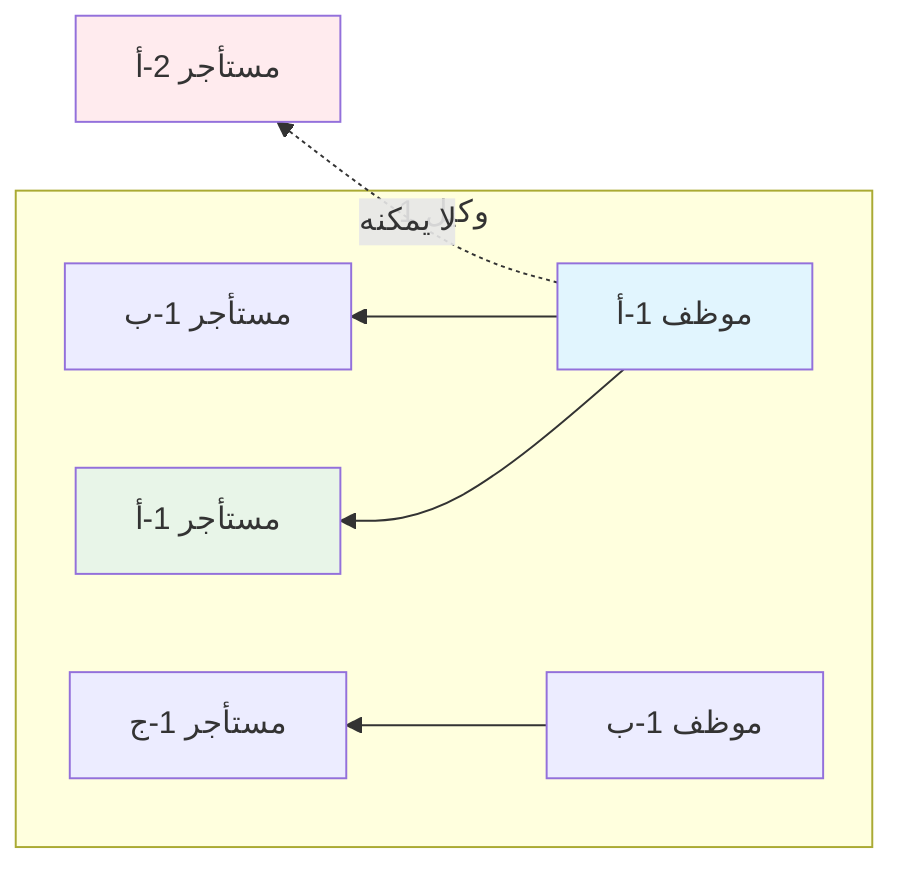

# AI Assistant Guide — منصة الهدهد (Go Backend)

## Project Overview

SMS platform backend (Global Standard Edition). Multi-tenant system where **Agents** (reseller companies) manage their employees and clients.

### Business Model

```
┌─────────────────────────────────────────────────────────┐
│                    منصة الهدهد (Hudhud)                  │
│                      (Main Platform)                     │
└─────────────────────┬───────────────────────────────────┘
                      │
        ┌─────────────┴─────────────┐
        │                           │
        ▼                           ▼
┌───────────────┐           ┌───────────────┐
│   الوكيل 1    │           │   الوكيل 2    │
│ (شركة برمجة)  │           │ (شركة برمجة)  │
└───────┬───────┘           └───────┬───────┘
        │                           │
        ▼                           ▼
┌───────────────┐           ┌───────────────┐
│  موظف 1-أ     │           │  موظف 2-أ     │
│  موظف 1-ب     │           │  موظف 2-ب     │
│  موظف 1-ج     │           │               │
└───────┬───────┘           └───────┬───────┘
        │                           │
        ▼                           ▼
┌───────────────┐           ┌───────────────┐
│  مستأجر 1-أ   │           │  مستأجر 2-أ   │
│  مستأجر 1-ب   │           │  مستأجر 2-ب   │
│  مستأجر 1-ج   │           │               │
└───────────────┘           └───────────────┘
```

---

## User Types & Permissions

### 1. الوكيل (Agent) - Company Owner
| Permission | Status |
|------------|--------|
| Create Tenants | ✅ |
| Pay Subscription | ✅ |
| Change Password | ✅ |
| Manage Employees | ✅ |
| View All Agent Employees | ✅ |
| View All Agent Tenants | ✅ |

### 2. الموظف (Employee) - Agent Staff
| Permission | Status |
|------------|--------|
| Create Tenants | ✅ (only for own agent) |
| Pay Subscription | ✅ (only for own agent) |
| Change Password | ✅ (own account) |
| View Own Profile | ✅ |
| View Agent's Employees | ❌ |
| View Other Agents | ❌ |

### 3. Employee Constraint (CRITICAL)
> الموظف يعمل فقط على المستأجرين الخاصين بالوكيل الذي ينتمي إليه



---

## Database Schema

### Tables Structure

```sql
-- الوكيل (شركة البرمجة)
CREATE TABLE agents (
    id              BIGSERIAL PRIMARY KEY,
    company_name    VARCHAR(255) NOT NULL,
    email           VARCHAR(255) UNIQUE NOT NULL,
    password_hash   VARCHAR(255) NOT NULL,
    phone           VARCHAR(50),
    api_key         VARCHAR(255) UNIQUE,
    is_active       BOOLEAN DEFAULT true,
    created_at      TIMESTAMPTZ DEFAULT NOW(),
    updated_at      TIMESTAMPTZ DEFAULT NOW()
);

-- موظف الوكيل
CREATE TABLE agent_employees (
    id              BIGSERIAL PRIMARY KEY,
    agent_id        BIGINT NOT NULL REFERENCES agents(id),
    name            VARCHAR(255) NOT NULL,
    email           VARCHAR(255) UNIQUE NOT NULL,
    password_hash   VARCHAR(255) NOT NULL,
    role            VARCHAR(50) DEFAULT 'staff',  -- 'admin', 'staff'
    is_active       BOOLEAN DEFAULT true,
    created_at      TIMESTAMPTZ DEFAULT NOW(),
    updated_at      TIMESTAMPTZ DEFAULT NOW()
);

-- ربط الوكلاء بمستأجرينهم
CREATE TABLE agent_tenants (
    id          BIGSERIAL PRIMARY KEY,
    agent_id    BIGINT NOT NULL REFERENCES agents(id),
    tenant_id   BIGINT NOT NULL REFERENCES tenants(id),
    created_at  TIMESTAMPTZ DEFAULT NOW(),
    UNIQUE(agent_id, tenant_id)
);

-- المستأجرين (عملاء الوكيل)
CREATE TABLE tenants (
    id              BIGSERIAL PRIMARY KEY,
    name            VARCHAR(255) NOT NULL,
    email           VARCHAR(255) UNIQUE NOT NULL,
    phone           VARCHAR(50),
    status          VARCHAR(20) DEFAULT 'active',
    subscription    VARCHAR(50),
    created_at      TIMESTAMPTZ DEFAULT NOW(),
    updated_at      TIMESTAMPTZ DEFAULT NOW()
);

-- الفواتير والمدفوعات
CREATE TABLE invoices (
    id          BIGSERIAL PRIMARY KEY,
    tenant_id   BIGINT NOT NULL REFERENCES tenants(id),
    amount      DECIMAL(10,2) NOT NULL,
    status      VARCHAR(20) DEFAULT 'pending',
    due_date    TIMESTAMPTZ,
    created_at  TIMESTAMPTZ DEFAULT NOW()
);

CREATE TABLE payments (
    id          BIGSERIAL PRIMARY KEY,
    invoice_id  BIGINT NOT NULL REFERENCES invoices(id),
    employee_id BIGINT REFERENCES agent_employees(id),  -- من قام بالسداد
    amount      DECIMAL(10,2) NOT NULL,
    created_at  TIMESTAMPTZ DEFAULT NOW()
);
```

### Relationships

```
agents (1) ←───── (N) agent_employees
    │                    │
    │                    └─── agent_id (foreign key)
    │
    └───── (N) agent_tenants ────── (1) tenants
                │
                └─── agent_id + tenant_id (unique)
```

---

## API Endpoints

### Authentication
| Method | Endpoint | Access |
|--------|----------|--------|
| POST | `/api/v1/agents/login` | Agent |
| POST | `/api/v1/agents/employees/login` | Employee |
| POST | `/api/v1/agents/change-password` | Agent |
| POST | `/api/v1/agents/employees/{id}/change-password` | Employee |
| POST | `/api/v1/agents/refresh` | Both |

### Employee Management (Agent Only)
| Method | Endpoint | Access |
|--------|----------|--------|
| POST | `/api/v1/agents/employees` | Agent |
| GET | `/api/v1/agents/employees` | Agent |
| GET | `/api/v1/agents/employees/{id}` | Agent |
| PUT | `/api/v1/agents/employees/{id}` | Agent |
| DELETE | `/api/v1/agents/employees/{id}` | Agent |

### Tenant Management (Agent + Employee)
| Method | Endpoint | Access |
|--------|----------|--------|
| POST | `/api/v1/agents/tenants` | Agent, Employee |
| GET | `/api/v1/agents/tenants` | Agent, Employee |
| GET | `/api/v1/agents/tenants/{id}` | Agent, Employee |

### Payments (Agent + Employee)
| Method | Endpoint | Access |
|--------|----------|--------|
| GET | `/api/v1/agents/invoices` | Agent, Employee |
| POST | `/api/v1/agents/pay` | Agent, Employee |

### Protected (Blocked for Both)
| Method | Endpoint | Response |
|--------|----------|----------|
| DELETE | `/api/v1/agents/tenants/{id}` | 403 Forbidden |
| PUT | `/api/v1/agents/tenants/{id}/suspend` | 403 Forbidden |
| PUT | `/api/v1/agents/tenants/{id}/activate` | 403 Forbidden |

---

## Code Structure

```
services/backend/
├── main.go
├── internal/
│   ├── api/
│   │   ├── handlers/
│   │   │   ├── agent_handler.go        # Agent auth & management
│   │   │   ├── employee_handler.go     # Employee endpoints
│   │   │   ├── tenant_handler.go       # Tenant management
│   │   │   └── payment_handler.go      # Payment endpoints
│   │   └── routes.go
│   ├── models/
│   │   ├── agent.go
│   │   ├── agent_employee.go           # Employee model
│   │   ├── tenant.go
│   │   └── agent_tenant.go
│   ├── middleware/
│   │   ├── agent_auth.go               # Agent JWT validation
│   │   ├── employee_auth.go            # Employee JWT validation
│   │   └── scope_guard.go              # Block restricted actions
│   └── services/
│       ├── agent_service.go
│       ├── employee_service.go
│       └── payment_service.go
└── migrations/
```

---

## Authentication Flow

### Agent Login
```
POST /api/v1/agents/login
→ Returns: { token, agent_id, role: "agent" }
```

### Employee Login
```
POST /api/v1/agents/employees/login
→ Returns: { token, employee_id, agent_id, role: "employee" }
```

### JWT Claims Structure
```go
type Claims struct {
    UserID   int64  `json:"user_id"`   // agent_id or employee_id
    AgentID  int64  `json:"agent_id"`  // ALWAYS present
    Role     string `json:"role"`      // "agent" or "employee"
    Type     string `json:"type"`      // "agent" or "employee"
}
```

---

## Implementation Rules

### 1. Employee Tenant Isolation (CRITICAL)

```go
// ❌ WRONG: Employee can see all tenants
func (h *TenantHandler) ListTenants(c *gin.Context) {
    tenants, _ := h.db.FindAllTenants()
}

// ✅ CORRECT: Employee sees ONLY their agent's tenants
func (h *TenantHandler) ListTenants(c *gin.Context) {
    // Get agent_id from JWT (works for both agent and employee)
    agentID := c.GetInt64("agent_id")
    
    tenants, _ := h.db.FindTenantsByAgentID(agentID)
    c.JSON(200, tenants)
}
```

### 2. Employee JWT Middleware

```go
func EmployeeAuthMiddleware() gin.HandlerFunc {
    return func(c *gin.Context) {
        token := c.GetHeader("Authorization")
        if token == "" {
            c.JSON(401, gin.H{"error": "Unauthorized"})
            c.Abort()
            return
        }
        
        claims, err := ValidateJWT(strings.TrimPrefix(token, "Bearer "))
        if err != nil || claims.Role != "employee" {
            c.JSON(401, gin.H{"error": "Invalid employee token"})
            c.Abort()
            return
        }
        
        // Set context for handler
        c.Set("employee_id", claims.UserID)
        c.Set("agent_id", claims.AgentID)  // AgentID from employee record
        c.Set("role", claims.Role)
        c.Next()
    }
}
```

### 3. Scope Guard (Block Restricted Actions)

```go
func ScopeGuardMiddleware() gin.HandlerFunc {
    blockedActions := map[string]bool{
        "DELETE:/api/v1/agents/tenants":         true,
        "PUT:/api/v1/agents/tenants/*/suspend":  true,
        "PUT:/api/v1/agents/tenants/*/activate": true,
    }
    
    return func(c *gin.Context) {
        key := c.Request.Method + ":" + c.FullPath()
        if blockedActions[key] {
            c.JSON(403, gin.H{
                "error": "غير مسموح - هذا الإجراء يتم من المنصة الرئيسية"
            })
            c.Abort()
            return
        }
        c.Next()
    }
}
```

### 4. Employee Creates Tenant

```go
func (h *TenantHandler) CreateTenant(c *gin.Context) {
    var req struct {
        Name  string `json:"name" binding:"required"`
        Email string `json:"email" binding:"required,email"`
        Phone string `json:"phone"`
    }
    
    if err := c.ShouldBindJSON(&req); err != nil {
        c.JSON(400, gin.H{"error": err.Error()})
        return
    }
    
    // Get agent_id (same for agent or employee)
    agentID := c.GetInt64("agent_id")
    
    // Create tenant
    tenant := &models.Tenant{
        Name:  req.Name,
        Email: req.Email,
        Phone: req.Phone,
        Status: "active",
    }
    
    created, _ := h.db.CreateTenant(tenant)
    
    // Link to agent
    h.db.CreateAgentTenantLink(agentID, created.ID)
    
    c.JSON(201, created)
}
```

### 5. Employee Makes Payment

```go
func (h *PaymentHandler) PayInvoice(c *gin.Context) {
    var req struct {
        InvoiceID int64   `json:"invoice_id" binding:"required"`
        Amount    float64 `json:"amount" binding:"required"`
    }
    
    if err := c.ShouldBindJSON(&req); err != nil {
        c.JSON(400, gin.H{"error": err.Error()})
        return
    }
    
    employeeID := c.GetInt64("employee_id")  // Track who paid
    agentID := c.GetInt64("agent_id")
    
    // Verify invoice belongs to agent's tenant
    invoice, err := h.db.GetInvoice(req.InvoiceID)
    if err != nil {
        c.JSON(404, gin.H{"error": "Invoice not found"})
        return
    }
    
    // Verify tenant belongs to this agent
    if !h.db.IsTenantOwnedByAgent(invoice.TenantID, agentID) {
        c.JSON(403, gin.H{"error": "Invoice not owned by your agent"})
        return
    }
    
    // Record payment
    payment := &models.Payment{
        InvoiceID:  req.InvoiceID,
        EmployeeID: employeeID,
        Amount:     req.Amount,
    }
    
    h.db.CreatePayment(payment)
    h.db.UpdateInvoiceStatus(req.InvoiceID, "paid")
    
    c.JSON(200, gin.H{"message": "تم السداد بنجاح"})
}
```

---

## Development Commands

```bash
cd services/backend

# Run server (port 8085)
go run main.go

# Build
go build -o backend.exe main.go

# Test
go test ./...

# Custom port
PORT=9000 go run main.go
```

---

## Code Conventions

- **Go Version:** 1.26.2
- **Framework:** Gin
- **ORM:** GORM
- **Module:** `github.com/al-hudhud/backend`
- **Logger:** Use `logger.GetLogger()` (zap)
- **Time:** UTC
- **JSON Errors:** `{ "error": "message" }`

---

## Security Checklist

- [ ] Passwords hashed with bcrypt
- [ ] JWT with agent_id claim (mandatory)
- [ ] Tenant isolation on all queries
- [ ] Employee can only see their agent's tenants
- [ ] Employee can only pay invoices for their agent's tenants
- [ ] All actions logged (who did what)
- [ ] Rate limiting per agent
- [ ] Input validation

---

## Testing Scenarios

### Test 1: Employee Login
```bash
curl -X POST http://localhost:8085/api/v1/agents/employees/login \
  -H "Content-Type: application/json" \
  -d '{"email":"employee@agent1.com","password":"pass123"}'
```

### Test 2: Employee Creates Tenant
```bash
curl -X POST http://localhost:8085/api/v1/agents/tenants \
  -H "Authorization: Bearer <employee_token>" \
  -H "Content-Type: application/json" \
  -d '{"name":"عميل جديد","email":"new@client.com"}'
```

### Test 3: Employee Cannot See Other Agent's Tenant
```bash
# Should return empty or own agent's tenants only
curl -X GET http://localhost:8085/api/v1/agents/tenants \
  -H "Authorization: Bearer <employee_token>"
```

### Test 4: Blocked Action
```bash
curl -X DELETE http://localhost:8085/api/v1/agents/tenants/123 \
  -H "Authorization: Bearer <employee_token>"

# Returns: {"error":"غير مسموح - هذا الإجراء يتم من المنصة الرئيسية"}
```

---

## Common Errors

| Error | Cause | Solution |
|-------|-------|----------|
| 401 | Invalid/expired token | Re-login |
| 403 | Blocked action | Use platform |
| 404 | Tenant not found | Verify tenant_id |
| 409 | Duplicate email | Use different email |
| 422 | Invoice not for agent's tenant | Check invoice tenant |

---

## Important Notes

- Employee always has `agent_id` in JWT - use this for all queries
- Never trust client-provided agent_id - always use from token
- Payment records include `employee_id` for audit trail
- Employee role can be 'admin' or 'staff' (admin can manage employees)