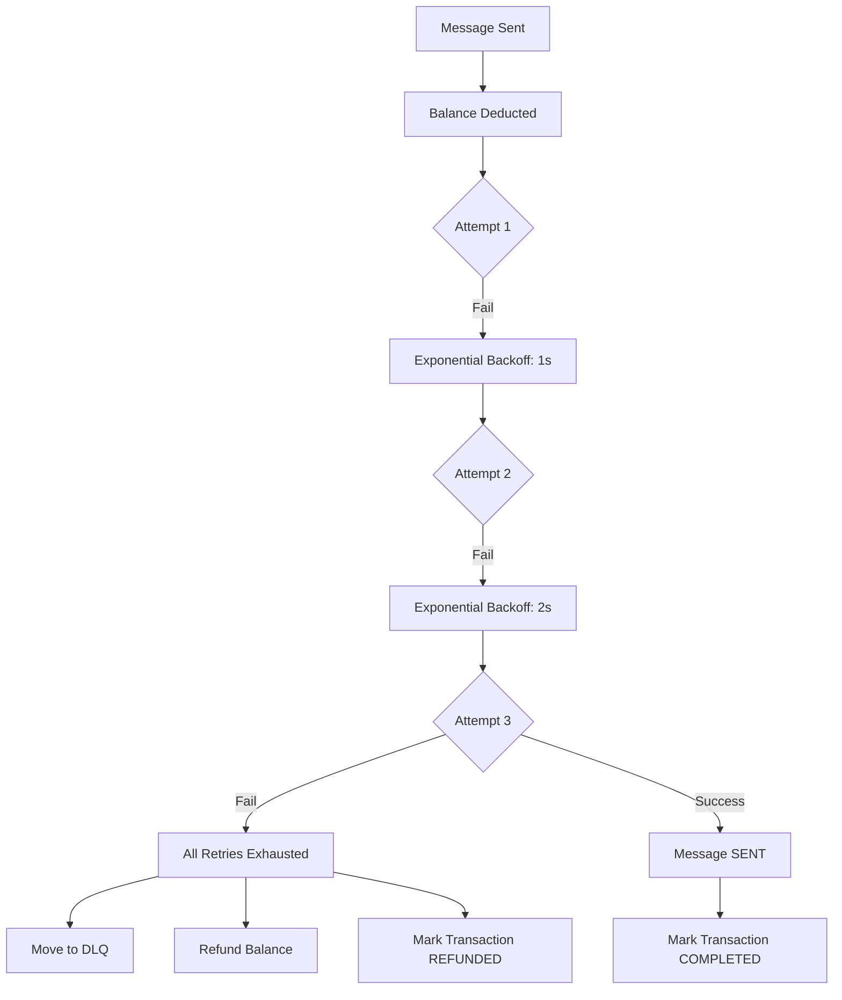

# دليل شامل - اختبار Failed Message Handling

## المحتويات
1. [نظرة عامة](#نظرة-عامة)
2. [البنية المعمارية](#البنية-المعمارية)
3. [السيناريوهات المختبرة](#السيناريوهات-المختبرة)
4. [إعداد البيئة](#إعداد-البيئة)
5. [تشغيل الاختبارات](#تشغيل-الاختبارات)
6. [فهم النتائج](#فهم-النتائج)
7. [استكشاف الأخطاء](#استكشاف-الأخطاء)
8. [أفضل الممارسات](#أفضل-الممارسات)

---

## نظرة عامة

### الهدف
اختبار شامل لجميع سيناريوهات فشل الرسائل في نظام SMS Gateway، مع التركيز على:
- ✅ إعادة المحاولات (Retry Logic)
- ✅ Exponential Backoff
- ✅ استرداد الرصيد (Balance Refund)
- ✅ Dead Letter Queue (DLQ)
- ✅ تسجيل جميع المحاولات (Attempt Logging)

### المتطلبات المختبرة
- **المتطلب 2.2**: معالجة تقارير حالة الرسائل وتسوية المحاسبة
- **المتطلب 17.4**: إعادة محاولة الرسائل الفاشلة 3 مرات
- **المتطلب 17.5**: نقل الرسائل إلى Dead Letter Queue بعد الفشل النهائي

### الملفات المتضمنة
```
services/backend/internal/integration/
├── failed_message_test.go              # ملف الاختبارات الرئيسي
├── FAILED_MESSAGE_TEST_QUICK_START.md  # دليل سريع
└── FAILED_MESSAGE_TEST_GUIDE.md        # هذا الملف (دليل شامل)
```

---

## البنية المعمارية

### مكونات النظام المختبرة

```
┌─────────────────────────────────────────────────────────────┐
│                    Failed Message Flow                       │
└─────────────────────────────────────────────────────────────┘

1. API Gateway
   ↓ (Queue Message)
2. Redis Buffer
   ↓ (Batch Process)
3. PostgreSQL (messages table)
   ↓ (Create River Job)
4. Worker Pool
   ↓ (Deduct Balance)
5. Balance Manager ──→ balance_history
   ↓ (Select Channel)
6. Routing Engine
   ↓ (Send via WebSocket)
7. WebSocket Hub
   ↓ (Attempt Send)
8. Mobile Gateway
   ↓ (Status Report)
9. Status Report Handler
   ↓ (Process Report)
10. Accounting Engine
    ├─→ SENT: Mark COMPLETED
    └─→ FAILED: Refund Balance + Move to DLQ
```

### تدفق البيانات في حالة الفشل



---

## السيناريوهات المختبرة

### 1. Temporary Failure (فشل مؤقت)

#### الوصف
رسالة تفشل في المحاولة الأولى بسبب خطأ مؤقت (مثل انقطاع مؤقت في الشبكة)، ثم تنجح في إعادة المحاولة.

#### خطوات الاختبار
1. إرسال رسالة عبر API Gateway
2. معالجة الدفعة وإدخال الرسالة في قاعدة البيانات
3. خصم الرصيد (0.05 وحدة)
4. محاكاة فشل المحاولة الأولى
5. إعادة المحاولة (Attempt 2)
6. نجاح المحاولة الثانية
7. معالجة تقرير SENT

#### التحققات
```go
✓ Message status: SENT
✓ Attempt count: 2
✓ Balance: 99.9500 (deducted, not refunded)
✓ Transaction status: COMPLETED
✓ Balance history: 1 DEDUCT, 0 REFUND
```

#### الحالة النهائية المتوقعة
| الحقل | القيمة المتوقعة |
|------|-----------------|
| message.status | SENT |
| message.attempt_count | 2 |
| tenant.balance | initial_balance - 0.05 |
| accounting_transaction.status | COMPLETED |
| balance_history (DEDUCT) | 1 |
| balance_history (REFUND) | 0 |

---

### 2. Permanent Failure (فشل دائم)

#### الوصف
رسالة تفشل في جميع المحاولات الثلاث، ويتم نقلها إلى Dead Letter Queue مع استرداد الرصيد.

#### خطوات الاختبار
1. إرسال رسالة عبر API Gateway
2. معالجة الدفعة وإدخال الرسالة في قاعدة البيانات
3. خصم الرصيد (0.05 وحدة)
4. محاكاة فشل المحاولة 1 (Backoff: 1s)
5. محاكاة فشل المحاولة 2 (Backoff: 2s)
6. محاكاة فشل المحاولة 3 (Backoff: 4s)
7. نقل الرسالة إلى DLQ
8. معالجة تقرير FAILED
9. استرداد الرصيد

#### التحققات
```go
✓ Message status: FAILED
✓ Attempt count: 3 (exactly)
✓ Message in DLQ
✓ Balance: 100.0000 (fully refunded)
✓ Transaction status: REFUNDED
✓ Balance history: 1 DEDUCT, 1 REFUND
```

#### Exponential Backoff
| المحاولة | الانتظار قبل المحاولة |
|---------|---------------------|
| 1 | 0s (فوري) |
| 2 | 1s |
| 3 | 2s |
| - | 4s (لو كانت هناك محاولة 4) |

#### الحالة النهائية المتوقعة
| الحقل | القيمة المتوقعة |
|------|-----------------|
| message.status | FAILED |
| message.attempt_count | 3 |
| tenant.balance | initial_balance (refunded) |
| accounting_transaction.status | REFUNDED |
| balance_history (DEDUCT) | 1 |
| balance_history (REFUND) | 1 |
| dead_letter_queue | 1 entry |

---

### 3. Channel Unavailable (عدم توفر قناة)

#### الوصف
رسالة لا يمكن إرسالها بسبب عدم وجود قنوات (أجهزة) متاحة، ثم يتم إرسالها بنجاح عند توفر قناة.

#### خطوات الاختبار
1. إرسال رسالة عبر API Gateway
2. معالجة الدفعة وإدخال الرسالة في قاعدة البيانات
3. محاولة اختيار قناة (فشل - لا توجد قنوات)
4. تحديث حالة الرسالة إلى WAITING
5. التحقق من عدم خصم الرصيد
6. إنشاء قناة جديدة (محاكاة توفر جهاز)
7. إعادة محاولة اختيار القناة (نجاح)
8. خصم الرصيد
9. إرسال الرسالة بنجاح

#### التحققات
```go
✓ Channel selection failed (no channels available)
✓ Message status: WAITING
✓ Balance unchanged (not deducted yet)
✓ Channel created
✓ Channel selected successfully
✓ Balance deducted
✓ Message sent successfully
✓ Final message status: SENT
```

#### الحالة النهائية المتوقعة
| الحقل | القيمة المتوقعة |
|------|-----------------|
| message.status | SENT |
| tenant.balance | initial_balance - 0.05 |
| accounting_transaction.status | COMPLETED |

---

### 4. Network Error (خطأ في الشبكة)

#### الوصف
رسالة تفشل بسبب مشاكل في الشبكة، مع تطبيق exponential backoff بين المحاولات، ثم تنجح في المحاولة الثالثة.

#### خطوات الاختبار
1. إرسال رسالة عبر API Gateway
2. معالجة الدفعة وإدخال الرسالة في قاعدة البيانات
3. خصم الرصيد
4. محاكاة خطأ شبكة في المحاولة 1
5. Backoff: 1 ثانية
6. محاكاة خطأ شبكة في المحاولة 2
7. Backoff: 2 ثانية
8. نجاح المحاولة 3
9. معالجة تقرير SENT

#### التحققات
```go
✓ Exponential backoff applied
✓ Message status: SENT (attempts: 3)
✓ Balance: 99.9500 (deducted, not refunded)
✓ Transaction status: COMPLETED
✓ All attempts and errors logged
```

#### قياس Exponential Backoff
```go
backoff1 := attemptTimes[1].Sub(attemptTimes[0])  // ~1s
backoff2 := attemptTimes[2].Sub(attemptTimes[1])  // ~2s
assert.Greater(t, backoff2, backoff1)  // backoff2 > backoff1
```

---

## إعداد البيئة

### 1. المتطلبات الأساسية

#### قاعدة البيانات (PostgreSQL)
```bash
# تشغيل PostgreSQL
docker-compose up -d postgres

# إنشاء قاعدة بيانات الاختبار
psql -U postgres -c "CREATE DATABASE sms_gateway_test;"

# تشغيل Migrations
cd services/backend
go run cmd/migrate/main.go -database sms_gateway_test
```

#### Redis
```bash
# تشغيل Redis
docker-compose up -d redis

# التحقق من الاتصال
redis-cli ping
# يجب أن يرجع: PONG
```

#### Go Dependencies
```bash
cd services/backend
go mod download
go mod tidy
```

### 2. التحقق من الإعداد

#### فحص قاعدة البيانات
```sql
-- الاتصال بقاعدة بيانات الاختبار
psql -U postgres -d sms_gateway_test

-- التحقق من وجود الجداول المطلوبة
\dt

-- يجب أن تظهر:
-- messages
-- tenants
-- channels
-- balance_history
-- accounting_transactions
-- dead_letter_queue
-- river_job
```

#### فحص Redis
```bash
# الاتصال بـ Redis
redis-cli

# اختيار DB 1 (المستخدم للاختبار)
SELECT 1

# التحقق من عدم وجود بيانات قديمة
KEYS *
# يجب أن يرجع: (empty array)
```

### 3. متغيرات البيئة

إنشاء ملف `.env.test`:
```env
# Database
DB_HOST=localhost
DB_PORT=5432
DB_USER=postgres
DB_PASSWORD=postgres
DB_NAME=sms_gateway_test

# Redis
REDIS_HOST=localhost
REDIS_PORT=6379
REDIS_PASSWORD=
REDIS_DB=1

# Testing
TEST_MODE=true
LOG_LEVEL=debug
```

---

## تشغيل الاختبارات

### 1. تشغيل جميع الاختبارات

```bash
cd services/backend

# تشغيل جميع اختبارات Failed Message
go test -v ./internal/integration -run TestFailedMessage

# مع timeout أطول (للاختبارات البطيئة)
go test -v -timeout 5m ./internal/integration -run TestFailedMessage

# مع تغطية الكود
go test -v -cover ./internal/integration -run TestFailedMessage
```

### 2. تشغيل اختبار محدد

```bash
# Temporary Failure
go test -v ./internal/integration -run TestFailedMessage_TemporaryFailure

# Permanent Failure
go test -v ./internal/integration -run TestFailedMessage_PermanentFailure

# Channel Unavailable
go test -v ./internal/integration -run TestFailedMessage_ChannelUnavailable

# Network Error
go test -v ./internal/integration -run TestFailedMessage_NetworkError

# All Scenarios (يشغل جميع السيناريوهات بالتسلسل)
go test -v ./internal/integration -run TestFailedMessage_AllScenarios
```

### 3. تشغيل مع خيارات إضافية

```bash
# مع logs مفصلة
go test -v ./internal/integration -run TestFailedMessage -args -log-level=debug

# مع parallel execution (حذر: قد يسبب تنافس)
go test -v -parallel 4 ./internal/integration -run TestFailedMessage

# مع race detection
go test -v -race ./internal/integration -run TestFailedMessage

# مع memory profiling
go test -v -memprofile=mem.prof ./internal/integration -run TestFailedMessage
```

### 4. تشغيل في CI/CD

#### GitHub Actions
```yaml
name: Failed Message Tests

on: [push, pull_request]

jobs:
  test:
    runs-on: ubuntu-latest
    
    services:
      postgres:
        image: postgres:15
        env:
          POSTGRES_PASSWORD: postgres
          POSTGRES_DB: sms_gateway_test
        ports:
          - 5432:5432
      
      redis:
        image: redis:7
        ports:
          - 6379:6379
    
    steps:
      - uses: actions/checkout@v3
      
      - name: Setup Go
        uses: actions/setup-go@v4
        with:
          go-version: '1.21'
      
      - name: Run Migrations
        run: |
          cd services/backend
          go run cmd/migrate/main.go -database sms_gateway_test
      
      - name: Run Failed Message Tests
        run: |
          cd services/backend
          go test -v ./internal/integration -run TestFailedMessage
```

---

## فهم النتائج

### 1. نجاح الاختبار

#### مثال على output ناجح
```
=== RUN   TestFailedMessage_PermanentFailure
=== Test Scenario: Permanent Failure After All Retries ===
Step 1: Sending message
✓ Message queued: 123e4567-e89b-12d3-a456-426614174000
Step 2: Processing batch
✓ Message in database
Step 3: Deducting balance
✓ Balance deducted: 100.0000 → 99.9500
Step 4: Simulating 3 failed attempts
  Attempt 1: Failing...
  Waiting 10ms before next attempt...
  Attempt 2: Failing...
  Waiting 10ms before next attempt...
  Attempt 3: Failing...
  Waiting 10ms before next attempt...
✓ All 3 attempts exhausted
Step 5: Moving to DLQ and processing FAILED report
✓ Message moved to DLQ
✓ FAILED status report processed
Step 6: Verifying final state
✓ Message status: FAILED (attempts: 3)
✓ Message in DLQ (ID: 1, reason: Permanent error - all retries exhausted)
✓ Balance refunded: 100.0000 (back to initial)
✓ Transaction status: REFUNDED
✓ Balance history: 1 DEDUCT, 1 REFUND
✅ Permanent failure scenario completed successfully!
--- PASS: TestFailedMessage_PermanentFailure (0.25s)
PASS
ok      github.com/al-hudhud/backend/internal/integration      0.256s
```

### 2. فشل الاختبار

#### مثال على output فاشل
```
=== RUN   TestFailedMessage_PermanentFailure
...
Step 6: Verifying final state
✓ Message status: FAILED (attempts: 3)
✓ Message in DLQ (ID: 1, reason: Permanent error - all retries exhausted)
    failed_message_test.go:XXX: 
        Error Trace:    failed_message_test.go:XXX
        Error:          Not equal: 
                        expected: 100.0000
                        actual  : 99.9500
        Test:           TestFailedMessage_PermanentFailure
        Messages:       Balance should be fully refunded
--- FAIL: TestFailedMessage_PermanentFailure (0.25s)
FAIL
```

#### تحليل الفشل
1. **السبب**: الرصيد لم يُسترد بشكل صحيح
2. **المتوقع**: 100.0000
3. **الفعلي**: 99.9500
4. **الإجراء**: فحص `Status Report Handler` و `Accounting Engine`

---

## استكشاف الأخطاء

### 1. مشاكل الاتصال

#### خطأ: Failed to connect to database
```
Error: pq: password authentication failed for user "postgres"
```

**الحل**:
```bash
# تحقق من بيانات الاتصال
psql -U postgres -d sms_gateway_test

# إعادة تعيين كلمة المرور
docker-compose down
docker-compose up -d postgres
```

#### خطأ: Failed to connect to Redis
```
Error: dial tcp [::1]:6379: connect: connection refused
```

**الحل**:
```bash
# تحقق من تشغيل Redis
redis-cli ping

# إعادة تشغيل Redis
docker-compose restart redis
```

### 2. مشاكل البيانات

#### خطأ: relation "messages" does not exist
```
Error: pq: relation "messages" does not exist
```

**الحل**:
```bash
# تشغيل migrations
cd services/backend
go run cmd/migrate/main.go -database sms_gateway_test
```

#### خطأ: بيانات قديمة تؤثر على الاختبار
```
Error: Expected 1 message, found 5
```

**الحل**:
```sql
-- تنظيف قاعدة البيانات يدوياً
DELETE FROM balance_history;
DELETE FROM accounting_transactions;
DELETE FROM river_job;
DELETE FROM messages;
DELETE FROM channels;
DELETE FROM tenants;
```

أو:
```bash
# إعادة إنشاء قاعدة البيانات
dropdb -U postgres sms_gateway_test
createdb -U postgres sms_gateway_test
go run cmd/migrate/main.go -database sms_gateway_test
```

### 3. مشاكل الأداء

#### خطأ: Test timeout
```
panic: test timed out after 10m0s
```

**الحل**:
```bash
# زيادة timeout
go test -v -timeout 30m ./internal/integration -run TestFailedMessage

# أو تشغيل اختبار واحد فقط
go test -v ./internal/integration -run TestFailedMessage_TemporaryFailure
```

---

## أفضل الممارسات

### 1. قبل تشغيل الاختبارات
- ✅ تأكد من تشغيل PostgreSQL و Redis
- ✅ قم بتشغيل migrations على قاعدة بيانات الاختبار
- ✅ تحقق من عدم وجود بيانات قديمة
- ✅ استخدم قاعدة بيانات منفصلة للاختبار (sms_gateway_test)

### 2. أثناء التطوير
- ✅ شغل اختبار واحد في كل مرة للتطوير السريع
- ✅ استخدم `-v` flag لرؤية logs مفصلة
- ✅ استخدم `-race` flag للكشف عن race conditions
- ✅ راجع logs في قاعدة البيانات بعد كل اختبار

### 3. قبل الـ Commit
- ✅ شغل جميع الاختبارات (`TestFailedMessage_AllScenarios`)
- ✅ تأكد من نجاح 100% من الاختبارات
- ✅ راجع تغطية الكود (`-cover` flag)
- ✅ تحقق من عدم وجود memory leaks

### 4. في الإنتاج
- ✅ شغل الاختبارات في CI/CD pipeline
- ✅ راقب معدل نجاح الاختبارات
- ✅ احتفظ بـ logs الاختبارات لمدة 30 يوم
- ✅ قم بمراجعة دورية للاختبارات الفاشلة

---

## الملحقات

### A. SQL Queries مفيدة

#### فحص الرسائل الفاشلة
```sql
SELECT 
    m.message_id,
    m.status,
    m.attempt_count,
    m.last_error,
    m.created_at,
    m.updated_at,
    CASE 
        WHEN dlq.id IS NOT NULL THEN 'In DLQ'
        ELSE 'Not in DLQ'
    END as dlq_status
FROM messages m
LEFT JOIN dead_letter_queue dlq ON m.message_id = dlq.message_id
WHERE m.status = 'FAILED'
ORDER BY m.created_at DESC
LIMIT 10;
```

#### فحص balance_history لرسالة محددة
```sql
SELECT 
    bh.id,
    bh.tenant_id,
    bh.message_id,
    bh.old_balance,
    bh.new_balance,
    bh.amount,
    bh.type,
    bh.reason,
    bh.created_at
FROM balance_history bh
WHERE bh.message_id = '123e4567-e89b-12d3-a456-426614174000'
ORDER BY bh.created_at;
```

#### إحصائيات الفشل
```sql
SELECT 
    status,
    COUNT(*) as count,
    AVG(attempt_count) as avg_attempts,
    MAX(attempt_count) as max_attempts
FROM messages
WHERE created_at > NOW() - INTERVAL '1 day'
GROUP BY status;
```

### B. Redis Commands مفيدة

#### فحص idempotency keys
```bash
redis-cli
SELECT 1
KEYS idempotency:*
```

#### فحص message buffer
```bash
KEYS messages:pending:*
LLEN messages:pending:123  # حجم buffer لـ tenant 123
```

### C. Go Test Flags مفيدة

```bash
# تشغيل مع verbose output
go test -v

# تشغيل مع race detection
go test -race

# تشغيل مع coverage
go test -cover -coverprofile=coverage.out

# عرض coverage في المتصفح
go tool cover -html=coverage.out

# تشغيل مع memory profiling
go test -memprofile=mem.prof
go tool pprof mem.prof

# تشغيل مع CPU profiling
go test -cpuprofile=cpu.prof
go tool pprof cpu.prof
```

---

## الخلاصة

هذا الدليل يغطي جميع جوانب اختبار Failed Message Handling:
- ✅ 4 سيناريوهات شاملة
- ✅ تغطية المتطلبات 2.2, 17.4, 17.5
- ✅ إعداد البيئة الكامل
- ✅ استكشاف الأخطاء الشائعة
- ✅ أفضل الممارسات

للمزيد من المعلومات، راجع:
- `FAILED_MESSAGE_TEST_QUICK_START.md` - دليل سريع
- `failed_message_test.go` - كود الاختبارات
- `README.md` - نظرة عامة على integration tests

---

**آخر تحديث**: 2024
**الإصدار**: 1.0
**المؤلف**: SMS Gateway Team
