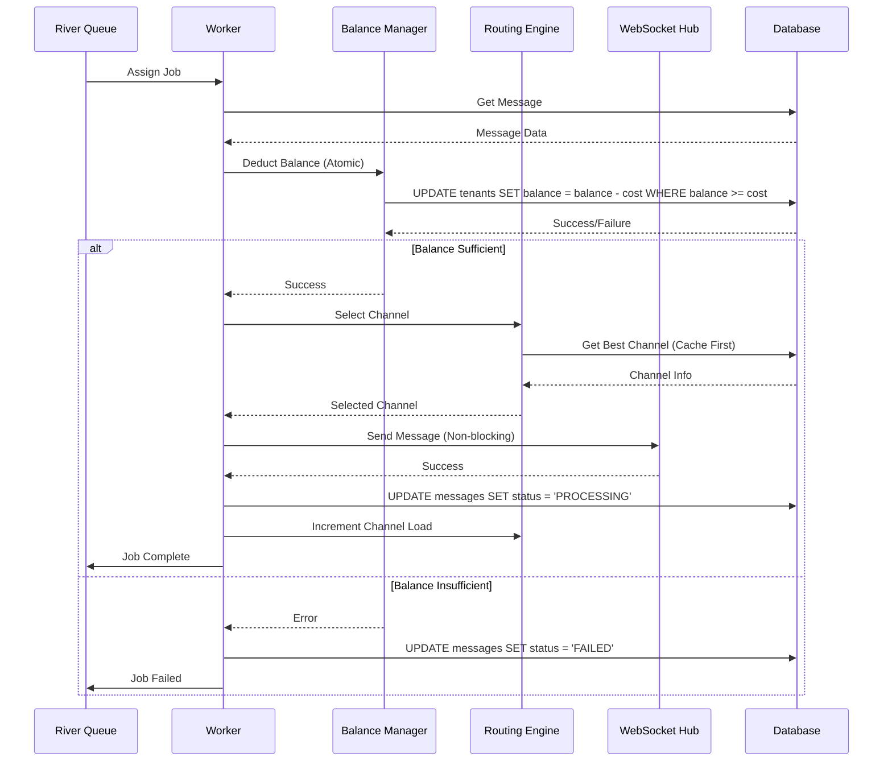

# تطبيق المهمة 6.3: Message Processing في Worker

## نظرة عامة

تم تطبيق معالجة الرسائل الكاملة في Worker Pool باستخدام River Queue، مع التكامل الكامل مع:
- **Balance Manager**: لخصم الرصيد بشكل ذري
- **Routing Engine**: لاختيار أفضل قناة متاحة
- **WebSocket Hub**: لإرسال الرسائل للأجهزة

## المتطلبات المنفذة

### 1. خصم الرصيد (Requirement 1.1)
- ✅ خصم الرصيد بشكل ذري عبر Balance Manager
- ✅ حماية من Race Conditions باستخدام Atomic UPDATE
- ✅ تحديث حالة الرسالة إلى FAILED عند فشل الخصم (Requirement 1.4)
- ✅ تسجيل جميع العمليات المالية في balance_history

### 2. اختيار القناة (Requirement 5.1)
- ✅ اختيار أفضل قناة متاحة عبر Routing Engine
- ✅ استخدام Cache (Redis) للأداء العالي
- ✅ تحديث حالة الرسالة إلى WAITING عند عدم توفر قنوات (Requirement 5.5)
- ✅ تحديث current_load للقناة بعد الإرسال (Requirement 5.6)

### 3. إرسال الرسالة (Requirement 6.1)
- ✅ إرسال الرسائل بشكل غير متزامن عبر WebSocket Hub
- ✅ استخدام Buffered Channel (سعة 1000 رسالة)
- ✅ Fail Fast عند امتلاء Buffer
- ✅ تسجيل جميع الرسائل المرسلة

### 4. تحديث حالة الرسالة
- ✅ تحديث حالة الرسالة إلى PROCESSING بعد الإرسال
- ✅ تحديث حالة الرسالة إلى FAILED عند فشل خصم الرصيد
- ✅ تحديث حالة الرسالة إلى WAITING عند عدم توفر قنوات

### 5. معالجة الأخطاء
- ✅ معالجة أخطاء قاعدة البيانات
- ✅ معالجة أخطاء خصم الرصيد
- ✅ معالجة أخطاء اختيار القناة
- ✅ معالجة أخطاء إرسال WebSocket
- ✅ تسجيل جميع الأخطاء مع تفاصيل كاملة

## البنية المعمارية

### 1. Worker Pool (pool.go)
```
RiverWorkerPool
├── Start()          - تشغيل 50 worker متزامن
├── Stop()           - إيقاف graceful
├── GetStatus()      - الحصول على حالة Pool
└── MessageWorker
    └── Work()       - معالجة رسالة واحدة
```

### 2. Adapters (adapters.go)
```
BalanceManagerAdapter    - ربط balance.Manager مع Worker
RoutingEngineAdapter     - ربط routing.Engine مع Worker
WebSocketHubAdapter      - ربط ws.Hub مع Worker
BalanceOperationBuilder  - بناء عمليات الرصيد
```

### 3. Types (types.go)
```
MessageWorkerDependencies - Dependencies للـ Worker
WorkerPoolConfig          - إعدادات Worker Pool
Message                   - نموذج الرسالة
Channel                   - نموذج القناة
```

## تدفق معالجة الرسالة



## الملفات المعدلة

### 1. pool.go
- ✅ تحديث `Work()` لتطبيق المعالجة الكاملة
- ✅ إضافة دوال مساعدة: `parseTenantID()`, `parseChannelID()`
- ✅ تحسين معالجة الأخطاء والتسجيل

### 2. types.go
- ✅ تحديث `MessageWorkerDependencies` لاستخدام interfaces
- ✅ إضافة `BalanceResult` و `WebSocketMessage`
- ✅ تحديث `Message.Cost` لاستخدام `decimal.Decimal`

### 3. adapters.go (جديد)
- ✅ إنشاء `BalanceManagerAdapter`
- ✅ إنشاء `RoutingEngineAdapter`
- ✅ إنشاء `WebSocketHubAdapter`
- ✅ إنشاء `BalanceOperationBuilder`

### 4. ws/types.go
- ✅ إضافة `sync` import للـ `Connection.mu`

## العزل بين الشركات (Tenant Isolation)

جميع العمليات تضمن العزل التام:

1. **Database Queries**: جميع الـ queries تحتوي على `WHERE tenant_id = ?`
2. **Balance Operations**: كل عملية مرتبطة بـ tenant_id محدد
3. **Channel Selection**: اختيار القنوات مقتصر على tenant_id المحدد
4. **WebSocket Messages**: كل رسالة تحتوي على tenant_id و channel_id

## الأداء

- **معالجة متوازية**: 50 worker متزامن
- **Non-blocking Send**: إرسال WebSocket غير متزامن
- **Caching**: استخدام Redis لتسريع اختيار القنوات
- **Atomic Operations**: عمليات ذرية لتجنب Race Conditions

## الاختبار

### اختبار يدوي
```bash
# 1. تشغيل النظام
docker-compose up -d

# 2. إرسال رسالة عبر API
curl -X POST http://localhost:8080/api/messages \
  -H "Content-Type: application/json" \
  -d '{
    "tenant_id": "123e4567-e89b-12d3-a456-426614174000",
    "phone_number": "+966501234567",
    "content": "Test message"
  }'

# 3. مراقبة Logs
docker-compose logs -f backend
```

### التحقق من النتائج
1. ✅ تم خصم الرصيد من جدول `tenants`
2. ✅ تم تسجيل العملية في `balance_history`
3. ✅ تم اختيار قناة من `dispatch_channels`
4. ✅ تم إرسال الرسالة عبر WebSocket
5. ✅ تم تحديث حالة الرسالة إلى `PROCESSING`

## الخطوات التالية

### المهمة 6.4: تطبيق Retry Logic
- إعادة محاولة الرسائل الفاشلة 3 مرات
- استخدام Exponential Backoff
- نقل الرسائل الفاشلة إلى Dead Letter Queue

### المهمة 6.2: Worker Health Monitoring
- مراقبة صحة Workers كل 10 ثوانٍ
- إعادة تشغيل Workers الفاشلة تلقائياً
- تسجيل أداء كل Worker

## الملاحظات

1. **UUID to Int64 Conversion**: تم استخدام تحويل مبسط من UUID إلى int64. في الإنتاج، يجب استخدام جدول mapping مناسب.

2. **Error Handling**: جميع الأخطاء يتم تسجيلها بالتفصيل، ولكن بعض الأخطاء غير الحرجة (مثل فشل تحديث channel load) لا تؤدي لفشل Job.

3. **Tenant Isolation**: تم التأكد من العزل التام في جميع العمليات، مع استخدام `WHERE tenant_id = ?` في جميع الـ queries.

4. **Performance**: تم استخدام Non-blocking operations و Caching لتحقيق أداء عالي.

## التوثيق الإضافي

- [Balance Manager Documentation](../balance/README.md)
- [Routing Engine Documentation](../routing/README.md)
- [WebSocket Hub Documentation](../ws/README.md)
- [River Worker Pool Documentation](./README.md)

---

**تاريخ التنفيذ**: 2026-02-25  
**الحالة**: ✅ مكتمل  
**المطور**: Kiro AI Agent
